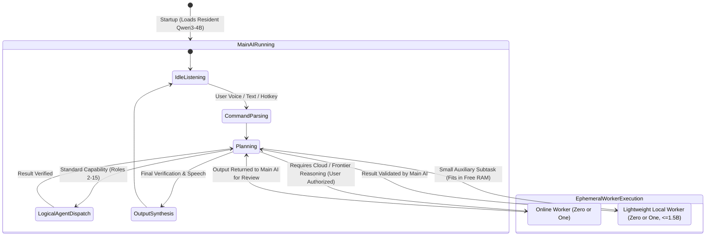
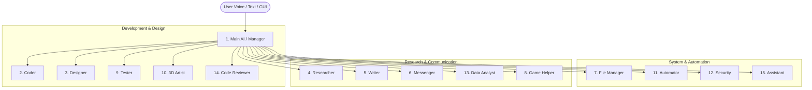
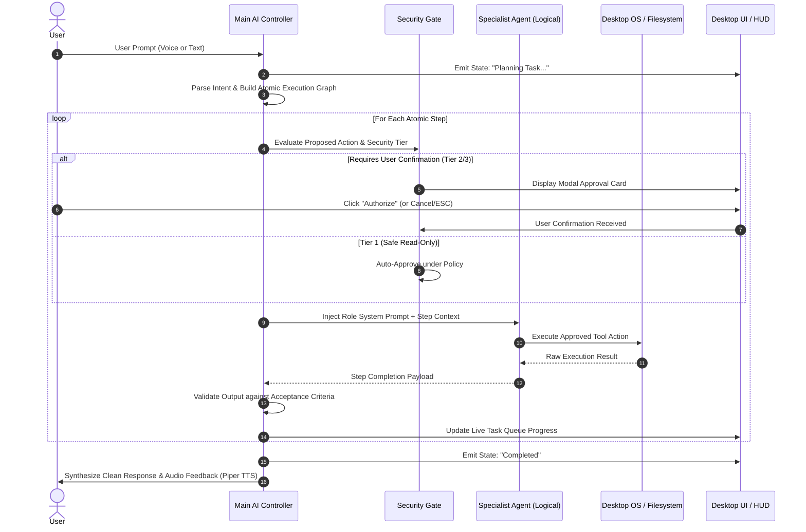

# Main AI Orchestration & Multi-Agent Architecture

## 1. Architectural Philosophy: Logical Roles vs. Physical Models

A foundational engineering principle governs our desktop assistant:
> **All 15 specialist agents are structured logical capabilities, NOT 15 concurrently loaded neural network models.**

Loading 15 distinct language models into memory is technically impossible on consumer hardware. Even enterprise multi-GPU servers do not load 15 separate weights for standard workflows. Instead, the architecture establishes:
1. **One Permanent Core Model (Main AI):** Loaded once into RAM at application startup and pinned permanently.
2. **Contextual Role Invocations (Specialist Personas):** The 15 agents are implemented through strictly structured system prompts, tool schemas, token constraints, and execution policies executed by the resident Core Model.
3. **Optional Ephemeral Worker (Local Heavyweight or Online API):** Spawned strictly one at a time for tasks exceeding the resident model's capabilities, executed, and immediately unloaded.

---

## 2. Concurrency Invariants & Hardware Constraints

### 2.1 The Strict Concurrency Rule
At any instant in time, the system operates under the following strict upper bounds:
- **Permanent Controller (Main AI):** Exactly **1** (never unloaded).
- **Local Worker AI:** Exactly **0 or 1** (ephemeral, unloaded immediately upon task completion).
- **Online Worker AI:** Exactly **0 or 1** (ephemeral, invoked via HTTPS only with explicit human permission).

### 2.2 Memory Math on 12 GB RAM: Can Two Models Co-Exist?
Let us calculate the real physical RAM requirements on our Intel i3-6100T Windows 10 host:

| Layer / Process | Minimum Resident RAM | Realistic Working RAM |
| :--- | :--- | :--- |
| **Windows 10 Pro 64-bit + Services** | 2,800 MB | 3,100 MB |
| **Intel HD 530 Shared Frame Buffer & Drivers** | 350 MB | 450 MB |
| **Tauri v2 Desktop App Shell + Rust Core** | 50 MB | 90 MB |
| **Piper TTS ONNX Engine (Mike + Rohan)** | 130 MB | 145 MB |
| **Whisper Base STT Buffer (`ggml-base.bin`)** | 180 MB | 220 MB |
| **SQLite + sqlite-vec Cache** | 60 MB | 100 MB |
| **Subtotal Base Infrastructure** | **~3,570 MB** | **~4,105 MB (~4.1 GB)** |
| **Available Free RAM for Models** | **~8,430 MB** | **~7,895 MB (~7.9 GB)** |

Now consider our available models:
- **Resident Main AI (`Qwen3-4B-Q4_K_M`):** 2.49 GB file + 4K KV cache = **~3.10 GB RAM**.
- **Heavy Local Worker (`Nemotron-3.5-Bolt-E4B-Q4_K_M`):** 6.18 GB file + 4K KV cache = **~7.10 GB RAM**.

### The Mathematical Reality:
$$\text{Total If Both Loaded} = 4.10\text{ GB (Base)} + 3.10\text{ GB (Qwen3)} + 7.10\text{ GB (Nemotron)} = \mathbf{14.30\text{ GB}}$$

**14.30 GB exceeds the 12.0 GB physical capacity by 2.3 GB.**  
Attempting to hold both models in memory concurrently will cause the Windows Memory Manager to push active process pages into `pagefile.sys` on the storage drive, resulting in hard CPU stalls, severe audio stutter, and an unresponsive desktop interface.

### 2.3 The Architectural Reality & Resolution: Main AI Permanency

#### 1. Main AI is Permanent & Non-Evictable
- The resident **`Qwen3-4B-Q4_K_M`** functions as the permanent Main AI Orchestrator and powers the 15 logical specialist roles.
- It is **NEVER** unloaded, frozen, unmapped, or evicted from memory. Unloading the supervisor leaves the system headless, breaks desktop responsiveness, and causes unacceptable disk paging latencies.
- Role switching between the 15 specialist agents takes **0 milliseconds** because it involves injecting specialized system instructions and tool definitions into the prompt context rather than loading new weights.
- Total RAM footprint: **~7.2 GB**. Free system headroom: **~4.8 GB**.
- System remains silky smooth, fully responsive, and offline.

#### 2. Nemotron-3.5-Bolt-E4B Local Worker Feasibility Verdict
- The on-disk model **`Nemotron-3.5-Bolt-E4B-Q4_K_M.gguf`** (6.18 GB file, ~7.5B parameters) requires **~7.1 GB to 7.2 GB RAM** during 4K inference.
- Since free system RAM with Main AI resident is only ~4.8 GB, **`Nemotron-3.5-Bolt-E4B` CANNOT be loaded as a local worker on this 12 GB machine without exhausting physical memory.**
- When deep reasoning, massive context, or complex software engineering exceeds what `Qwen3-4B` can achieve:
  1. **Primary Local Path:** Main AI breaks down the task into sequential sub-steps executed by resident logical roles (Coder $\to$ Reviewer $\to$ Tester).
  2. **Authorized Cloud Path:** Main AI requests explicit user authorization to route the subtask to an ephemeral **Online Worker** (Claude 3.5 Sonnet, GPT-4o, Groq).
  3. **No Unsafe Swapping:** The system will never attempt to unload Main AI to force-load Nemotron on this 12 GB PC.

---

## 3. The 15 Logical Agent Roles Specification

Every agent is a dedicated functional capability with explicit tool bindings, permission requirements, and output schemas.

### 3.1 Detailed Agent Matrix

| # | Agent Role | Primary Responsibility | Authorized Tool Capabilities | Safety Permission Level |
| :---: | :--- | :--- | :--- | :--- |
| **1** | **Main AI / Manager** | User intent parsing, task decomposition, agent routing, permission gating, output verification. | Orchestrator kernel, state machine, task queue, TTS trigger. | **Supervisor (System Level)** |
| **2** | **Coder** | Synthesizing, refactoring, and debugging source code across languages. | `read_file`, `write_file`, `patch_file`, `search_codebase`. | Tier 2 (Requires approval for overwriting files) |
| **3** | **Designer** | UI/UX layout recommendations, Tailwind CSS styling, design token auditing. | `read_design_tokens`, `inspect_css`, `suggest_palette`. | Tier 1 (Read-only / Safe proposals) |
| **4** | **Researcher** | Synthesizing local project documents and authorized web queries. | `search_local_docs`, `sqlite_vector_search`, `fetch_web_summary`*. | Tier 1 (Safe; web requires internet toggle) |
| **5** | **Writer** | Drafting documentation, user guides, changelogs, and clear explanations. | `read_notes`, `draft_markdown`, `format_table`. | Tier 1 (Safe) |
| **6** | **Messenger** | Preparing notifications, emails, or status messages for external delivery. | `draft_message`, `stage_notification`, `queue_webhook`*. | Tier 3 (Mandatory explicit user approval to send) |
| **7** | **File Manager** | Safe local file management: directory listing, moving, archiving, and cleaning. | `list_directory`, `move_file`, `copy_file`, `archive_zip`. | Tier 3 (Deletion/Move requires explicit approval) |
| **8** | **Game Helper** | Providing contextual game tips, lore lookups, walkthrough hints, and shortcuts. | `query_game_wiki`, `show_keybindings`, `display_hint`. | Tier 1 (Read-only hints. **NO botting/gameplay automation**) |
| **9** | **Tester** | Generating unit tests, running test commands, analyzing test failures. | `run_test_suite`, `parse_coverage`, `lint_code`. | Tier 2 (Running command execution) |
| **10** | **3D Artist** | Evaluating 3D asset metadata, WebGL/Three.js shaders, and topology settings. | `inspect_obj_gltf`, `tune_canvas_settings`, `export_svg`. | Tier 1 (Local asset inspection) |
| **11** | **Automator** | Running approved scheduled tasks, background file organizing, and routine scripts. | `register_cron`, `execute_script`, `notify_desktop`. | Tier 2/3 (Script execution requires confirmation) |
| **12** | **Security** | Auditing file operations, scanning shell commands for dangers, enforcing air-gap. | `inspect_command_ast`, `verify_hashes`, `check_api_scopes`. | **Enforcer (Intercepts all Tier 2/3 operations)** |
| **13** | **Data Analyst** | Querying SQLite tables, computing stats, formatting metrics into charts. | `run_sql_query`, `calculate_metrics`, `export_csv`. | Tier 1 (Read-only database analysis) |
| **14** | **Code Reviewer** | Static code analysis, style compliance, identifying edge cases and security risks. | `diff_inspect`, `ast_grep`, `rule_check`. | Tier 1 (Advisory review) |
| **15** | **Assistant** | Personal workflow support: calendar reminders, to-dos, quick notes, and shortcuts. | `manage_todos`, `set_timer`, `take_note`, `query_history`. | Tier 1 (Safe user productivity) |

*\*Web and external communications require explicit user authorization and unmuted air-gap toggles.*

---

## 4. Main AI Task Decomposition & Execution Lifecycle

When the user enters a request (e.g., *"Audit my project's Python scripts, fix any syntax bugs, and let me know when ready"*), the Main AI proceeds through 7 deterministic phases:

### 4.1 Step Validation & Output Verification
The Main AI does not blindly relay specialist outputs. It enforces a **Self-Correction Loop**:
1. If **Coder** outputs modified code, **Code Reviewer** or **Tester** checks syntax and imports.
2. If syntax errors exist, the Main AI re-prompts the Coder with the error trace (maximum 2 retries before escalating to the user).
3. If destructive file changes are proposed, the **Security Agent** calculates diffs and requests human approval.

---

## 5. Emergency Interruption & Task Control Protocol

The application provides continuous, zero-latency operator control over executing agents:
1. **Global Emergency Interrupt (`Ctrl + Alt + Escape`):** A dedicated, non-swallowing global hotkey cancels running subtasks, halts child processes, and flushes audio buffers without interfering with the Escape key in other Windows applications.
2. **Context-Aware `ESC` Key:** When the Assistant Main Window or Floating AI HUD has input focus, pressing bare `ESC` instantly pauses all active tool dispatches, stops TTS audio playback, and cancels queued subtasks.
3. **UI Pause / Resume Buttons:** Prominently placed in the Command Center (Screen 01) and Floating HUD (Screen 15).
4. **Audit History Recording:** Every prompt, tool invocation, shell command, file diff, and return code is committed to the local `task_audit_log` in SQLite for forensic review.
