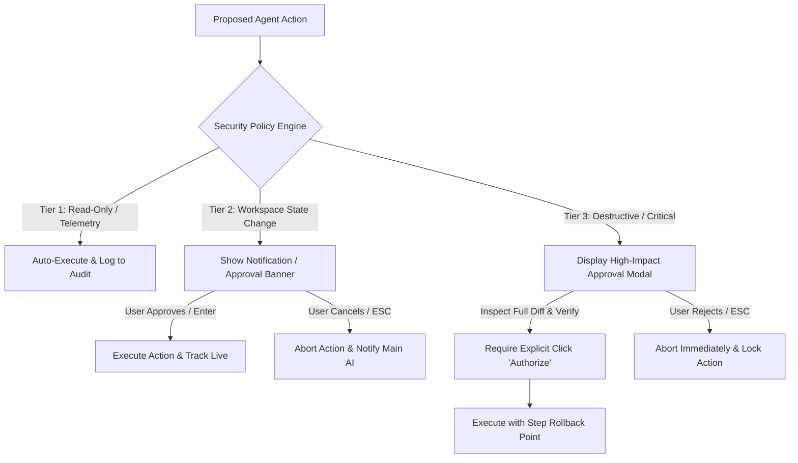
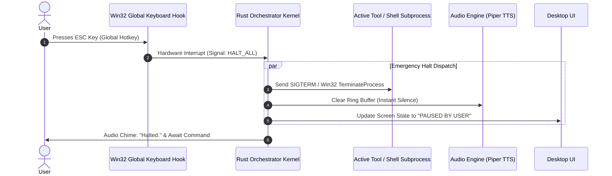

# Desktop Automation & Human-In-The-Loop Security Architecture

## 1. Zero Hidden PC Activity Mandate

A non-negotiable core tenet of this Windows AI Assistant is:
> **Zero covert background activity.** Every tool invocation, file edit, terminal command, and window interaction must be visually announced, tracked in real-time on screen, and logged into an append-only audit database.

The user must retain absolute visibility and sovereign control over everything the assistant executes on their Windows 10 desktop.

---

## 2. Three-Tier Permission Matrix & Approval Flow

To balance effortless productivity with bulletproof safety, all desktop capabilities are categorized into three deterministic permission tiers:



### 2.1 Detailed Tier Classifications

| Security Tier | Classification | Included Operations | Default Policy | UI Representation |
| :---: | :--- | :--- | :--- | :--- |
| **Tier 1** | **Safe / Read-Only** | Reading file contents, searching directories, inspecting running process names, reading system telemetry (CPU/RAM), vector memory search, local TTS audio generation. | **Auto-Approved** (Air-Gap compliant) | Green pulse indicator on Floating HUD and Command Center. |
| **Tier 2** | **Project State Change** | Writing a new file in active workspace, patching code, running benign developer commands (`git status`, `npm test`, `cargo build`), switching window focus. | **Standard Confirmation** (Single-click or hotkey confirmation) | Yellow card displaying proposed command, working directory, and estimated time. |
| **Tier 3** | **Destructive / High Impact** | Deleting/moving files, overwriting files without backup, sending external emails/webhooks, executing elevated/PowerShell commands (`rmdir`, `reg.exe`, admin scripts), network access. | **Mandatory Explicit Human Approval** | Modal dialog displaying side-by-side diff, security risk warning, and requires explicit click. |

---

## 3. Safe Implementation of Desktop Capabilities

### 3.1 Filesystem Operations
- **Scoped Workspaces:** The assistant operates by default inside explicitly designated workspace folders (e.g., `T:\ai creation` or user-pinned project roots).
- **Prohibited System Paths:** Operations targeting `C:\Windows`, `C:\Program Files`, root drives `C:\`, or system boot sectors are blocked at the Rust kernel level and cannot be overridden by agent prompts.
- **Atomic Backup on Edit:** Before any file is modified or overwritten, the Rust backend creates a timestamped copy in `.assistant/backups/<timestamp>_<filename>`. If an edit corrupts code, the user can click "Rollback" with one click.

### 3.2 Multi-Layered Terminal & Shell Execution Sandbox
- Command execution is driven via native child processes (`std::process::Command` in Rust) wrapping PowerShell or Windows Command Prompt.
- **Why Blacklists are Insufficient:** Simple string or regex blacklists can be easily bypassed via PowerShell alias expansion, base64 encoded payloads (`powershell -enc`), or string concatenation.
- **Multi-Layered Protection:**
  1. *Directory Whitelisting:* Commands are strictly constrained to execute within explicitly approved project workspace paths. Execution targeting system paths (`C:\Windows`, `C:\Program Files`) is blocked at the Rust host level.
  2. *AST Semantic Analysis:* Shell commands are parsed into Abstract Syntax Trees using the PowerShell native language parser before invocation to detect hidden script execution, execution policy bypasses, and unquoted dynamic evaluations.
  3. *Three-Tier Permission Gate:* Any state-changing command triggers an explicit UI modal displaying working directory, command string, and expected impact.
  4. *Execution Timeout:* Every shell process runs under a strict timeout (default: 30 seconds for routine commands).
  5. *Real-Time Output Streaming:* Terminal stdout/stderr streams directly into the UI Command Center console in real time.

### 3.3 Window & Desktop UI Automation
- **Native Win32 Integration:** Implemented using official Microsoft `windows-rs` bindings.
- **Window Enumeration & Focus:** Uses `EnumWindows`, `GetWindowTextW`, and `SetForegroundWindow` to identify application windows (e.g., VS Code, Chrome, Blender).
- **Virtual Input Safeguards:** Keyboard and mouse automation (`SendInput`) is strictly confined to the currently focused target window.
- **Emergency Interlock:** The moment physical user mouse movement or keyboard input is detected, virtual automation immediately pauses to prevent input collisions.

---

## 4. Emergency Escape & Interruption Protocol

The user must always be able to stop the assistant instantly, regardless of what state it is in.



### 4.1 Implementation Mechanism
1. **Dedicated Emergency Hotkey (`Ctrl + Alt + Escape`):** Uses Windows `RegisterHotKey` (or a pass-through `WH_KEYBOARD_LL` hook) listening specifically for `Ctrl + Alt + Escape`. It never swallows the plain `ESC` key, preventing any interference with games, IDEs, or standard Windows software. When the Assistant UI or Floating HUD is actively focused, bare `ESC` also immediately pauses execution and closes active modals.
2. **Deterministic Process Tree Cleanup:** The Rust backend associates all spawned sub-processes (compilers, git commands, python scripts) with a Windows **Job Object** (`CreateJobObjectW` with `JOB_OBJECT_LIMIT_KILL_ON_JOB_CLOSE`). When the task terminates, `TerminateJobObject` instantly kills the entire process tree, leaving zero orphaned background processes.

---

## 5. Security & Audit Logging Engine

Every single action is permanently recorded in the local SQLite database table `audit_events`:

```sql
CREATE TABLE audit_events (
    id INTEGER PRIMARY KEY AUTOINCREMENT,
    timestamp DATETIME DEFAULT CURRENT_TIMESTAMP,
    agent_role TEXT NOT NULL,
    action_type TEXT NOT NULL, -- 'FILE_READ', 'FILE_WRITE', 'SHELL_EXEC', 'WINDOW_FOCUS', 'WEB_CALL'
    target_path_or_cmd TEXT NOT NULL,
    permission_tier INTEGER NOT NULL,
    approval_status TEXT NOT NULL, -- 'AUTO_APPROVED', 'USER_CONFIRMED', 'USER_REJECTED', 'EMERGENCY_HALTED'
    execution_duration_ms INTEGER,
    return_code INTEGER,
    sha256_hash TEXT
);
```

The user can view, filter, and inspect this audit trail at any time in the **Security & Permissions** screen (Screen 13).
