# KAATYA: Final 23-Agent Roster & Capability Matrix

## 1. Architectural Principle: Logical Personas on Shared Runtimes

> **The 23 specialist agents in KAATYA are NOT 23 separately loaded language models.**
> 
> They are strictly structured **logical capabilities, system prompt personas, and tool-scoped execution handlers** orchestrated by the permanent Main AI controller (**KAATYA**) and powered by shared resident/worker runtimes.

```mermaid
graph TD
    User([User Voice / Text / GUI]) --> M[1. KAATYA Main AI - Supervisor]

    subgraph Software_And_Data ["Engineering & Data Cluster"]
        M --> Coder[2. Coder]
        M --> Tester[9. Tester]
        M --> Reviewer[14. Code Reviewer]
        M --> DBEng[23. Database Engineer]
        M --> Analyst[13. Data Analyst]
    end

    subgraph Creative_And_Media ["Creative & Multimodal Cluster"]
        M --> Designer[3. Designer]
        M --> Artist[10. 3D Artist]
        M --> VideoEd[16. Video Editor]
        M --> ImgStudio[17. Image Studio]
        M --> AudioVoice[20. Audio & Voice]
        M --> Presentation[21. Presentation]
    end

    subgraph Content_And_Language ["Content & Language Cluster"]
        M --> Writer[5. Writer]
        M --> Grammar[18. Grammar & Language]
        M --> Social[19. Social Media]
        M --> DocIntel[22. Document Intel]
        M --> Researcher[4. Researcher]
    end

    subgraph Operations_And_Security ["Operations & Assistant Cluster"]
        M --> FileMgr[7. File Manager]
        M --> Automator[11. Automator]
        M --> Security[12. Security]
        M --> Messenger[6. Messenger]
        M --> Assistant[15. Assistant]
        M --> GameHelper[8. Game Helper - Hints Only]
    end
```

---

## 2. Complete 23-Agent Capability Matrix

| # | Agent Name | Core Responsibilities | Primary Authorized Tools | Permission Tier | Underlying Engine Assignment |
| :---: | :--- | :--- | :--- | :---: | :--- |
| **1** | **KAATYA Main AI** | Conversational controller, task planning, sub-agent routing, permission gate, final synthesis. | `orchestrator_kernel`, `task_queue`, `tts_speak`, `agent_dispatch`. | **Supervisor** | **Permanent Core:** `Qwen3-4B-Q4_K_M` |
| **2** | **Coder** | Software engineering, code generation, refactoring, bug fixes, script creation. | `read_file`, `write_file`, `patch_file`, `search_codebase`. | Tier 2 | Local `Qwen2.5-Coder-1.5B` or Main AI |
| **3** | **Designer** | UI/UX layout advice, Tailwind token audits, Obsidian Command styling. | `read_design_tokens`, `inspect_css`, `suggest_palette`. | Tier 1 | Main AI (`Qwen3-4B`) |
| **4** | **Researcher** | Semantic document synthesis, local vector search, authorized web research. | `search_local_docs`, `sqlite_vector_search`, `fetch_web_summary`*. | Tier 1 | Main AI + `Qwen3-Embedding` |
| **5** | **Writer** | Documentation, technical reports, manuals, release notes, long-form prose. | `read_notes`, `draft_markdown`, `format_table`. | Tier 1 | Local `Qwen3-1.7B` or Main AI |
| **6** | **Messenger** | Preparing notifications, emails, messages (Confirmation mandatory to send). | `draft_message`, `stage_notification`, `queue_webhook`*. | Tier 3 | Local `SmolLM2-1.7B` or Main AI |
| **7** | **File Manager** | Scoped directory browsing, archiving, pre-edit backups (Deletion confirmed). | `list_directory`, `move_file`, `copy_file`, `archive_zip`. | Tier 3 | Main AI tool executor |
| **8** | **Game Helper** | Strategy hints, keybindings, walkthrough lookups (**READ-ONLY; NO gameplay bots**). | `query_game_wiki`, `show_keybindings`, `display_hint`. | Tier 1 | Main AI (`Qwen3-4B`) |
| **9** | **Tester** | Test case generation, test execution, coverage inspection, regression testing. | `run_test_suite`, `parse_coverage`, `lint_code`. | Tier 2 | Local `Qwen2.5-Coder-1.5B` or Main AI |
| **10** | **3D Artist** | Blender Python scripting, 3D file metadata inspection, 2D/2.5D canvas tuning. | `inspect_obj_gltf`, `tune_canvas_settings`, `export_svg`. | Tier 1 | Main AI (`Qwen3-4B`) |
| **11** | **Automator** | Scheduled task registration, routine developer workflows, repetitive PC actions. | `register_cron`, `execute_script`, `notify_desktop`. | Tier 2/3 | Main AI tool executor |
| **12** | **Security** | Permission enforcement, shell AST inspection, path blacklisting, audit logger. | `inspect_command_ast`, `verify_hashes`, `check_api_scopes`. | **Enforcer** | Main AI rule engine |
| **13** | **Data Analyst** | SQLite database queries, CSV formatting, deterministic statistics via Python/pandas/sqlite (never pure LLM math). | `run_sql_query`, `calculate_metrics`, `export_csv`. | Tier 1 | Deterministic scripts + Local worker |
| **14** | **Code Reviewer** | Static code analysis, syntax checking, diff validation, security review. | `diff_inspect`, `ast_grep`, `rule_check`. | Tier 1 | Main AI (`Qwen3-4B`) |
| **15** | **Assistant** | Quick notes, to-dos, calendar reminders, everyday productivity. | `manage_todos`, `set_timer`, `take_note`, `query_history`. | Tier 1 | Local `SmolLM2-1.7B` or Main AI |
| **16** | **Video Editor** | Complete video production: multi-editor interchange (XML/EDL/OTIO), FFmpeg CLI, Whisper subtitles. | `ffmpeg_exec`, `export_nle_timeline`, `generate_subtitles`. | Tier 2/3 | Main AI + FFmpeg + Whisper STT |
| **17** | **Image Studio** | Image generation workflows (FLUX.2 Klein 4B DiT / Cloud Diffusion Gate). | `generate_image_local`, `generate_image_cloud`*. | Tier 2/3 | Local `FLUX.2` (Experimental) or Cloud API |
| **18** | **Grammar & Language** | Grammar correction, spelling, translation (Benchmark-dependent between SmolLM2-1.7B and Qwen3-1.7B). | `check_grammar`, `translate_text`, `rewrite_tone`. | Tier 1 | Benchmark-dependent (`SmolLM2` / `Qwen3`) |
| **19** | **Social Media** | Social media post drafting, YouTube/Instagram captions, hashtags, hooks. | `draft_post`, `generate_hashtags`, `format_caption`. | Tier 1 | Local `Qwen3-1.7B` or Main AI |
| **20** | **Audio & Voice** | Audio processing, voice cloning prep, transcription formatting, loudness. | `process_audio`, `normalize_loudness`, `transcribe_whisper`. | Tier 1 | Main AI + Whisper STT + Piper TTS |
| **21** | **Presentation** | Slide deck structure planning, outline generation, markdown presentation decks. | `draft_slides`, `format_deck_markdown`, `export_pptx`. | Tier 1 | Local `Qwen3-1.7B` or Main AI |
| **22** | **Document Intel** | PDF text extraction, invoice parsing, Word/Excel data extraction. | `extract_pdf_text`, `parse_invoice_table`, `read_docx`. | Tier 1 | Local `qwen2.5-1.5b` or Main AI |
| **23** | **Database Engineer** | SQL schema design, migrations, query optimization, database backups. | `generate_schema`, `validate_sql`, `backup_sqlite`. | Tier 2 | Local `Qwen2.5-Coder-1.5B` or Main AI |

*\*External web lookups and cloud generation require explicit user approval and unmuted Air-Gap toggles.*

---

## 3. Detailed Agent Specifications for the 8 New Roles

### Agent 16: Video Editor
- **Persona:** Professional video production assistant and timeline editor.
- **Responsibilities:** Organizing footage, generating scene shotlists, executing FFmpeg operations (cutting, concatenating, audio replacement), managing CapCut project templates, generating timed SRT subtitles via Whisper, and validating output resolution/aspect ratios (16:9, 9:16, 1:1).
- **Safety Rule:** Never overwrite raw user video assets. All exports written to `.assistant/exports/video/`.

### Agent 17: Image Studio
- **Persona:** Visual art director and generative image engineer.
- **Responsibilities:** Translating user visual concepts into detailed diffusion prompts, configuring local FLUX.2 Klein 4B parameters (resolution, steps, seeds), and staging online provider calls (DALL-E, Ideogram) with explicit cost and prompt disclosure.
- **Safety Rule:** Require explicit confirmation before initiating local CPU render or transmitting data to cloud APIs.

### Agent 18: Grammar & Language
- **Persona:** Strict, bilingual linguistic proofreader and translator (English, Hindi, Hinglish).
- **Responsibilities:** Fixing grammatical syntax, punctuation, spelling errors, tone calibration (formal, executive, casual), and natural translation between English and Hindi.
- **Engine:** Uses `SmolLM2-1.7B` for ultra-fast English grammar polishing and `Qwen3-1.7B` for Hindi/Hinglish translations.

### Agent 19: Social Media
- **Persona:** High-engagement social media strategist and copywriter.
- **Responsibilities:** Generating viral hooks, YouTube video descriptions, SEO tags, Instagram Reel captions, LinkedIn thought leadership summaries, and tweet threads.
- **Engine:** Powered by `Qwen3-1.7B` for creative and punchy copy.

### Agent 20: Audio & Voice
- **Persona:** Audio engineer and speech acoustics specialist.
- **Responsibilities:** Trimming audio noise, normalizing speech waveforms to EBU R128 loudness standards, slicing audio segments for Whisper transcription, and managing Piper voice synthesis profiles (`mike` and `rohan`).

### Agent 21: Presentation
- **Persona:** Executive presentation designer and slide architect.
- **Responsibilities:** Structuring narrative flow for pitch decks, educational lectures, and technical reviews; outputting structured Marp/Slidev markdown or PPTX-compatible outlines.

### Agent 22: Document Intelligence
- **Persona:** Forensic document parsing specialist.
- **Responsibilities:** Ingesting local PDF reports, invoices, bank statements, CSV dumps, and Word documents; extracting tabular data into structured JSON and indexing text into the semantic Memory Centre.

### Agent 23: Database Engineer
- **Persona:** Senior database architect and SQL specialist.
- **Responsibilities:** Drafting normalized relational schemas (SQLite / PostgreSQL), writing optimized indexed queries, planning database migrations, and executing automated database integrity checks.

---

## 4. Task Handoff & Main AI Verification Protocol

```mermaid
sequenceDiagram
    autonumber
    actor User
    participant MainAI as KAATYA Main AI
    participant Sec as Security Gate
    participant Agent as Specialist Agent
    participant Runtime as Local / Online Engine

    User->>MainAI: User Prompt: "Generate a 30s video script and subtitles for a coding tip"
    MainAI->>MainAI: Task Breakdown: 1. Script (Writer) -> 2. Audio (Audio & Voice) -> 3. Video Assembly (Video Editor)
    
    rect rgb(20, 30, 45)
        note right of MainAI: Step 1: Script Creation
        MainAI->>Agent: Invoke Writer Role
        Agent->>Runtime: Generate 30s Hook & Body
        Runtime-->>Agent: Script Output
        Agent-->>MainAI: Deliver Script
        MainAI->>MainAI: Verify Word Count (~60 words for 30s)
    end

    rect rgb(20, 30, 45)
        note right of MainAI: Step 2: Voiceover Generation
        MainAI->>Agent: Invoke Audio & Voice Role
        Agent->>Runtime: Synthesize Speech via Piper (Mike)
        Runtime-->>Agent: audio.wav (22.05 kHz)
        Agent-->>MainAI: Deliver Audio Path
    end

    rect rgb(20, 30, 45)
        note right of MainAI: Step 3: Subtitle Generation & Assembly
        MainAI->>Agent: Invoke Video Editor Role
        Agent->>Runtime: Transcribe audio.wav via Whisper -> subtitles.srt
        Runtime-->>Agent: subtitles.srt
        Agent->>Sec: Request Approval to render final MP4 via FFmpeg
        Sec->>User: Display Approval Modal (Command + Target Paths)
        User-->>Sec: User Approves
        Agent->>Runtime: Execute FFmpeg burn-in
        Agent-->>MainAI: Final Video Rendered
    end

    MainAI->>User: "Video generated successfully with synchronized subtitles. Ready for review."
```

