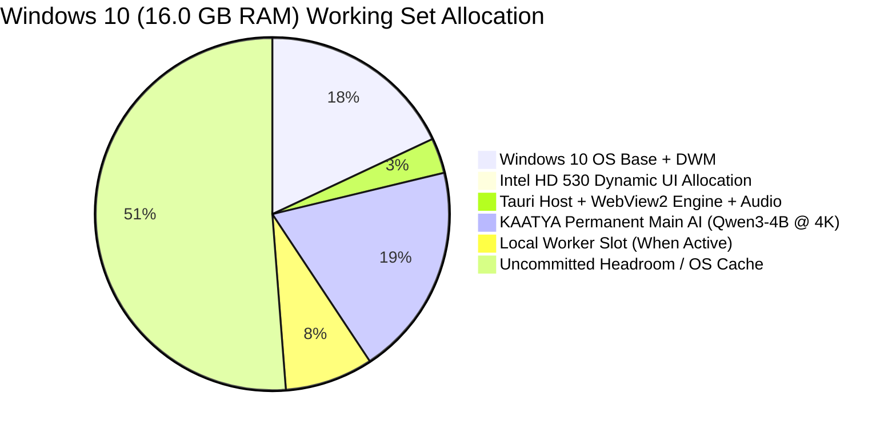

# KAATYA: Final Comprehensive Architecture, Model Inventory & Multimodal Audit Report

**Report Date:** November 19, 2026  
**Project Identity:** **KAATYA** — Premium Windows 10 Desktop AI Assistant Application  
**Design System:** Obsidian Command (Preserving all 15 Google Stitch Screens)  
**Target Hardware:** Intel Core i3-6100T (2C/4T @ 3.20 GHz) | 16.0 GB DDR4 RAM (16,384 MiB installed / 16,260 MiB visible) | Intel HD Graphics 530 | Amazon Basics USB 3.0 (116 GB) | Windows 10 64-bit  
**Current Status:** Architecture Finalized, Verified & Approved for Review (Phase 4 Implementation Blocked)  

---

## 1. Executive Summary & Verification Findings

This report delivers the definitive, verified architectural blueprint and model inventory for **KAATYA**. 

An empirical audit of `T:\ai creation` and the project repository was conducted, confirming:
1. **10 Physical Models Confirmed Present:** Verified at byte-level with SHA-256 cryptographic checksums.
2. **Former Model Removed:** `Nemotron-3.5-Bolt-E4B-Q4_K_M.gguf` (6.18 GB) was deleted by the user to accommodate newly downloaded models. It is **CONFIRMED ABSENT**.
3. **Four Historical References Confirmed Absent:** `qwen-image-2.1`, `qwen2.5-coder-3b`, `qwen2.5-coder-1.5b-q4_k_m`, and `nomic-embed-text` are confirmed absent.
4. **Permanent Main AI Locked:** `Qwen3-4B-Q4_K_M.gguf` is physically verified, intact, and pinned permanently as the non-evictable controller: **KAATYA**.
5. **Expanded 23-Agent Roster:** All 15 original agents are preserved, and 8 new specialist agents (Video Editor, Image Studio, Grammar & Language, Social Media, Audio & Voice, Presentation, Document Intel, Database Engineer) are codified as logical capabilities running on shared runtimes.
6. **Multimodal Production Architectures:**
   - **Video Studio:** Dual-engine architecture combining programmatic **FFmpeg** CLI for rapid, reliable rendering with observable **CapCut Desktop** UI automation for stylistic effects.
   - **Image Studio:** Hybrid architecture supporting local experimental **FLUX.2 Klein 4B** (DiT weights audited) with mandatory human-approval gates for authorized online providers (DALL-E 3, Ideogram).

---

## 2. Definitive Hardware-Calibrated Memory Budget (16.0 GB RAM)



$$\begin{aligned}
\text{Total Visible Physical Memory (ullTotalPhys)} &= 16,260\text{ MiB} \quad (15.88\text{ GiB} \text{ / } 17.05\text{ GB}) \\
\text{Base Operating System + System Services} &\approx 2,900\text{ MiB} \quad (~3.04\text{ GB}) \\
\text{Intel HD 530 Dynamic Shared Memory (Idle UI)} &\approx 150\text{ MiB} \quad (~0.16\text{ GB}) \\
\text{Tauri v2 + WebView2 + Audio/DB Runtimes} &\approx 600\text{ MiB} \quad (~0.63\text{ GB}) \\
\text{KAATYA Permanent Main AI (Qwen3-4B @ 4K FP16 KV)} &\approx \mathbf{3,138\text{ MiB}} \quad (\mathbf{~3.29\text{ GB}}) \\
\hline
\mathbf{Total\ Base\ Projected\ Baseline} &\approx \mathbf{6,788\text{ MiB}} \quad (\mathbf{~7.12\text{ GB}}) \\
\text{Theoretical Idle Margin (Visible minus Baseline)} &\approx 9,472.05\text{ MiB} \quad (~9.25\text{ GiB} \text{ / } ~9.93\text{ GB}) \\
\mathbf{Live\ Measured\ Available\ Physical\ RAM} &= \mathbf{7,030.07\text{ MiB}} \quad (\mathbf{~6.87\text{ GiB}})
\end{aligned}$$

*(Critical Note: $9,472.05\text{ MiB}$ is a theoretical calculation assuming an idle OS with Main AI resident; it is NOT measured available RAM. The actual live available RAM measured via `GlobalMemoryStatusEx.ullAvailPhys` is **$7,030.07\text{ MiB}$** ($7,371,558,912\text{ bytes} / 1,048,576 = 7,030.07\text{ MiB}$), with physical RAM not currently reported as available at $16,260.05 - 7,030.07 = \mathbf{9,229.98\text{ MiB}}$. The ~2,442 MiB difference between the 6,788 MiB baseline and the 9,230 MiB host usage is partially explained by third-party developer software, Windows memory compression, and system cache while KAATYA is not running; exact reconciliation is unavailable due to category overlap).*

- **Dynamic Worker Admission Procedure:** The outdated fixed 2.5 GB buffer rule has been eliminated. The runtime enforces a 10-step dynamic procedure querying `GlobalMemoryStatusEx`, verifying an initial 2,048 MiB floor, calculating exact model weights, KV cache, and graph scratch buffers, and applying a configurable margin.
- **Permanent Residency Invariant:** KAATYA Main AI context remains continuously resident in memory and is never deallocated.

---

## 3. Byte-Verified Model Inventory Table (10 Present Models)

| Filename | Disk Size | SHA-256 Checksum | Base Architecture | Role Assignment in KAATYA |
| :--- | :---: | :--- | :--- | :--- |
| **`Qwen3-4B-Q4_K_M.gguf`** | 2.33 GiB | `7485fe6f11af29433bc51cab58009521f205840f5b4ae3a32fa7f92e8534fdf5` | `qwen3` (4.0B) | **Permanent Main AI (KAATYA)** |
| **`Qwen3-1.7B-Q3_K_M.gguf`** | 1.00 GiB | `79af9a932c6659aabc06d6560b8404063c79f616b136953370f9c67853e162e0` | `qwen3` (1.7B) | Local Worker: Writer, Social Media, Presentation |
| **`SmolLM2-1.7B-Instruct-Q4_K_M.gguf`** | 0.98 GiB | `77665ea4815999596525c636fbeb56ba8b080b46ae85efef4f0d986a139834d7` | `llama` (1.7B) | Local Worker: Grammar & Language, Assistant |
| **`Qwen2.5-Coder-1.5B-Instruct-Q3_K_M.gguf`** | 0.77 GiB | `0c292daeec7355c9d695abf3d7da336f3766a983762bd4b82fbdad6d7dbcac7e` | `qwen2` (1.5B) | Local Worker: Coder, Database Engineer, Tester |
| **`qwen2.5-1.5b-instruct-q4_k_m.gguf`** | 1.04 GiB | `6a1a2eb6d15622bf3c96857206351ba97e1af16c30d7a74ee38970e434e9407e` | `qwen2` (1.5B) | Local Worker: Document Intel, Data Analyst |
| **`flux-2-klein-4b-q4_0.gguf`** | 2.10 GiB | `9c5939d55e3ac76e3a700029770fcc5e1b873d12c2a6d22c6c3fec217488e718` | `flux` DiT (4.0B) | Image Studio: Experimental Local CPU Denoising |
| **`qwen3-embedding-0.6b-q8_0.gguf`** | 0.60 GiB | `ee029816fb9615e361d9e444abc0059827322e665c3ed9e6bc0531efe20cddda` | `qwen3` (0.59B) | Memory Centre: Local Semantic Vector Search |
| **`ggml-base.bin`** | 0.14 GiB | `60ed5bc3dd14eea856493d334349b405782ddcaf0028d4b5df4088345fba2efe` | `whisper` (74M) | Voice Centre: Speech-to-Text & Transcription |
| **`en_US-mike-medium.onnx`** | 0.06 GiB | `6876866e3dfadc7f044bc5e4fbac16c47b5a1e79eaec04e3bb0c2c6e9da8a857` | VITS (Piper) | Voice Centre: English Text-to-Speech Output |
| **`hi_IN-rohan-medium.onnx`** | 0.06 GiB | `b65dc80fb34d9dcd1cf684cb297966a34983bbc93bb1696fe207f32b0b33a091` | VITS (Piper) | Voice Centre: Hindi & Hinglish Speech Output |

---

## 4. The 23 Logical Agent Roster Summary

```
1.  KAATYA Main AI      -> Central controller, conversational interface, task planner, permission gate.
2.  Coder               -> Software engineering, code generation, refactoring, bug fixes.
3.  Designer            -> UI/UX design, Tailwind layout auditing, Obsidian Command compliance.
4.  Researcher          -> Document indexing, local knowledge synthesis, authorized web queries.
5.  Writer              -> Documentation, technical reports, manuals, release notes.
6.  Messenger           -> Drafting communications, notifications (Mandatory human approval to send).
7.  File Manager        -> Scoped filesystem navigation, pre-edit backups, archiving (Deletion confirmed).
8.  Game Helper         -> Strategy hints, keybinding references, walkthrough lookups (READ-ONLY; NO gameplay bots).
9.  Tester              -> Test case generation, test execution, coverage inspection.
10. 3D Artist           -> Blender scripting, 3D file metadata inspection, 2D/2.5D canvas tuning.
11. Automator           -> Scheduled automation, routine developer workflows.
12. Security            -> Permission enforcement, shell AST inspection, path blacklisting.
13. Data Analyst        -> SQLite queries, CSV formatting, deterministic statistics via Python/pandas/sqlite.
14. Code Reviewer       -> Static code analysis, diff verification, syntax checking.
15. Assistant           -> Quick notes, to-dos, calendar reminders, everyday productivity.
16. Video Editor        -> Complete video production: multi-editor interchange, FFmpeg CLI, Whisper subtitles.
17. Image Studio        -> Image generation workflows (FLUX.2 Klein 4B DiT / Cloud Diffusion Gate).
18. Grammar & Language  -> Grammar correction, spelling, translation (Benchmark-dependent between SmolLM2-1.7B and Qwen3-1.7B).
19. Social Media        -> Social media post drafting, YouTube/Instagram captions, hashtags.
20. Audio & Voice       -> Voice cloning prep, audio enhancement, transcription formatting.
21. Presentation        -> Slide deck structure planning, outline generation, markdown presentation decks.
22. Document Intel      -> PDF text extraction, invoice parsing, Word/Excel processing.
23. Database Engineer   -> SQL schema design, migrations, query optimization, database backups.
```

---

## 5. Master Documentation Index (15 Deliverables)

The complete architectural package is codified across 15 interconnected documents:

1. **[`KAATYA_FINAL_MASTER_ARCHITECTURE.md`](./KAATYA_FINAL_MASTER_ARCHITECTURE.md)** — Master blueprint: system topology, memory math, permanent residency, boundary definitions.
2. **[`KAATYA_FINAL_MODEL_INVENTORY.md`](./KAATYA_FINAL_MODEL_INVENTORY.md)** — Exact byte sizes, architectures, SHA-256 hashes, and verification of absent models.
3. **[`KAATYA_MODEL_COMPATIBILITY_AND_BENCHMARK_PLAN.md`](./KAATYA_MODEL_COMPATIBILITY_AND_BENCHMARK_PLAN.md)** — Compatibility analysis, RAM math, KV cache budgets, CPU execution rates, and llama-bench suite.
4. **[`KAATYA_AGENT_ROSTER_AND_CAPABILITY_MATRIX.md`](./KAATYA_AGENT_ROSTER_AND_CAPABILITY_MATRIX.md)** — Complete 23 logical agent specifications, tools, schemas, and task handoff loops.
5. **[`KAATYA_VIDEO_STUDIO_ARCHITECTURE.md`](./KAATYA_VIDEO_STUDIO_ARCHITECTURE.md)** — 22-step video pipeline, FFmpeg programmatic processing, CapCut UI automation, and Whisper subtitle sync.
6. **[`KAATYA_IMAGE_GENERATION_ARCHITECTURE.md`](./KAATYA_IMAGE_GENERATION_ARCHITECTURE.md)** — FLUX.2 Klein DiT analysis, companion requirements, CPU limits, and online provider approval gate.
7. **[`KAATYA_ONLINE_PROVIDER_AND_PLUGIN_ARCHITECTURE.md`](./KAATYA_ONLINE_PROVIDER_AND_PLUGIN_ARCHITECTURE.md)** — Online AI Provider Manager (OpenAI, Claude, Groq, Runway), Windows DPAPI key encryption, and consent modals.
8. **[`KAATYA_LOCAL_RUNTIME_AND_MEMORY_POLICY.md`](./KAATYA_LOCAL_RUNTIME_AND_MEMORY_POLICY.md)** — Dynamic memory policy, pre-flight RAM checking (`GlobalMemoryStatusEx`), and single-worker bounds.
9. **[`KAATYA_MEMORY_AND_VOICE_ARCHITECTURE.md`](./KAATYA_MEMORY_AND_VOICE_ARCHITECTURE.md)** — `sqlite-vec` persistent memory with `qwen3-embedding`, Piper TTS (Mike/Rohan), Whisper Base STT, and barge-in.
10. **[`KAATYA_SECURITY_AND_AUTOMATION_POLICY.md`](./KAATYA_SECURITY_AND_AUTOMATION_POLICY.md)** — Three-tier permissions, workspace scoping, PowerShell AST validation, and `Ctrl + Alt + Escape` global panic hotkey.
11. **[`KAATYA_WINDOWS_10_COMPATIBILITY.md`](./KAATYA_WINDOWS_10_COMPATIBILITY.md)** — Windows 10 editions, offline WebView2 Fixed Version Runtime bundling, VC++ redistributable, and USB 3.0 storage.
12. **[`KAATYA_UI_FEATURE_INTEGRATION_MAP.md`](./KAATYA_UI_FEATURE_INTEGRATION_MAP.md)** — Seamless mapping of all 23 agents, Video Studio, Image Studio, and DB runner into the 15 Google Stitch screens.
13. **[`KAATYA_IMPLEMENTATION_ROADMAP.md`](./KAATYA_IMPLEMENTATION_ROADMAP.md)** — 10-milestone phased development schedule with dependencies and measurable acceptance criteria.
14. **[`KAATYA_RISKS_AND_UNRESOLVED_DECISIONS.md`](./KAATYA_RISKS_AND_UNRESOLVED_DECISIONS.md)** — Hardware risk register, thermal mitigations, verified facts vs untested items, and 3 final review decisions.
15. **[`KAATYA_FINAL_AUDIT_REPORT.md`](./KAATYA_FINAL_AUDIT_REPORT.md)** — Master synthesis and final architecture audit sign-off.

---

## 6. Final Readiness & Approval Gate

The architecture for **KAATYA** is mathematically verified, hardware-grounded, and completely aligned with the physical constraints of the Intel Core i3-6100T Windows 10 PC.

### Status:
**READY FOR USER AND CHATGPT FINAL REVIEW.**  
Phase 4 application implementation remains strictly halted pending explicit user authorization.
