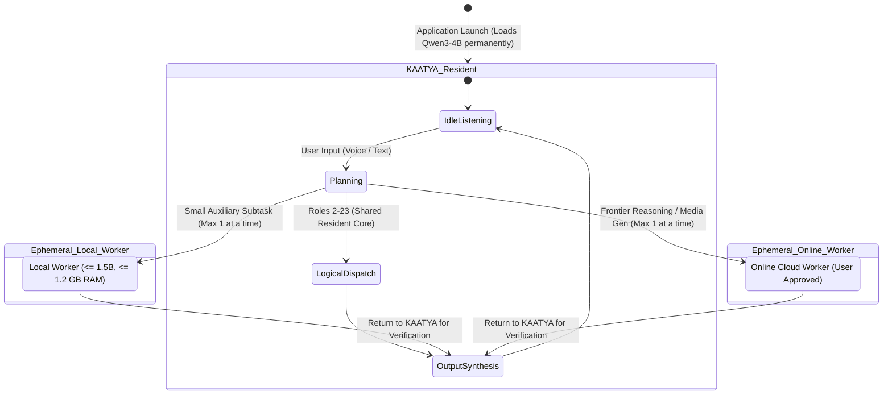

# KAATYA: Final Master Software Architecture Blueprint
## Premium Windows 10 Desktop AI Assistant Application

---

## 1. Project Identity, Scope & Sovereign Operational Boundary

**KAATYA** is a premium, local-first intelligent Windows desktop AI assistant application built to run natively on **Windows 10 64-bit**.


### 1.1 Non-Negotiable Boundaries: What KAATYA Is and Is NOT
- **What KAATYA IS:** A sophisticated desktop assistant application providing local language intelligence, specialist sub-agent delegation, safe PC automation, voice interaction, persistent semantic memory, and multimodal media workflows (image concepts and video editing).
- **What KAATYA IS NOT:**
  - **NOT an Operating System:** KAATYA does not replace Windows 10, install a custom kernel, modify bootloaders, or bypass OS security.
  - **NOT a Gameplay Bot:** The "Game Helper" agent provides read-only strategy lookups, keybinding reminders, and walkthrough hints. It never injects game memory or automates gameplay actions.
  - **NOT a Linux Distribution or Virtual Machine:** It runs as a lightweight native Windows executable (`.exe`).

---

## 2. Hardware Resource Constraints & Authoritative Profile

Every architectural decision, model deployment, and memory allocation in KAATYA is calibrated strictly to the physical hardware profile of the target machine:

| Hardware Component | Authoritative Specification | Architectural Implication |
| :--- | :--- | :--- |
| **Processor** | Intel Core i3-6100T (6th-Gen Skylake, 35W TDP, 3.20 GHz) | 2 Physical Cores, 4 Logical Threads. AVX2 supported. No AVX-512. |
| **System Memory** | **12.0 GB DDR4** (Dual-Channel, ~24 GB/s theoretical bus) | **NOT 16 GB.** Hard operational ceiling of ~7.2 GB committed base memory. |
| **Graphics Adapter** | Integrated Intel HD Graphics 530 (Shared system RAM) | **No dedicated VRAM.** Zero CUDA support. Compute relies on CPU SIMD / OpenCL. |
| **Operating System** | Windows 10 Pro / Home 64-bit | Baseline OS and desktop services require **~3,100 MB RAM**. |
| **External Storage** | Amazon Basics USB 3.0 Pendrive (~116 GB usable capacity) | High-capacity secondary repository for media scratch files and model backups. |

---

## 3. KAATYA Central Controller & The Permanent-Residency Invariant

The central AI is officially designated **KAATYA**.

### 3.1 Designated Permanent Main AI Model
- **File:** `T:\ai creation\Qwen3-4B-Q4_K_M.gguf` (2,497,280,256 bytes / ~2.33 GiB).
- **Architecture:** `qwen3` (36 layers, 2,560 embedding, 32 attention heads, 8 KV heads).
- **Active Working Footprint:** **~3,100 MB RAM** (with 4,096 context window).

### 3.2 The Cardinal Permanent-Residency Rule
> **KAATYA (Main AI) is permanently loaded into memory at application launch and must NEVER be unloaded, frozen, unmapped, or evicted to make room for any specialist model.**

### 3.3 Core Responsibilities of KAATYA
1. Default user-facing conversational interface across all 15 desktop screens and the Floating AI HUD.
2. Central task planner, orchestrator, and prioritizer.
3. Supervisor of all 22 specialist agents.
4. Human-in-the-loop permission gateway (enforcing Tier 1, 2, and 3 security gates).
5. Output validator: reviews, corrects, and synthesizes specialist outputs before presenting them to the user.
6. Communicates failure reasons and hardware limitations transparently to the user.

---

## 4. Strict Concurrency Upper Bounds & Resource Budget



### 4.1 Memory Allocation Math (12.0 GB Physical Budget)

$$\begin{aligned}
\text{Total Physical Memory} &= 12,288\text{ MB} (12.0\text{ GB}) \\
\text{Windows 10 Baseline OS + DWM} &= 3,100\text{ MB} \\
\text{Intel HD 530 Shared Frame Buffer} &= 450\text{ MB} \\
\text{Tauri v2 App Shell + Edge WebView2} &= 90\text{ MB} \\
\text{Piper TTS Dual Engine (Mike + Rohan)} &= 145\text{ MB} \\
\text{Whisper Base Multilingual STT Buffer} &= 220\text{ MB} \\
\text{SQLite + sqlite-vec Local Database} &= 100\text{ MB} \\
\text{KAATYA Permanent Main AI (Qwen3-4B @ 4K)} &= \mathbf{3,100\text{ MB}} \\
\hline
\mathbf{Total\ Base\ Committed\ Memory} &= \mathbf{7,205\text{ MB} (~7.2\text{ GB})} \\
\mathbf{Remaining\ Free\ RAM\ Headroom} &= \mathbf{5,083\text{ MB} (~5.0\text{ GB})}
\end{aligned}$$

### 4.2 Local Worker Constraint
Any local worker model loaded concurrently with KAATYA **must fit safely within the ~5.0 GB headroom** (leaving at least 2.5 GB for OS disk cache and UI fluidity).
- Models like `Qwen2.5-Coder-1.5B` (~1.1 GB RAM) or `SmolLM2-1.7B` (~1.4 GB RAM) **fit safely**.
- Heavy models requiring $>5\text{ GB RAM}$ (such as the former `Nemotron-7.5B`) **cannot be loaded locally**.

---

## 5. Summary of the 23 Logical Agent Roster

KAATYA orchestrates **23 logical specialist agent roles** (1 permanent Main AI + 22 specialist capabilities). All specialist agents execute using shared model runtimes and tool bindings:

```
1.  KAATYA Main AI      -> Central controller, conversational interface, task planner, permission gate.
2.  Coder               -> Application development, code generation, refactoring, bug fixes.
3.  Designer            -> UI/UX design, Tailwind layout auditing, Obsidian Command compliance.
4.  Researcher          -> Document indexing, local knowledge synthesis, authorized web queries.
5.  Writer              -> Documentation, technical reports, manuals, release notes.
6.  Messenger           -> Drafting communications, notifications (Mandatory human approval to send).
7.  File Manager        -> Scoped filesystem navigation, pre-edit backups, archiving (Deletion confirmed).
8.  Game Helper         -> Strategy hints, keybinding references, walkthrough lookups (READ-ONLY).
9.  Tester              -> Test case generation, test execution, coverage inspection.
10. 3D Artist           -> Blender scripting, 3D file metadata inspection, 2D/2.5D canvas tuning.
11. Automator           -> Scheduled automation, routine developer workflows.
12. Security            -> Permission enforcement, shell AST inspection, path blacklisting.
13. Data Analyst        -> SQLite queries, CSV data formatting, statistics, calculations.
14. Code Reviewer       -> Static code analysis, syntax checking, diff validation.
15. Assistant           -> Quick notes, to-dos, calendar reminders, everyday productivity.
16. Video Editor        -> Complete video production: CapCut automation, FFmpeg processing, subtitles.
17. Image Studio        -> Image generation workflows (FLUX.2 Klein 4B / Qwen Image / Cloud fallback).
18. Grammar & Language  -> Grammar correction, spelling, multi-language translation, proofreading.
19. Social Media        -> Social media post drafting, YouTube/Instagram captions, hashtags.
20. Audio & Voice       -> Voice cloning prep, audio enhancement, transcription formatting.
21. Presentation        -> Slide deck structure planning, outline generation, markdown presentation decks.
22. Document Intel      -> PDF text extraction, invoice parsing, Word/Excel processing.
23. Database Engineer   -> SQL schema design, migrations, query optimization, database backups.
```

---

## 6. Multimodal Architecture: Video Studio & Image Studio

### 6.1 Video Studio Architecture
- **Dual Engine:** Programmatic editing via **FFmpeg** combined with observable desktop automation of **CapCut Desktop**.
- **Capabilities:** Script writing, automated subtitle extraction via Whisper, voiceover synchronization via Piper, clip trimming, aspect ratio formatting (16:9, 9:16 Shorts/Reels, 1:1), and quality validation.
- **Local Video Generation Feasibility:** Experimental small models (Wan 2.1, LTX-Video) are memory-gated and strictly optional. Video editing remains 100% functional through existing media assets, FFmpeg, and CapCut without requiring local video generation.

### 6.2 Image Studio Architecture
- **Local Model:** `flux-2-klein-4b-q4_0.gguf` (2.26 GB). Audited as a Diffusion Transformer (DiT) backbone requiring companion CLIP-L, T5-XXL, and VAE weights.
- **Hardware Strategy:** Because FLUX inference on CPU is extremely heavy (~9–11 GB RAM total, 5–15 min per image), the Image Studio supports local generation as an experimental mode while seamlessly integrating **authorized online image providers** (e.g. OpenAI DALL-E, Stability, Ideogram) with explicit per-generation user consent.

---

## 7. Online AI Provider Integration & User Consent Policy

- **Default State:** **Online Mode is DISABLED by default** (Air-Gap compliance).
- **Per-Generation Approval:** Before any prompt or media is transmitted to an online provider, a modal displays:
  - Exact target provider and model.
  - Prompt text and attached file names.
  - Estimated API cost.
  - Require explicit click on `"Authorize Transmission"`.
- **Credential Storage:** All API keys encrypted via Windows Data Protection API (DPAPI). Zero plaintext keys.

---

## 8. Preserving the Google Stitch Obsidian Command UI

The application shell preserves **100% of the approved 15 Google Stitch screens** and the Obsidian Command design system:
- High-density `#070B14` canvas, `#43D9FF` local accent, `#367BFF` system accent.
- All 23 agents integrate into Screen 06 (Agent Workspace) and Screen 01 (Command Center).
- Video Studio and Image Studio integrate directly into existing studio panels and PC Control tools without fragmenting the UI.
- Neural Core (Screen 03) renders in lightweight 2D/2.5D Canvas (`GL_LOWRES`), protecting the Intel HD 530 GPU.
