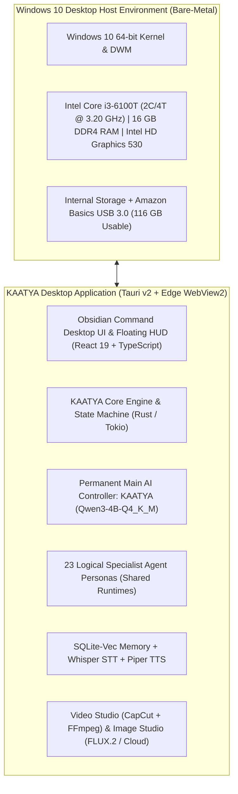
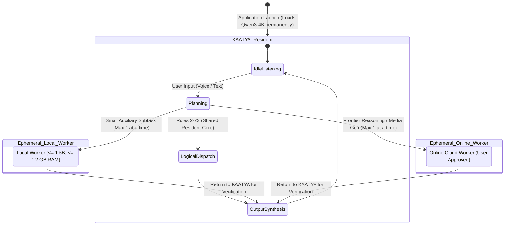

# KAATYA: Final Master Software Architecture Blueprint
## Premium Windows 10 Desktop AI Assistant Application

---

## 1. Project Identity, Scope & Sovereign Operational Boundary

**KAATYA** is a premium, local-first intelligent Windows desktop AI assistant application built to run natively on **Windows 10 64-bit**.



### 1.1 Non-Negotiable Boundaries: What KAATYA Is and Is NOT
- **What KAATYA IS:** A sophisticated desktop assistant application providing local language intelligence, specialist sub-agent delegation, safe PC automation, voice interaction, persistent semantic memory, and multimodal media workflows (image concepts and video editing).
- **What KAATYA IS NOT:**
  - **NOT an Operating System:** KAATYA does not replace Windows 10, install a custom kernel, modify bootloaders, or bypass OS security.
  - **NOT a Gameplay Bot:** The "Game Helper" agent provides read-only strategy lookups, keybinding reminders, and walkthrough hints. It never injects game memory or automates gameplay actions.
  - **NOT a Linux Distribution or Virtual Machine:** It runs as a lightweight native Windows executable (`.exe`).

---

## 2. Hardware Resource Constraints & Authoritative Profile

Every architectural decision, model deployment, and memory allocation in KAATYA is calibrated strictly to the physical hardware profile of the target machine:

| Hardware Component | Authoritative Specification | Architectural Implication |
| :--- | :--- | :--- |
| **Processor** | Intel Core i3-6100T (6th-Gen Skylake, 35W TDP, 3.20 GHz) | 2 Physical Cores, 4 Logical Threads. AVX2 supported. No AVX-512. |
| **System Memory** | **16.0 GB DDR4** (Two 8 GB Samsung DIMMs in `ChannelA-DIMM0` and `ChannelB-DIMM0`; Rated DDR4-2666, Configured at 2133 MT/s via WMI `ConfiguredClockSpeed = 2133`, active dual-channel mode unverified) | **VERIFIED 16 GB INSTALLED.** 16,384 MiB installed, 16,260.05 MiB OS-visible (`ullTotalPhys`), ~124 MiB hardware-reserved. Theoretical max bandwidth: 34.13 GB/s (Intel spec 34.1 GB/s). Projected base commit ~6,788 MiB; live available RAM ~7,030 MiB. |
| **Graphics Adapter** | Integrated Intel HD Graphics 530 (Shared system RAM) | **No dedicated VRAM.** Zero CUDA support. Compute relies on CPU SIMD / OpenCL. |
| **Operating System** | Windows 10 Pro / Home 64-bit | Baseline OS and desktop services require **~3,100 MB RAM**. |
| **External Storage** | Amazon Basics USB 3.0 Pendrive (~116 GB usable capacity) | High-capacity secondary repository for media scratch files and model backups. |

---

## 3. KAATYA Central Controller & The Permanent-Residency Invariant

The central AI is officially designated **KAATYA**.

### 3.1 Designated Permanent Main AI Model
- **File:** `T:\ai creation\Qwen3-4B-Q4_K_M.gguf` (2,497,280,256 bytes / ~2.33 GiB).
- **Architecture:** `qwen3` (36 layers, 2,560 embedding, 32 attention heads, 8 KV heads).
- **Active Working Footprint:** **~3,100 MB RAM** (with 4,096 context window).

### 3.2 Permanent-Residency Invariant & Windows Memory Realities
> **Application-Level Residency Invariant:**
> The KAATYA runtime will **NEVER** issue an unload, unmap, or destruction call on the Main AI instance (`Qwen3-4B-Q4_K_M.gguf`) during its application lifecycle. The Main AI context and model pointers remain permanently referenced in the host process.

#### Distinguishing Application Guarantees vs. Windows Operating System Behavior:
1. **Application-Level Model Residency:** The KAATYA runtime guarantees that no worker model or user action will cause the Main AI to be evicted or deallocated by the application.
2. **Memory Mapping (`mmap`):** Weights are mapped via Win32 `CreateFileMapping` / `MapViewOfFile`. Active weight pages reside in the process working set.
3. **Windows Working-Set Management & Pagefile:** The Windows Virtual Memory Manager (VMM) ultimately manages physical RAM pages. While KAATYA sets its process priority to `ABOVE_NORMAL_PRIORITY_CLASS` and optimizes working set quotas (`SetProcessWorkingSetSizeEx`), under severe external OS memory pressure (e.g. user opening heavy external applications), Windows may trim process working sets or page virtual memory to `pagefile.sys`.
4. **What KAATYA Guarantees:** KAATYA guarantees it will never intentionally unload Main AI to load a worker, and enforces pre-flight physical memory checks (`GlobalMemoryStatusEx`) before spawning any worker to prevent triggering OS-level paging.

### 3.3 Core Responsibilities of KAATYA
1. Default user-facing conversational interface across all 15 desktop screens and the Floating AI HUD.
2. Central task planner, orchestrator, and prioritizer.
3. Supervisor of all 22 specialist agents.
4. Human-in-the-loop permission gateway (enforcing Tier 1, 2, and 3 security gates).
5. Output validator: reviews, corrects, and synthesizes specialist outputs before presenting them to the user.
6. Communicates failure reasons and hardware limitations transparently to the user.

---

## 4. Strict Concurrency Upper Bounds & Resource Budget



### 4.1 Memory Allocation Analysis & Hardware Realities (16.0 GB Physical Budget)

The target machine possesses **16.0 GB Physical RAM** ($16,384\text{ MiB}$ binary installed across two 8 GB Samsung DIMMs in `ChannelA-DIMM0` and `ChannelB-DIMM0`, rated at 2,666 MT/s, configured operating speed 2,133 MT/s via WMI `ConfiguredClockSpeed = 2133`, active dual-channel mode unverified / $16,260.05\text{ MiB}$ Windows-visible `ullTotalPhys` / $17.05\text{ GB}$ decimal).

#### Critical Architecture Principles:
1. **Model File Size $\neq$ Memory Footprint:**
   A 2.50 GB GGUF model file does not consume merely 2.50 GB of RAM. The true process working set comprises:
   - Memory-mapped weights: ~2,382 MiB (2,497,280,256 bytes)
   - KV Cache (4,096 context, FP16): $2 \times 36\text{ layers} \times 8\text{ KV heads} \times 128\text{ head\_dim} \times 4096\text{ tokens} \times 2\text{ bytes} = \mathbf{576.0\text{ MiB}}$ ($73,728\text{ elements/token}$; or $\mathbf{306.0\text{ MiB}}$ with Q8_0 KV quantization, $\mathbf{288.0\text{ MiB}}$ at 2,048 tokens FP16).
   - Compute scratch buffers (`ggml_gallocr`) & runtime context: ~180 MiB.
   - **Total Active Main AI Process Working Set:** **~3,138 MiB (~3.29 GB)** (or ~2,868 MiB with Q8_0 KV quantization).
2. **Intel HD Graphics 530 Dynamic Shared Memory:**
   Intel HD 530 uses Dynamic Video Memory Technology (DVMT). It has **0 dedicated VRAM** and dynamically allocates memory from system RAM on demand (typically ~100–180 MB working set for idle 2D desktop compositing and WebView2 rendering; measured installed-vs-visible RAM difference is 123.95 MiB, exact reservation breakdown unverified).
3. **Realistic Application & WebView2 Working Sets:**
   Tauri v2 host binary + Microsoft Edge WebView2 (browser engine, render process, GPU compositor) consumes ~180–250 MiB under realistic multi-screen rendering.
4. **Main AI Memory Residency Behavior:**
   KAATYA application runtime policy mandates that Main AI is never intentionally evicted or unloaded during normal execution. However, the Windows Memory Manager (`ntoskrnl.exe`) may still page virtual memory pages to `pagefile.sys` under severe host memory pressure; actual physical residency and paging behavior require runtime validation under load during Phase 4.

#### Memory Budget Breakdown (Binary MiB & Decimal GB):

$$\begin{aligned}
\text{Total Visible Physical Memory (ullTotalPhys)} &= 16,260.05\text{ MiB} \quad (15.88\text{ GiB} \text{ / } 17.05\text{ GB}) \\
\text{Windows 10 Base OS + DWM + System Services} &\approx 2,900\text{ MiB} \quad (~3.04\text{ GB}) \\
\text{Intel HD 530 Dynamic Shared Memory (Idle UI)} &\approx 150\text{ MiB} \quad (~0.16\text{ GB}) \\
\text{Tauri v2 Shell + Microsoft WebView2 Engine} &\approx 220\text{ MiB} \quad (~0.23\text{ GB}) \\
\text{Audio Subsystem (PortAudio + Piper Dual ONNX + Whisper)} &\approx 300\text{ MiB} \quad (~0.31\text{ GB}) \\
\text{Local Store (SQLite + sqlite-vec Cache)} &\approx 80\text{ MiB} \quad (~0.08\text{ GB}) \\
\text{KAATYA Permanent Main AI (Qwen3-4B @ 4K FP16 KV)} &\approx \mathbf{3,138\text{ MiB}} \quad (\mathbf{~3.29\text{ GB}}) \\
\hline
\mathbf{Total\ Base\ Projected\ Baseline} &\approx \mathbf{6,788\text{ MiB}} \quad (\mathbf{~7.12\text{ GB}}) \\
\text{Theoretical Idle Margin (Visible minus Baseline)} &\approx 9,472.05\text{ MiB} \quad (~9.25\text{ GiB} \text{ / } ~9.93\text{ GB}) \\
\mathbf{Live\ Measured\ Available\ Physical\ RAM\ (ullAvailPhys)} &= \mathbf{7,030.07\text{ MiB}} \quad (\mathbf{~6.87\text{ GiB}})
\end{aligned}$$

*(Critical Distinction: $9,472.05\text{ MiB}$ is a theoretical calculation of uncommitted margin assuming an idle OS with Main AI resident. It is NOT measured available RAM. The actual live available RAM measured via `GlobalMemoryStatusEx.ullAvailPhys` is **$7,030.07\text{ MiB}$** ($7,371,558,912\text{ bytes} / 1,048,576 = 7,030.07\text{ MiB}$) at initial capture and fluctuates dynamically with host workload. In Windows memory architecture, `ullAvailPhys` includes Free, Zeroed, and Standby pages. Physical RAM not currently reported as available is $16,260.05 - 7,030.07 = \mathbf{9,229.98\text{ MiB}}$. This non-available physical RAM consists of active process working sets (which includes active user applications and the `Memory Compression` process working set, observed at 1,160,495,104 bytes / ~1,106.73 MiB as an element of active working sets, NOT an additive quantity), modified pages, and locked kernel memory [non-paged pool], resident paged pool; standby pages are NOT part of this non-available quantity. The ~2,442 MiB difference between the 6,788 MiB baseline and the 9,230 MiB host load is partially explained by active developer software [Chrome ~2.8 GB, Antigravity IDE ~1.2 GB], Windows Memory Compression [`MemCompression` ~1,106.73 MiB, managed by the Windows Memory Manager `ntoskrnl.exe`], and kernel pools [~1.23 GB], while KAATYA Main AI is not yet loaded. Note that physical RAM not reported as available does NOT equal the arithmetic sum of process working sets due to shared pages and kernel memory, and component reconciliation cannot be claimed without independent, non-overlapping measurements).*

#### Required Itemized Memory Accounting Table

| Component | Footprint (MiB) | Evidence Classification | Notes |
| :--- | ---:| :--- | :--- |
| **Windows Base OS & Services** | ~2,900 MiB | PROVISIONAL ESTIMATE | Windows 10 x64 kernel, DWM, background services (idle clean boot) |
| **Dynamic GPU Shared Memory** | ~150 MiB | PROVISIONAL ESTIMATE | Intel HD 530 DVMT dynamic UI allocation (idle 2D surface) |
| **KAATYA Desktop Shell** | ~220 MiB | PROVISIONAL ESTIMATE | Tauri v2 host binary + Edge WebView2 (unimplemented) |
| **Audio Subsystem** | ~300 MiB | PROVISIONAL ESTIMATE | PortAudio stream, Piper dual ONNX, Whisper buffer (unimplemented) |
| **Database Store** | ~80 MiB | PROVISIONAL ESTIMATE | SQLite 3 engine and `sqlite-vec` cache (unimplemented) |
| **KAATYA Main AI** | ~3,138 MiB | THEORETICAL CALCULATION | `Qwen3-4B-Q4_K_M` weights (2,382 MiB) + 4K FP16 KV (576 MiB) + graph/scratch (180 MiB) |
| **Total Projected Baseline** | **~6,788 MiB** | **PROJECTED ESTIMATE** | **Sum of projected components — NOT AN OBSERVED RUNNING SYSTEM** |
| **Live Host Visible RAM** | **16,260.05 MiB** | **EMPIRICALLY MEASURED** | Win32 API `GlobalMemoryStatusEx.ullTotalPhys` |
| **Live Host Available RAM** | **7,030.07 MiB** | **EMPIRICALLY MEASURED** | Win32 API `GlobalMemoryStatusEx.ullAvailPhys` (Includes Free, Zeroed, Standby pages) |
| **Live Host Commit Charge** | **12,020.82 MiB** | **EMPIRICALLY MEASURED** | Win32 API `ullTotalPageFile - ullAvailPageFile` (Virtual commit across all apps; NOT physical RAM consumed) |

### 4.2 Dynamic Worker Admission Procedure
Rather than enforcing an unsupported static safety-cushion formula, KAATYA executes a deterministic **10-Step Dynamic Worker Admission Procedure** before starting any optional specialist worker:
1. **Query Available Memory:** Query Win32 `GlobalMemoryStatusEx` for current `ullAvailPhys`.
2. **Initial Rejection Floor:** If `ullAvailPhys < 2,048\text{ MiB}`, reject immediately as an unsafe operating floor (passing this floor is an initial gate, not proof of safety).
3. **Identify Worker Model:** Determine the requested model file and target task.
4. **Estimate Weight Residency:** Compute resident weight footprint from quantized tensor size.
5. **Estimate Context & KV-Cache:** Calculate required KV cache based on target context length ($N$) and precision.
6. **Estimate Compute Buffers:** Calculate forward graph scratch buffer demand (`ggml_gallocr`).
7. **Audit Main AI Observed Footprint:** Confirm Main AI working set remains intact and un-evicted.
8. **Factor System Memory Pressure:** Read active system memory load percentage (`dwMemoryLoad`).
9. **Apply Configurable Test Margin:** Apply a dynamic safety margin derived from empirical testing.
10. **Log & Enforce Decision:** If total projected demand exceeds `ullAvailPhys`, reject or defer worker loading, log the diagnostic reason in `.assistant/logs/scheduler.log`, and route the task to the resident Main AI or cloud fallback.

---

## 5. Summary of the 23 Logical Agent Roster

KAATYA orchestrates **23 logical specialist agent roles** (1 permanent Main AI + 22 specialist capabilities). All specialist agents execute using shared model runtimes and tool bindings:

```
1.  KAATYA Main AI      -> Central controller, conversational interface, task planner, permission gate.
2.  Coder               -> Application development, code generation, refactoring, bug fixes.
3.  Designer            -> UI/UX design, Tailwind layout auditing, Obsidian Command compliance.
4.  Researcher          -> Document indexing, local knowledge synthesis, authorized web queries.
5.  Writer              -> Documentation, technical reports, manuals, release notes.
6.  Messenger           -> Drafting communications, notifications (Mandatory human approval to send).
7.  File Manager        -> Scoped filesystem navigation, pre-edit backups, archiving (Deletion confirmed).
8.  Game Helper         -> Strategy hints, keybinding references, walkthrough lookups (READ-ONLY; NO gameplay automation bots).
9.  Tester              -> Test case generation, test execution, coverage inspection.
10. 3D Artist           -> Blender scripting, 3D file metadata inspection, 2D/2.5D canvas tuning.
11. Automator           -> Scheduled automation, routine developer workflows.
12. Security            -> Permission enforcement, shell AST inspection, path blacklisting.
13. Data Analyst        -> SQLite queries, CSV data formatting, deterministic statistics via Python/pandas/sqlite (never pure LLM token math).
14. Code Reviewer       -> Static code analysis, syntax checking, diff validation.
15. Assistant           -> Quick notes, to-dos, calendar reminders, everyday productivity.
16. Video Editor        -> Complete video production: multi-editor interchange, FFmpeg CLI processing, Whisper subtitles.
17. Image Studio        -> Image generation workflows (FLUX.2 Klein 4B DiT / Cloud Diffusion Gate).
18. Grammar & Language  -> Grammar correction, spelling, translation, proofreading (Benchmark-dependent between SmolLM2-1.7B and Qwen3-1.7B).
19. Social Media        -> Social media post drafting, YouTube/Instagram captions, hashtags.
20. Audio & Voice       -> Voice cloning prep, audio enhancement, transcription formatting.
21. Presentation        -> Slide deck structure planning, outline generation, markdown presentation decks.
22. Document Intel      -> PDF text extraction, invoice parsing, Word/Excel processing.
23. Database Engineer   -> SQL schema design, migrations, query optimization, database backups.
```

---

## 6. Multimodal Architecture: Video Studio & Image Studio

### 6.1 Video Studio Architecture
- **Primary Workhorse (FFmpeg CLI):** Deterministic, headless execution via supervised child processes. Trimming, concatenating, loudness normalization (EBU R128), and hardcoded/soft Whisper subtitle burn-in.
- **Multi-Editor Support:** Supports industry-standard interchange formats (Final Cut Pro / Premiere XML, Edit Decision List `.edl`, OpenTimelineIO `.otio`, and `.srt`/`.ass` subtitle tracks) enabling seamless workflows across DaVinci Resolve, Adobe Premiere, Shotcut, Kdenlive, and CapCut.
- **CapCut Desktop Integration:**
  1. *Supported:* External media export and standard subtitle track import.
  2. *Visible UI Automation:* Accessible desktop automation via Windows UIAutomation (`UIAutomationCore.dll`) for hands-free timeline loading.
  3. *Experimental:* Internal draft project generation (`%LOCALAPPDATA%\CapCut\User Data\Projects\com.lveditor.draft\kaatya_test_*`). This internal schema is treated as strictly experimental, tested only on isolated disposable folders, and **never overwrites existing user projects**.
- **Local Video Diffusion Feasibility:**
  - Video diffusion models (e.g., Wan 2.1 T2V 1.3B, LTX-Video 2B) require dedicated high-throughput tensor cores and 8–16+ GB dedicated high-bandwidth VRAM.
  - On the target Intel Core i3-6100T (2 cores, 4 threads, Intel HD 530 with dynamic shared RAM and 0 dedicated VRAM, 16 GB DDR4 system RAM), local text-to-video diffusion is classified as **Impractical on target hardware / Unsupported by local realtime runtime** (generation latency measured in hours per 5s clip and memory bus bottlenecked).
  - The Video Studio does **NOT** rely on local video diffusion: it produces complete, broadcast-ready videos through script generation, Piper TTS voiceovers, Whisper subtitles, user footage, and programmatic FFmpeg composition. When generative video clips are required, KAATYA routes to an **authorized Online Video Provider** (Runway, Luma, Kling) with explicit human confirmation.

### 6.2 Image Studio Architecture
- **Local Model Identity:** `flux-2-klein-4b-q4_0.gguf` (2.26 GB / 2,256,889,280 bytes). Empirical tensor audit proves it is a standalone Diffusion Transformer (DiT) backbone (149 tensors, 0 KV metadata). All 149 tensor headers have been audited: 83 tensors of standard `Q4_0` (raw numeric type ID 2, 0.5625 bytes/element) and 66 tensors of `BF16` (raw numeric type ID 30, 2.0 bytes/element). Zero `Q4_0_4_4` tensors exist in the file. Input projection `txt_in.weight` is stored unquantized in `BF16` ($47,185,920\text{ bytes}$). CPU AVX2 support alone does not establish inference compatibility without dedicated runtime kernel implementations; runtime compatibility in `sd.cpp` or `ComfyUI-GGUF` remains unverified.
- **Actual FLUX.2 Klein Pipeline Dependencies:**
  - Unlike older FLUX.1 models, FLUX.2 Klein does **NOT** use CLIP-L or T5-XXL.
  - The tensor `txt_in.weight` has an observed shape of `(7680, 3072)`. A community hypothesis proposes that this 7,680-dimension corresponds to three concatenated hidden layers (9, 18, and 27) of a Qwen3 model ($3 \times 2,560 = 7,680$). However, without architecture metadata in the container or upstream documentation, this remains an unproven theoretical conjecture, NOT a confirmed three-part conditioning implementation. Earlier references to 7860 were typos.
  - Required VAE: `flux2-vae.safetensors` (~335 MiB).
  - Required Tokenizer: Qwen3 tokenizer with `<|im_start|>` chat template formatting.
- **Can the Resident Main AI (`Qwen3-4B`) be Reused as Text Encoder?**
  - While architectural weights overlap, reusing the resident Main AI instance introduces severe runtime hurdles:
    1. Standard `llama.cpp` inference evaluates next-token logits and discards intermediate layer activations; intermediate feature extraction requires custom C-API hook branches.
    2. Quantization: `Q4_K_M` quantization in Main AI degrades conditioning embeddings compared to FP8/BF16.
    3. Concurrency Lock: Reusing the resident instance for feature extraction disrupts or blocks ongoing conversational dialogue and KV-caching.
- **Memory Feasibility on 16 GB Hardware:**
  - With 16 GB installed RAM (16,260 MiB Windows-visible), the uncommitted memory headroom above baseline (~6,788 MiB) is ~9,472 MiB.
  - FLUX DiT worker (~3,100 MiB) + VAE decode (~635 MiB) physically fit alongside Windows and permanent Main AI without violating the permanent residency policy.
  - However, because generation latency on CPU-only AVX2 is estimated at 45–90 seconds per step (15–30 minutes total for 20 steps), and no unified C++ pipeline exists yet, FLUX.2 Klein execution remains strictly classified as **EXPERIMENTAL / RESEARCH PROTOTYPE (CPU-Only)**.
- **Hardware & Runtime Strategy:**
  - Local FLUX generation remains **EXPERIMENTAL** pending real hardware benchmarking. Companion encoders will not be fetched until compatible runtimes (e.g. ComfyUI-GGUF or stable-diffusion.cpp FLUX.2 Klein branches) are validated.
  - Primary production path: **Online Cloud Diffusion Gate** (OpenAI DALL-E 3, Stability AI, Fal.ai) with strict per-generation approval.

---

## 7. Online AI Provider Integration & User Consent Policy

- **Default State:** **Online Mode is DISABLED by default** (Air-Gap compliance).
- **Per-Generation Approval:** Before any prompt or media is transmitted to an online provider, a modal displays:
  - Exact target provider and model.
  - Prompt text and attached file names.
  - Estimated API cost.
  - Require explicit click on `"Authorize Transmission"`.
- **Credential Storage:** All API keys encrypted via Windows Data Protection API (DPAPI). Zero plaintext keys.

---

## 8. Preserving the Google Stitch Obsidian Command UI

The application shell preserves **100% of the approved 15 Google Stitch screens** and the Obsidian Command design system:
- High-density `#070B14` canvas, `#43D9FF` local accent, `#367BFF` system accent.
- All 23 agents integrate into Screen 06 (Agent Workspace) and Screen 01 (Command Center).
- Video Studio and Image Studio integrate directly into existing studio panels and PC Control tools without fragmenting the UI.
- Neural Core (Screen 03) renders in lightweight 2D/2.5D Canvas (`GL_LOWRES`), protecting the Intel HD 530 GPU.

---

## 9. Definitive Technology Stack

### Status: APPROVED PROPOSED ARCHITECTURE — IMPLEMENTATION NOT STARTED

To ensure complete architectural consistency across all documents, the core technology stack is formally unified:
- **Desktop Application Shell:** **Tauri v2** (Native backend: Rust host process, memory footprint ~25–40 MiB).
- **Frontend Presentation Layer:** **React 19, TypeScript and Tailwind CSS** running inside the native Windows **Microsoft Edge WebView2** runtime (~180–220 MiB working set).
- **Local LLM Inference Engine:** Native **`llama.cpp` AVX2 backend** linked via direct C-FFI bindings into the Rust core.
- **Audio Subsystem:** **Whisper.cpp** (`ggml-base.bin`) for speech-to-text + **Piper ONNX** (via ONNX Runtime CPU) for speech synthesis.
- **Local Storage & Vector Retrieval:** Embedded **SQLite 3** engine with optional **`sqlite-vec` extension** for sub-millisecond local vector retrieval.
- **Operating System Platform:** Strictly hosted on **Windows 10 64-bit**.
