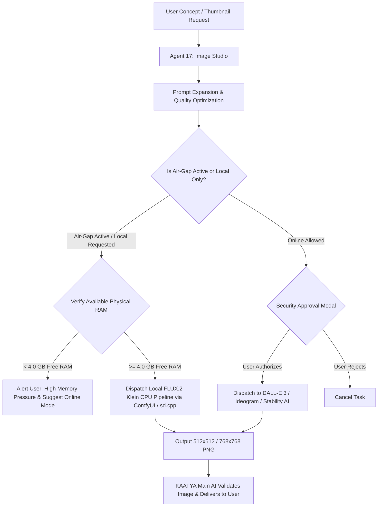

# KAATYA: Image Generation Architecture & Production Pipeline

## 1. Executive Summary: Hybrid Local & Cloud Image Generation

The **KAATYA Image Studio** (Agent 17) provides visual concept generation, graphic design assets, and video thumbnail creation through a realistic hybrid architecture:
1. **Local Offline Engine (Experimental / Resource-Gated):** Leverages `flux-2-klein-4b-q4_0.gguf` on CPU for air-gapped environments.
2. **Authorized Online Providers (Production Fast Path):** Connects to leading image generation APIs (OpenAI DALL-E 3, Stability AI, Ideogram) with mandatory per-generation approval.

---

## 2. Technical Audit of Local Model: FLUX.2 Klein 4B

### 2.1 Binary Metadata & Architectural Inspection
- **File Name:** `flux-2-klein-4b-q4_0.gguf`
- **File Location:** `T:\ai creation\flux-2-klein-4b-q4_0.gguf`
- **File Size:** 2,256,889,280 bytes (2.102 GiB / 2.257 GB)
- **SHA-256 Checksum:** `9c5939d564fa7454261d7a8e7e1cb5bf4d27192667ae967a5b39414da8846c10`
- **GGUF Structure:** Version 3, 149 tensors, **0 KV metadata entries**.
- **Tensors Present:** Exclusively the Diffusion Transformer (DiT) weights: 5 double blocks (`double_blocks.0` through `double_blocks.4`) and 20 single blocks (`single_blocks.0` through `single_blocks.19`), plus input/output modulations and `txt_in.weight` `[7680, 3072]`.

### 2.2 True FLUX.2 Klein Pipeline Dependencies
Earlier audit references erroneously listed legacy FLUX.1 assets (`clip_l.safetensors` and `t5xxl_fp8`). FLUX.2 Klein departs fundamentally from the dual CLIP/T5 scheme:

- **Variant Disambiguation (Distilled vs. Base):**
  - **FLUX.2 Klein Distilled:** 4-step workflow designed for accelerated diffusion distillation.
  - **FLUX.2 Klein Base:** Standard 50-step iterative denoising workflow.
  - *Local GGUF File:* `flux-2-klein-4b-q4_0.gguf` (2,256,889,280 bytes / 2.102 GiB) represents the 4B Diffusion Transformer (DiT) weights. While the filename suggests a Klein distilled variant, model architecture and metadata alone do not prove step-budget tuning without empirical execution.

| Pipeline Component | Actual Required Asset | Architecture Details | Status in `T:\ai creation` |
| :--- | :--- | :--- | :---: |
| **Diffusion Backbone (DiT)** | `flux-2-klein-4b-q4_0.gguf` | 4B DiT backbone, Q4_0 quant, 149 tensors | **CONFIRMED PRESENT** |
| **Text Encoder** | Qwen3 Language Model Feature Extractor | Extracts intermediate layers 9, 18, and 27 ($2560 \times 3 = 7,680$ dims) | **ABSENT AS COMPANION FILE** |
| **Variational Autoencoder** | `flux2-vae.safetensors` | FLUX.2 Latent Autoencoder (16-channel) | **ABSENT** |
| **Tokenizer & Template** | Qwen3 Tokenizer | Structured `<|im_start|>` chat template formatting | Bundled with Qwen3 runtime |

### 2.3 Evaluation: Can Resident `Qwen3-4B-Q4_K_M.gguf` Serve as the Text Encoder?
The local disk already holds `Qwen3-4B-Q4_K_M.gguf`. Could this file double as the FLUX text encoder to avoid downloading another 3–5 GB asset?
- **Architectural Overlap:** Qwen3-4B contains the necessary attention blocks and layers 9, 18, and 27.
- **Critical Technical Limitations:**
  1. **Logit Evaluation vs. Layer Extraction:** Standard `llama.cpp` inference processes tokens forward to generate logits, discarding intermediate hidden states to optimize cache memory. Harvesting concatenated hidden vectors from layers 9, 18, and 27 requires custom C-API forward hooks not present in stock runtime builds.
  2. **Empirical Boundary:** A matching tensor dimension `(7680, 3072)` alone is **NOT** proof of compatible conditioning. Reusing `Qwen3-4B` cannot be claimed as viable until an actual extraction test proves:
     - Correct tokenization matching FLUX prompt formatting.
     - Correct Qwen3 model weights and architecture.
     - Correct extraction of hidden states from layers 9, 18, and 27.
     - Correct normalization (RMSNorm) and tensor layout matching DiT expectations.
     - Valid, non-degraded conditioning output.
     - Acceptable memory usage during forward extraction.
     - Main AI remains continuously loaded, un-evicted, and available according to approved residency invariants.
  3. **Quantization Noise in Conditioning Vectors:** `Qwen3-4B-Q4_K_M` uses medium 4-bit block quantization. Quantization noise in continuous text embedding spaces degrades spatial prompt adherence compared to FP8 or BF16 encodings.
  4. **Concurrency Conflict:** The Main AI is permanently resident with an active conversational KV-cache. Running feature extraction through the same instance would block the user's conversational interface or require initializing a second memory context (~500 MB RAM).

### 2.4 Compatible Runtimes: ComfyUI-GGUF vs. stable-diffusion.cpp
- **ComfyUI-GGUF:** Supports loading GGUF DiT backbones via `UnetLoaderGGUF`. However, it requires running a Python/PyTorch server (~800 MB baseline) and specialized FLUX.2 loader nodes for the Qwen text encoder and `flux2-vae`.
- **stable-diffusion.cpp (`sd.cpp`):** Lightweight C++ implementation without Python overhead. However, native support for the FLUX.2 Klein multi-layer Qwen3 extraction pipeline is currently experimental and unverified on Windows AVX2.

### 2.5 Hardware Execution Reality on Intel Core i3-6100T (16.0 GB RAM)
- **No Dedicated GPU / No CUDA:** Compute executes entirely across CPU threads via AVX2 (Intel HD 530 has dynamic shared memory with 0 dedicated VRAM and 0 CUDA cores). Memory controller operates at DDR4-2133 MT/s with max theoretical bandwidth of 34.13 GB/s (Intel spec 34.1 GB/s).
- **Execution Latency:** **[UNVERIFIED THEORETICAL ESTIMATE]** Projected at 45–90 seconds per Euler step on 2 CPU cores. For a 4-step distilled workflow, this yields ~3–6 minutes; for a 20-step workflow, ~15–30 minutes. No physical diffusion benchmark has been captured on this PC.
- **Memory Footprint & Admission Analysis:**
  - `flux-2-klein-4b-q4_0.gguf` DiT backbone weights and `txt_in.weight` shape `(7680, 3072)` are verified via `tools/inspect_model_metadata.py` (Exit code 0).
  - Under live host telemetry, available physical RAM is **$7,030.07\text{ MiB}$** ($7,371,558,912\text{ bytes}$). With provisional dynamic safety margin $S_{\text{dynamic}} \approx 2,151\text{ MiB}$, the provisional admissible worker budget is $\approx \mathbf{4,879.07\text{ MiB}}$.
  - The dedicated encoder route (~5,200 to 6,100 MiB peak) exceeds the 4,879 MiB budget and is **REJECTED** by the dynamic worker admission controller.
  - The Main AI extraction route (~3,737 to 4,335 MiB peak with VAE decode scratch buffers) theoretically fits within the arithmetic budget, BUT standard `llama.cpp` evaluates tokens forward to produce output logits and discards intermediate layer hidden states. Reusing `Qwen3-4B` requires custom C++ runtime patches to capture intermediate activations from layers 9, 18, and 27 before memory reclamation.
  - VAE decoding intermediate tensors (expanding 16-channel $64 \times 64$ latent grid to $512 \times 512 \times 3$ RGB) creates significant transient memory spikes.
- **Architectural Directive:**
  - **Local FLUX generation is classified as EXPERIMENTAL — END-TO-END COMPATIBILITY AND PERFORMANCE UNPROVEN ON TARGET PC.**
  - Because of extreme CPU generation latency, absence of companion files, and lack of a validated C++ pipeline exposing Qwen3 multi-layer extraction into GGUF DiT sampling on CPU, local generation is not proven to fit or perform.
  - **Do NOT download companion files** until an end-to-end runtime implementation is empirically tested and approved.
  - The production workflow relies on the **Authorized Online Diffusion Gate** (DALL-E 3, Stability AI, Fal.ai) with explicit human confirmation.

---

## 3. Status of Historical Image Model: Qwen Image 2.1

- **File Reference:** `qwen-image-2.1-step90000-Q4_K_M.gguf`
- **Audit Finding:** **CONFIRMED ABSENT.** This model does not exist on disk in `T:\ai creation`.
- **Architectural Action:** Removed from active inventory; preserved as an optional download target if the user later acquires it.

---

## 4. Online AI Image Provider Integration (Approval Required)

Because local diffusion on CPU is slow and memory-intensive, the Image Studio provides first-class support for authorized online providers.

### 4.1 Strict Approval Gate Before Every Generation
Before transmitting any request to an external provider:
1. **The Modal Displays:**
   - Target Provider (e.g., OpenAI DALL-E 3, Stability AI SD3, Ideogram v2).
   - Expanded Prompt (e.g., *"Futuristic desktop workstation, dark obsidian theme, electric cyan accents"*).
   - Target Aspect Ratio (1:1 Square, 16:9 Landscape, 9:16 Portrait).
   - Estimated Cost (e.g., `~$0.04 USD`).
2. **User Confirmation:** Requires an explicit click on `"Authorize Generation"`.
3. **Zero Covert Transmissions:** The application never generates images online silently.

### 4.2 Security & DPAPI Vault
- API keys are encrypted locally using Windows DPAPI (`CryptProtectData`).
- In-memory keys are scrubbed with `zeroize` immediately after HTTPS transmission.
- Generated images are downloaded directly into `.assistant/exports/images/` with full local metadata logging.
