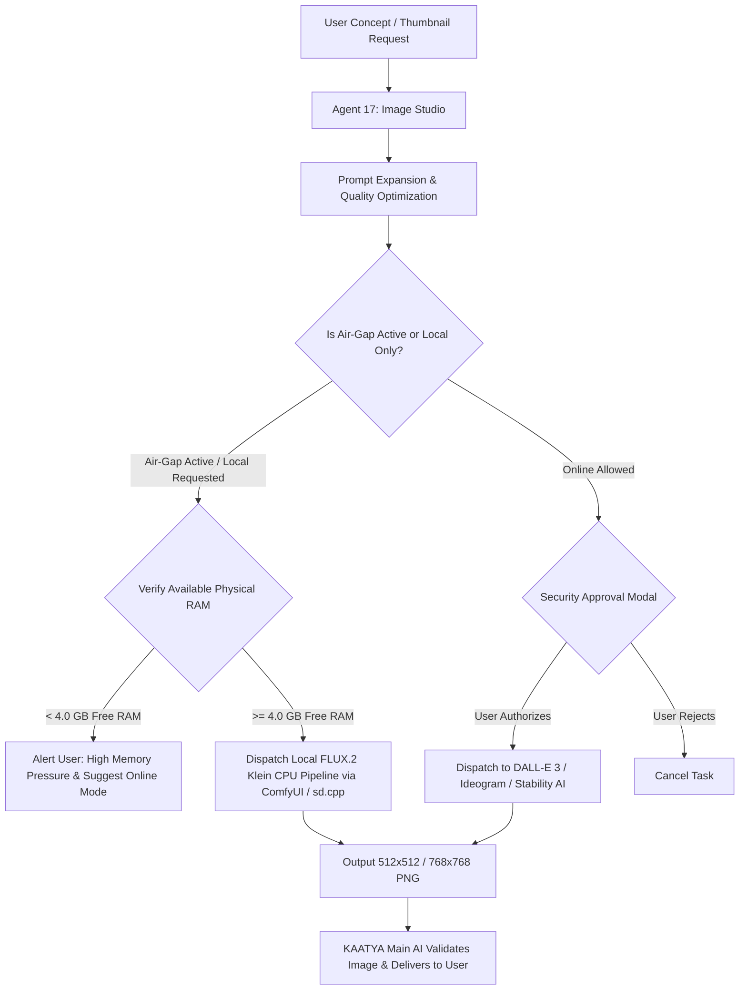

# KAATYA: Image Generation Architecture & Production Pipeline

## 1. Executive Summary: Hybrid Local & Cloud Image Generation

The **KAATYA Image Studio** (Agent 17) provides visual concept generation, graphic design assets, and video thumbnail creation through a realistic hybrid architecture:
1. **Local Offline Engine (Experimental / Resource-Gated):** Leverages `flux-2-klein-4b-q4_0.gguf` on CPU for air-gapped environments.
2. **Authorized Online Providers (Production Fast Path):** Connects to leading image generation APIs (OpenAI DALL-E 3, Stability AI, Ideogram) with mandatory per-generation approval.

---

## 2. Technical Audit of Local Model: FLUX.2 Klein 4B

### 2.1 Binary Metadata Verification
- **File Name:** `flux-2-klein-4b-q4_0.gguf`
- **File Location:** `T:\ai creation\flux-2-klein-4b-q4_0.gguf`
- **File Size:** 2,256,889,280 bytes (2.10 GiB / 2.26 GB)
- **SHA-256 Checksum:** `9c5939d55e3ac76e3a700029770fcc5e1b873d12c2a6d22c6c3fec217488e718`
- **GGUF Structure:** Version 3, 149 tensors, 0 KV metadata entries.
- **Tensors Present:** Exclusively the Diffusion Transformer (DiT) residual blocks (`double_blocks.0.*` through `single_blocks.37.*`).

### 2.2 Required Companion Components (Not in the Single GGUF)
To generate an image locally, the DiT weights cannot function alone. The pipeline requires:

| Pipeline Component | Recommended Asset | Disk Size | RAM Footprint | Status in `T:\ai creation` |
| :--- | :--- | :---: | :---: | :---: |
| **Diffusion Backbone** | `flux-2-klein-4b-q4_0.gguf` | 2.26 GB | ~2.4 GB | **CONFIRMED PRESENT** |
| **Text Encoder 1** | `clip_l.safetensors` | 246 MB | ~280 MB | **ABSENT (Requires Companion Setup)** |
| **Text Encoder 2** | `t5xxl_q4_k.gguf` (Quantized T5-XXL) | ~2.5 GB | ~2.8 GB | **ABSENT (Requires Companion Setup)** |
| **Variational Autoencoder** | `ae.safetensors` (FLUX VAE) | 335 MB | ~380 MB | **ABSENT (Requires Companion Setup)** |
| **Latent Buffer & Workspace** | Dynamic PyTorch / C++ tensor buffers | N/A | ~1.5 GB | N/A |
| **TOTAL PIPELINE DEMAND** | Full Local FLUX Pipeline | **~5.34 GB** | **~7.36 GB RAM** | **Incomplete Local Toolchain** |

### 2.3 Hardware Execution Reality on Intel Core i3-6100T
- **No CUDA Cores:** The integrated Intel HD Graphics 530 has no CUDA cores and shares system RAM.
- **CPU Generation Speed:** Running 20 diffusion steps on a 2-core / 4-thread 35W CPU takes **[UNVERIFIED THEORETICAL ESTIMATE: 5 to 15 minutes per 512x512 image]**.
- **Memory Pressure:** Running the full FLUX pipeline (~7.36 GB RAM) alongside Windows 10 (~3.1 GB) and KAATYA Main AI (~3.1 GB) demands **~13.56 GB RAM**, exceeding the physical 12.0 GB limit.
- **Architectural Policy:** Local FLUX generation is supported as an **experimental offline capability**. When run locally, KAATYA enforces lightweight quantization, low resolution (512x512), and sequential offloading of T5-XXL before running DiT denoising.

---

## 3. Status of Historical Image Model: Qwen Image 2.1

- **File Reference:** `qwen-image-2.1-step90000-Q4_K_M.gguf`
- **Audit Finding:** **CONFIRMED ABSENT.** This model does not exist on disk in `T:\ai creation`.
- **Architectural Action:** Removed from active inventory; preserved as an optional download target if the user later acquires it.

---

## 4. Online AI Image Provider Integration (Approval Required)

Because local diffusion on CPU is slow and memory-intensive, the Image Studio provides first-class support for authorized online providers.

### 4.1 Strict Approval Gate Before Every Generation
Before transmitting any request to an external provider:
1. **The Modal Displays:**
   - Target Provider (e.g., OpenAI DALL-E 3, Stability AI SD3, Ideogram v2).
   - Expanded Prompt (e.g., *"Futuristic desktop workstation, dark obsidian theme, electric cyan accents"*).
   - Target Aspect Ratio (1:1 Square, 16:9 Landscape, 9:16 Portrait).
   - Estimated Cost (e.g., `~$0.04 USD`).
2. **User Confirmation:** Requires an explicit click on `"Authorize Generation"`.
3. **Zero Covert Transmissions:** The application never generates images online silently.

### 4.2 Security & DPAPI Vault
- API keys are encrypted locally using Windows DPAPI (`CryptProtectData`).
- In-memory keys are scrubbed with `zeroize` immediately after HTTPS transmission.
- Generated images are downloaded directly into `.assistant/exports/images/` with full local metadata logging.
