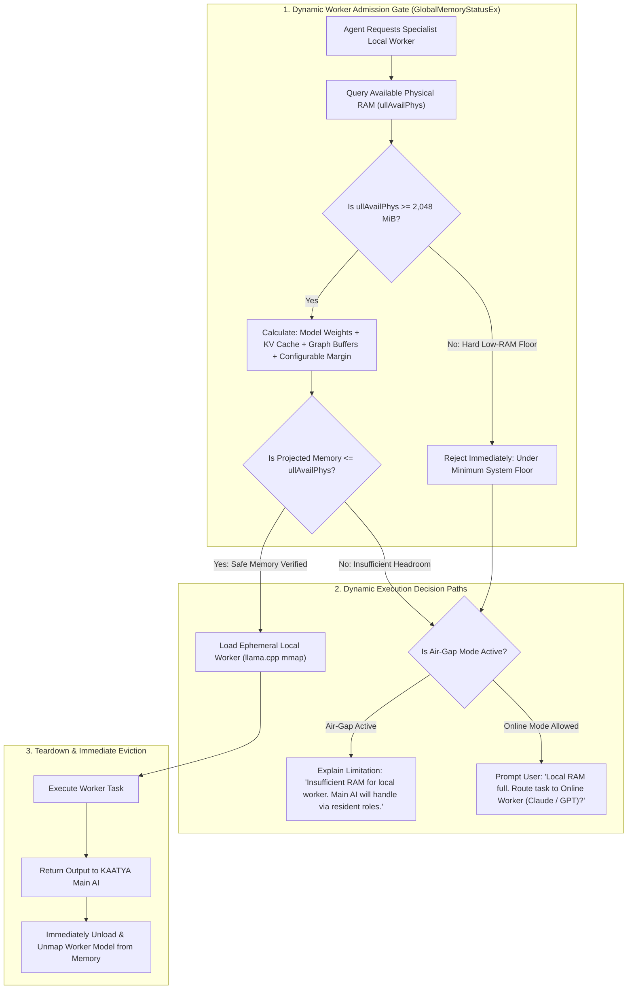

# KAATYA: Local Runtime & Dynamic Memory Execution Policy

## 1. Executive Memory Governance Framework

Operating a local-first AI assistant on an **Intel Core i3-6100T with 16.0 GB RAM (16,384 MiB installed / 16,260 MiB Windows-visible) and no dedicated GPU** requires a deterministic, hardware-enforced memory policy. 

Windows 10 physical memory is an unforgiving boundary: exceeding physical RAM triggers hard pagefile paging, dropping system throughput to $<0.5\text{ tok/s}$ and causing audio stutter and UI freezing.



---

## 2. The Strict Three-Tier Concurrency Rules

1. **Tier 0: Permanent Controller (KAATYA Main AI)**
   - Pinned in physical memory at application launch.
   - Resource allocation: **~3,100 MB RAM** (weights + 4,096 KV cache).
   - **Upper Bound: Exactly 1 permanent model.** Never unloaded, frozen, unmapped, or evicted under any circumstances.
2. **Tier 1: Ephemeral Local Worker (Specialist Helper)**
   - Spawned on demand for specialized sub-tasks (e.g., `Qwen2.5-Coder-1.5B` for coding or `SmolLM2-1.7B` for grammar).
   - Resource allocation: **$\le 1,400\text{ MB RAM}$**.
   - **Upper Bound: Maximum 0 or 1 active local worker.** Loaded, executed, and immediately evicted.
3. **Tier 2: Ephemeral Online Worker (Cloud API)**
   - Invoked via HTTPS when frontier reasoning, long context, or high-fidelity media generation is requested.
   - Resource allocation: **$\le 50\text{ MB RAM}$** (network buffers).
   - **Upper Bound: Maximum 0 or 1 active online request.** Requires explicit per-task user approval.

---

## 3. Dynamic Memory Budget & Hardware Scheduling Thresholds

### 3.1 Memory Math & Operating System Realities (16.0 GB Physical Budget)

The target machine possesses **16.0 GB physically installed Physical RAM** across two dual-channel Samsung DDR4-2666 modules:
- **Installed Physical Capacity:** $16\text{ GiB} = 16,384\text{ MiB} = 17,179,869,184\text{ bytes} \approx 17.18\text{ GB}$ decimal ($17,179,869,184 / 10^9$).
- **Hardware-Reserved Memory:** $129,970,176\text{ bytes} \approx 123.95\text{ MiB} \approx 124\text{ MiB}$ (~0.13 GB), reserved by BIOS, APIC/PCIe, and Intel HD Graphics 530 DVMT.
- **Windows-Visible Physical Memory (`ullTotalPhys`):** $17,049,899,008\text{ bytes} = 15.8790\text{ GiB} = 16,260.05\text{ MiB} \approx 17.05\text{ GB}$ decimal ($17,049,899,008 / 10^9$).
- **Mandatory Conversion Rules:**
  - $1\text{ GiB} = 1,024\text{ MiB} = 1,073,741,824\text{ bytes}$.
  - $1\text{ GB} = 1,000,000,000\text{ bytes}$.
  - $1\text{ MiB} = 1,048,576\text{ bytes}$.
  - *Never mix decimal GB with binary GiB in the same subtraction.*

#### Binary Calculation Against Windows-Visible Physical RAM (MiB & GiB):
$$\begin{aligned}
\text{Total Visible Physical Memory (ullTotalPhys)} &= 16,260\text{ MiB} \quad (15.88\text{ GiB} \text{ / } 17.05\text{ GB}) \\
\text{Provisional Base Working Set Commitment} &\approx 6,788\text{ MiB} \quad (~6.63\text{ GiB} \text{ / } ~7.12\text{ GB}) \\
\hline
\mathbf{Uncommitted\ Physical\ Memory\ Headroom} &\approx \mathbf{9,472\text{ MiB}} \quad (\mathbf{~9.25\text{ GiB}})
\end{aligned}$$

*(Note: In decimal conversion, the $9,472\text{ MiB}$ remainder equals $9,472 \times 1,048,576 / 10^9 \approx \mathbf{9.93\text{ GB}}$. Relative to gross installed memory ($16,384\text{ MiB}$), gross headroom is $16,384 - 6,788 = \mathbf{9,596\text{ MiB}} \approx \mathbf{9.37\text{ GiB}} \approx \mathbf{10.06\text{ GB}}$. In a hypothetical pure $16.00\text{ GB}$ decimal calculation with a $7.12\text{ GB}$ footprint, the remainder is $16.00 - 7.12 = \mathbf{8.88\text{ GB}}$, or $16.00 - 7.20 = \mathbf{8.80\text{ GB}}$ if baseline is rounded to one decimal place).*

### 3.2 Required Itemized Memory Accounting Table

| Component | Measured or Estimated (MiB) | Evidence Status | Notes |
| :--- | ---:| :--- | :--- |
| **Windows Base OS & Services** | ~2,900 MiB | PROVISIONAL ESTIMATE | Windows 10 x64 kernel, DWM, background services |
| **Dynamic GPU Shared Memory** | ~150 MiB | PROVISIONAL ESTIMATE | Intel HD 530 DVMT dynamic UI allocation (idle) |
| **KAATYA Desktop Shell** | ~220 MiB | PROVISIONAL ESTIMATE | Tauri v2 host binary + Edge WebView2 (15 screens) |
| **Audio Subsystem** | ~300 MiB | PROVISIONAL ESTIMATE | PortAudio stream, Piper dual ONNX, Whisper buffer |
| **Database Store** | ~80 MiB | PROVISIONAL ESTIMATE | SQLite 3 engine and `sqlite-vec` cache |
| **KAATYA Main AI** | ~3,138 MiB | PROVISIONAL ESTIMATE | `Qwen3-4B-Q4_K_M` weights + 4K FP16 KV cache + graph |
| **Other Active User Processes** | ~0 MiB | PROVISIONAL ESTIMATE | Variable third-party background load |
| **Total Observed Working Set** | **~6,788 MiB** | PROVISIONAL ESTIMATE | Sum of active baseline resident working sets (~6.63 GiB / ~7.12 GB) |
| **Available Physical Memory** | **~9,472 MiB** | PROVISIONAL ESTIMATE | Remaining from 16,260 MiB visible pool (~9.25 GiB / ~9.93 GB) |

### 3.3 Memory Concepts & Distinctions
1. **Installed Physical Memory:** 16.0 GB hardware module total across 2x8 GB Samsung DIMMs ($16,384\text{ MiB}$ binary / ~17.18 GB decimal).
2. **Hardware-Reserved Memory:** ~124 MiB ($129,970,176\text{ bytes}$) reserved by BIOS, system boards, and Intel HD 530 DVMT pre-allocation.
3. **OS-Visible Physical Memory:** Memory reported by Windows via `GlobalMemoryStatusEx` (`ullTotalPhys`: 17,049,899,008 bytes = 16,260 MiB).
4. **Available Physical Memory:** Memory available for allocation without paging (`ullAvailPhys`).
5. **Committed Memory:** Virtual address space allocations backed by RAM or pagefile (`ullTotalPageFile`).
6. **Process Working Set:** Physical RAM pages currently assigned to the active process.
7. **Private Working Set:** Memory allocated specifically to the process that cannot be shared.
8. **Memory-Mapped File Pages:** Clean file-backed pages (e.g., GGUF weights) that Windows Cache Manager can discard and reload without writing to `pagefile.sys`.
9. **Pagefile Usage:** Backing store on disk utilized when physical memory demands exceed available RAM.

---

## 4. Dynamic Worker Admission Policy (Replacing the Fixed 2.5 GB Rule)

The former static safety-buffer formula has been **permanently eliminated**. It is replaced by a deterministic **10-Step Dynamic Worker Admission Procedure**:

### 4.1 The 10-Step Dynamic Worker Admission Procedure
Before spawning any optional specialist local worker, the runtime executes:
1. **Query Available Memory:** Invoke Win32 `GlobalMemoryStatusEx` to obtain current `ullAvailPhys`.
2. **Initial Rejection Gate:** If `ullAvailPhys < 2,048\text{ MiB}`, reject immediately as an unsafe operating floor. *(Note: Passing this floor is a necessary initial condition, but NOT sufficient proof that a worker can load).*
3. **Identify Target Model:** Determine the exact specialist model file requested (e.g., `Qwen2.5-Coder-1.5B-Instruct-Q3_K_M.gguf`).
4. **Estimate Weight Residency:** Compute resident weight footprint from quantized tensor size.
5. **Estimate Context & KV-Cache:** Calculate required KV cache based on target context length ($N$) and precision (FP16 or quantized).
6. **Estimate Compute Buffers:** Calculate forward graph scratch buffer demand (`ggml_gallocr`).
7. **Audit Main AI Observed Footprint:** Confirm Main AI working set remains intact and un-evicted.
8. **Factor System Memory Pressure:** Read active system memory load percentage (`dwMemoryLoad`).
9. **Apply Configurable Test Margin:** Apply a dynamic safety margin derived from empirical testing (accounting for OS caching and UI responsiveness).
10. **Log & Enforce Decision:** If total projected demand exceeds `ullAvailPhys`, reject or defer worker loading, log the exact diagnostic reason in `.assistant/logs/scheduler.log`, and route the task to the resident Main AI or cloud fallback.

### 4.2 Dynamic Admission Implementation (Rust Core)

```rust
// Dynamic Worker Admission Procedure in KAATYA Rust Core Engine
pub fn can_admit_local_worker(
    worker_weight_bytes: u64,
    worker_kv_bytes: u64,
    worker_graph_bytes: u64,
    config_safety_margin_bytes: u64,
) -> Result<(), MemoryError> {
    use windows::Win32::System::SystemInformation::{GlobalMemoryStatusEx, MEMORYSTATUSEX};
    
    let mut mem_status = MEMORYSTATUSEX::default();
    mem_status.dwLength = std::mem::size_of::<MEMORYSTATUSEX>() as u32;
    
    unsafe {
        GlobalMemoryStatusEx(&mut mem_status).ok()?;
    }
    
    let free_phys = mem_status.ullAvailPhys;
    let min_system_floor = 2_048 * 1024 * 1024; // 2,048 MiB initial rejection threshold
    
    // Step 2: Hard floor check
    if free_phys < min_system_floor {
        return Err(MemoryError::BelowSystemFloor {
            available_mb: free_phys / (1024 * 1024),
            floor_mb: min_system_floor / (1024 * 1024),
        });
    }
    
    // Steps 4-9: Dynamic projected requirement calculation
    let total_projected_demand = worker_weight_bytes 
        + worker_kv_bytes 
        + worker_graph_bytes 
        + config_safety_margin_bytes;
        
    if free_phys < total_projected_demand {
        return Err(MemoryError::InsufficientDynamicHeadroom {
            available_mb: free_phys / (1024 * 1024),
            projected_demand_mb: total_projected_demand / (1024 * 1024),
        });
    }
    
    Ok(())
}
```

### 4.3 Low-Memory Handling & Transparent User Explanation
If `can_admit_local_worker` fails:
1. **The application NEVER attempts to load the worker anyway.**
2. **The application NEVER unloads KAATYA Main AI.**
3. **KAATYA delivers a clear, polite explanation:**
   > *"I cannot allocate the local specialist worker because available physical RAM is insufficient for safe execution without triggering Windows paging. I will handle this task directly using my resident capabilities, or you can authorize an online worker."*
4. **Emergency Context Truncation:** If memory drops critically during prompt generation, the worker context is truncated using rolling window attention to prevent out-of-memory crashes.
3. **KAATYA delivers a clear, polite explanation:**
   > *"I cannot allocate the local coding worker because your PC currently has only 2.1 GB of free RAM (3.5 GB required for safe execution without slowing down Windows). I will handle this task directly using my resident capabilities, or you can authorize an online worker."*
4. **Emergency Context Truncation:** If memory drops critically during prompt generation, the KV cache is trimmed to the most recent 2,048 tokens using rolling window attention to prevent out-of-memory crashes.
