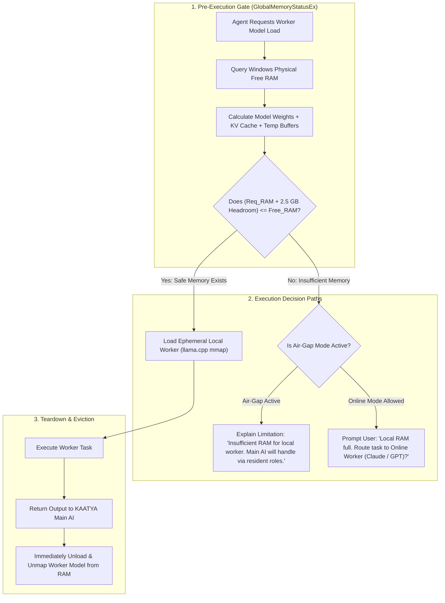

# KAATYA: Local Runtime & Dynamic Memory Execution Policy

## 1. Executive Memory Governance Framework

Operating a local-first AI assistant on an **Intel Core i3-6100T with 12.0 GB RAM and no dedicated GPU** requires a deterministic, hardware-enforced memory policy. 

Windows 10 physical memory is an unforgiving boundary: exceeding physical RAM triggers hard pagefile paging, dropping system throughput to $<0.5\text{ tok/s}$ and causing audio stutter and UI freezing.



---

## 2. The Strict Three-Tier Concurrency Rules

1. **Tier 0: Permanent Controller (KAATYA Main AI)**
   - Pinned in physical memory at application launch.
   - Resource allocation: **~3,100 MB RAM** (weights + 4,096 KV cache).
   - **Upper Bound: Exactly 1 permanent model.** Never unloaded, frozen, unmapped, or evicted under any circumstances.
2. **Tier 1: Ephemeral Local Worker (Specialist Helper)**
   - Spawned on demand for specialized sub-tasks (e.g., `Qwen2.5-Coder-1.5B` for coding or `SmolLM2-1.7B` for grammar).
   - Resource allocation: **$\le 1,400\text{ MB RAM}$**.
   - **Upper Bound: Maximum 0 or 1 active local worker.** Loaded, executed, and immediately evicted.
3. **Tier 2: Ephemeral Online Worker (Cloud API)**
   - Invoked via HTTPS when frontier reasoning, long context, or high-fidelity media generation is requested.
   - Resource allocation: **$\le 50\text{ MB RAM}$** (network buffers).
   - **Upper Bound: Maximum 0 or 1 active online request.** Requires explicit per-task user approval.

---

## 3. Dynamic Memory Budget & Hardware Scheduling Thresholds

### 3.1 Memory Math & Operating System Realities (12.0 GB Physical Budget)

The target machine possesses **12.0 GB Physical RAM** ($12,288\text{ MiB}$ binary / $12.88\text{ GB}$ decimal, or $12.00\text{ GB}$ decimal if strictly bounded to $12 \times 10^9$ bytes).

$$\begin{aligned}
\text{Total Physical Memory} &= 12,288\text{ MiB} \quad (12.00\text{ GiB} \text{ / } 12.88\text{ GB}) \\
\text{Windows 10 Base OS + DWM + System Services} &\approx 2,900\text{ MiB} \quad (~3.04\text{ GB}) \\
\text{Intel HD 530 Dynamic Shared Memory (Idle UI)} &\approx 150\text{ MiB} \quad (~0.16\text{ GB}) \\
\text{Tauri v2 App Shell + Microsoft WebView2} &\approx 220\text{ MiB} \quad (~0.23\text{ GB}) \\
\text{Audio Engine (PortAudio + Piper Dual ONNX + Whisper)} &\approx 300\text{ MiB} \quad (~0.31\text{ GB}) \\
\text{Local Database (SQLite + sqlite-vec Cache)} &\approx 80\text{ MiB} \quad (~0.08\text{ GB}) \\
\text{KAATYA Permanent Main AI (Qwen3-4B @ 4K FP16 KV)} &\approx \mathbf{3,138\text{ MiB}} \quad (\mathbf{~3.29\text{ GB}}) \\
\hline
\mathbf{Total\ Base\ Working\ Set\ Commitment} &\approx \mathbf{6,788\text{ MiB}} \quad (\mathbf{~7.12\text{ GB}}) \\
\mathbf{Remaining\ Uncommitted\ Physical\ Memory} &\approx \mathbf{5,500\text{ MiB}} \quad (\mathbf{~5.76\text{ GB}})
\end{aligned}$$

*(Arithmetic Correction: If calculated on a strict decimal $12.00\text{ GB}$ baseline with a $7.20\text{ GB}$ committed footprint: $12.00 - 7.20 = \mathbf{4.80\text{ GB}}$ remaining, correcting previous reports that erroneously claimed ~5.0 GB).*

### 3.2 Distinguishing Physical RAM, Committed Memory, and Working Sets
1. **No Fixed Shared GPU Reservation:** Intel HD Graphics 530 uses Dynamic Video Memory Technology (DVMT). It does not hold a fixed 450 MB physical reservation; memory is allocated dynamically from system RAM when 3D or video surfaces are drawn and returned when idle.
2. **Model File Size vs. Memory Footprint:** A 2.50 GB GGUF model file requires ~3,138 MiB working set because it includes memory-mapped weights (~2,382 MiB), KV-cache (~576 MiB for 4K context), and compute scratch buffers (~180 MiB).
3. **No Unsupported Safety Guarantees:** The application cannot guarantee that Windows will never page memory under external system stress. Instead, the runtime enforces a **pre-flight scheduler threshold**: if `GlobalMemoryStatusEx` reports less than **2,048 MiB (~2.0 GB)** free physical memory, worker spawning is refused.

### 3.3 Local Worker Feasibility Table

| Local Candidate Model | Disk Size | Runtime Memory (4K Ctx) | Fits Within Headroom Threshold? | Execution Status |
| :--- | :---: | :---: | :---: | :--- |
| **`Qwen2.5-Coder-1.5B-Q3_K_M`** | 824 MB (0.77 GiB) | **~1,000 MB** | **YES** (Leaves $>3.5\text{ GB}$ free) | **Approved Local Worker** |
| **`SmolLM2-1.7B-Instruct-Q4_K_M`** | 1,055 MB (0.98 GiB) | **~1,350 MB** | **YES** (Leaves $>3.2\text{ GB}$ free) | **Approved Local Worker** |
| **`Qwen3-1.7B-Q3_K_M`** | 1,073 MB (1.00 GiB) | **~1,250 MB** | **YES** (Leaves $>3.3\text{ GB}$ free) | **Approved Local Worker** |
| **`qwen2.5-1.5b-instruct-q4_k_m`** | 1,117 MB (1.04 GiB) | **~1,280 MB** | **YES** (Leaves $>3.3\text{ GB}$ free) | **Approved Local Worker** |
| **`flux-2-klein-4b-q4_0` (DiT)** | 2,256 MB (2.10 GiB) | **~7,500–8,500 MB** (Full pipeline) | **NO** (Exhausts target physical RAM) | **Memory-Gated / Experimental** |
| **`Nemotron-3.5-Bolt-E4B`** (Former) | 6,180 MB | **~7,200 MB** | **NO** (Exceeds safe limits) | **Disqualified / Absent from Disk** |

---

## 4. Pre-Flight Resource Gate & Emergency Degradation Protocol

Before the Rust runtime executes `llama_load_model_from_file()`, it executes a mandatory pre-flight safety check:

```rust
// Pre-flight memory verification in KAATYA Rust Core
pub fn can_load_local_worker(required_bytes: u64) -> Result<(), MemoryError> {
    use windows::Win32::System::SystemInformation::{GlobalMemoryStatusEx, MEMORYSTATUSEX};
    
    let mut mem_status = MEMORYSTATUSEX::default();
    mem_status.dwLength = std::mem::size_of::<MEMORYSTATUSEX>() as u32;
    
    unsafe {
        GlobalMemoryStatusEx(&mut mem_status).ok()?;
    }
    
    let free_phys = mem_status.ullAvailPhys;
    let safety_cushion = 2_500 * 1024 * 1024; // 2.5 GB reserved cushion
    
    if free_phys < (required_bytes + safety_cushion) {
        return Err(MemoryError::InsufficientFreeRam {
            available_mb: free_phys / (1024 * 1024),
            required_mb: (required_bytes + safety_cushion) / (1024 * 1024),
        });
    }
    Ok(())
}
```

### 4.1 Low-Memory Handling & Transparent User Explanation
If `can_load_local_worker` fails (e.g., the user has multiple heavy browser tabs or Visual Studio open):
1. **The application NEVER attempts to load the worker anyway.**
2. **The application NEVER unloads KAATYA Main AI.**
3. **KAATYA delivers a clear, polite explanation:**
   > *"I cannot allocate the local coding worker because your PC currently has only 2.1 GB of free RAM (3.5 GB required for safe execution without slowing down Windows). I will handle this task directly using my resident capabilities, or you can authorize an online worker."*
4. **Emergency Context Truncation:** If memory drops critically during prompt generation, the KV cache is trimmed to the most recent 2,048 tokens using rolling window attention to prevent out-of-memory crashes.
