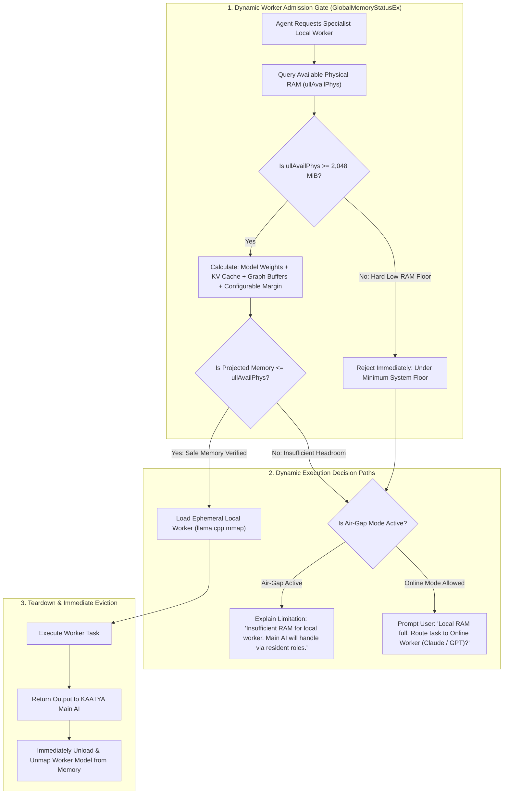

# KAATYA: Local Runtime & Dynamic Memory Execution Policy

## 1. Executive Memory Governance Framework

Operating a local-first AI assistant on an **Intel Core i3-6100T with 16.0 GB RAM (16,384 MiB installed / 16,260 MiB Windows-visible) and no dedicated GPU** requires a deterministic, hardware-enforced memory policy. 

Windows 10 physical memory is an unforgiving boundary: exceeding physical RAM triggers hard pagefile paging, dropping system throughput to $<0.5\text{ tok/s}$ and causing audio stutter and UI freezing.



---

## 2. The Strict Three-Tier Concurrency Rules

1. **Tier 0: Permanent Controller (KAATYA Main AI)**
   - Pinned in runtime memory at application launch.
   - Resource allocation: **~3,138 MiB RAM** (weights + 4,096 FP16 KV cache + compute scratch).
   - **Upper Bound: Exactly 1 permanent model.** Application runtime policy strictly mandates that Main AI is never intentionally unloaded, unmapped, or evicted during normal execution. However, the Windows Memory Manager (`ntoskrnl.exe`) may still page virtual memory pages to `pagefile.sys` under severe system pressure; actual physical residency and paging behavior require empirical testing during Phase 4.
2. **Tier 1: Ephemeral Local Worker (Specialist Helper)**
   - Spawned on demand for specialized sub-tasks (e.g., `Qwen2.5-Coder-1.5B` for coding or `SmolLM2-1.7B` for grammar).
   - Resource allocation: Projected $\le 1,400\text{ MiB RAM}$ for lightweight models.
   - **Upper Bound: Maximum 0 or 1 active local worker.** Loaded, executed, and immediately evicted.
3. **Tier 2: Ephemeral Online Worker (Cloud API)**
   - Invoked via HTTPS when frontier reasoning, long context, or high-fidelity media generation is requested.
   - Resource allocation: **$\le 50\text{ MB RAM}$** (network buffers).
   - **Upper Bound: Maximum 0 or 1 active online request.** Requires explicit per-task user approval.

---

## 3. Dynamic Memory Budget & Hardware Scheduling Thresholds

### 3.1 Memory Math & Operating System Realities (16.0 GB Physical Budget)

The target machine possesses **16.0 GB physically installed Physical RAM** across two Samsung DDR4 modules:
- **Module Hardware Specifications:** Two 8 GB Samsung `M378A1K43DB2-CTD` DIMMs installed in `ChannelA-DIMM0` (Bank 0) and `ChannelB-DIMM0` (Bank 2). Modules are rated at 2,666 MT/s, but configured operating clock speed is **2,133 MT/s** (confirmed via WMI `Win32_PhysicalMemory.ConfiguredClockSpeed = 2133`), matching the Intel Core i3-6100T memory controller hardware limit. While dual-slot installation across channels A and B is empirically confirmed, active symmetric dual-channel memory controller mode remains **unverified** without low-level diagnostic tools (e.g., CPU-Z or HWiNFO).
- **Installed Physical Capacity:** $16\text{ GiB} = 16,384\text{ MiB} = 17,179,869,184\text{ bytes} \approx 17.18\text{ GB}$ decimal ($17,179,869,184 / 10^9$).
- **Hardware-Reserved Memory Difference:** $129,970,176\text{ bytes} \approx 123.95\text{ MiB} \approx 124\text{ MiB}$ (~0.13 GB). Measured installed-versus-visible RAM difference: 123.95 MiB. Exact hardware reservation breakdown between BIOS, APIC, and integrated GPU pre-allocation remains unverified.
- **Windows-Visible Physical Memory (`ullTotalPhys`):** $17,049,899,008\text{ bytes} = 15.8790\text{ GiB} = 16,260.05\text{ MiB} \approx 17.05\text{ GB}$ decimal ($17,049,899,008 / 10^9$).
- **Mandatory Conversion Rules:**
  - $1\text{ GiB} = 1,024\text{ MiB} = 1,073,741,824\text{ bytes}$.
  - $1\text{ GB} = 1,000,000,000\text{ bytes}$.
  - $1\text{ MiB} = 1,048,576\text{ bytes}$.
  - *Never mix decimal GB with binary GiB in the same subtraction.*

#### Binary Calculations & Available Memory Disambiguation:
$$\begin{aligned}
\text{Total Visible Physical Memory (ullTotalPhys)} &= 16,260.05\text{ MiB} \quad (15.88\text{ GiB} \text{ / } 17.05\text{ GB}) \\
\text{Projected Base Working Set Commitment} &\approx 6,788\text{ MiB} \quad (~6.63\text{ GiB} \text{ / } ~7.12\text{ GB}) \\
\hline
\text{Theoretical Idle Margin (Visible minus Baseline)} &\approx 9,472.05\text{ MiB} \quad (~9.25\text{ GiB} \text{ / } ~9.93\text{ GB}) \\
\mathbf{Actual\ Measured\ Available\ Physical\ RAM\ (ullAvailPhys)} &= \mathbf{7,030.07\text{ MiB}} \quad (\mathbf{~6.87\text{ GiB}})
\end{aligned}$$

*(Critical Distinction: $9,472.05\text{ MiB}$ is a theoretical calculation assuming an idle OS with Main AI resident. It is NOT measured available RAM. The actual live available RAM measured via `GlobalMemoryStatusEx.ullAvailPhys` is **$7,030.07\text{ MiB}$** ($7,371,558,912\text{ bytes} / 1,048,576 = 7,030.07\text{ MiB}$) at initial baseline capture and **$6,590.47\text{ MiB}$** during active multitasking. In Windows memory architecture, `ullAvailPhys` includes Free, Zeroed, and Standby pages. Physical RAM not currently reported as available is $16,260.05 - 7,030.07 = \mathbf{9,229.98\text{ MiB}}$. This non-available physical RAM consists of active process working sets, modified pages, locked kernel memory [non-paged pool], resident paged pool, and Windows Memory Compression working set; standby pages are NOT part of this quantity. The ~2,442 MiB difference between the 6,788 MiB baseline and the 9,230 MiB host load is partially explained by active developer software [Chrome, IDE], Windows Memory Compression [`MemCompression` ~1,106.73 MiB, managed by the Windows Memory Manager `ntoskrnl.exe`], and kernel pools [~1.23 GB], while KAATYA Main AI is not yet loaded. Note that physical RAM not reported as available does NOT equal the arithmetic sum of process working sets due to shared pages and kernel memory).*

### 3.2 Required Itemized Memory Accounting Table

| Component | Footprint (MiB) | Evidence Classification | Notes |
| :--- | ---:| :--- | :--- |
| **Windows Base OS & Services** | ~2,900 MiB | PROVISIONAL ESTIMATE | Windows 10 x64 kernel, DWM, background services (idle clean boot) |
| **Dynamic GPU Shared Memory** | ~150 MiB | PROVISIONAL ESTIMATE | Intel HD 530 DVMT dynamic UI allocation (idle 2D surface) |
| **KAATYA Desktop Shell** | ~220 MiB | PROVISIONAL ESTIMATE | Tauri v2 host binary + Edge WebView2 (unimplemented) |
| **Audio Subsystem** | ~300 MiB | PROVISIONAL ESTIMATE | PortAudio stream, Piper dual ONNX, Whisper buffer (unimplemented) |
| **Database Store** | ~80 MiB | PROVISIONAL ESTIMATE | SQLite 3 engine and `sqlite-vec` cache (unimplemented) |
| **KAATYA Main AI** | ~3,138 MiB | THEORETICAL CALCULATION | `Qwen3-4B-Q4_K_M` weights (2,382 MiB) + 4K FP16 KV (576 MiB) + graph/scratch (180 MiB) |
| **Total Projected Baseline** | **~6,788 MiB** | **PROJECTED ESTIMATE** | **Sum of projected components — NOT AN OBSERVED RUNNING SYSTEM** |
| **Live Host Visible RAM** | **16,260.05 MiB** | **EMPIRICALLY MEASURED** | Win32 API `GlobalMemoryStatusEx.ullTotalPhys` |
| **Live Host Available RAM** | **7,030.07 MiB** | **EMPIRICALLY MEASURED** | Win32 API `GlobalMemoryStatusEx.ullAvailPhys` (Includes Free, Zeroed, Standby pages) |
| **Live Host Commit Charge** | **12,020.82 MiB** | **EMPIRICALLY MEASURED** | Win32 API `ullTotalPageFile - ullAvailPageFile` (Virtual commit across all apps; NOT physical RAM consumed) |

### 3.3 Memory Concepts & Distinctions
1. **Installed Physical Memory:** 16.0 GB hardware module total across two 8 GB Samsung DIMMs ($16,384\text{ MiB}$ binary / ~17.18 GB decimal).
2. **Hardware-Reserved Memory Difference:** ~124 MiB ($129,970,176\text{ bytes}$) measured difference between installed and visible RAM (breakdown between BIOS, APIC, and Intel HD 530 DVMT pre-allocation is unverified).
3. **OS-Visible Physical Memory:** Memory reported by Windows via `GlobalMemoryStatusEx` (`ullTotalPhys`: 17,049,899,008 bytes = 16,260.05 MiB).
4. **Available Physical Memory:** Memory available for allocation without paging (`ullAvailPhys`), comprising Free, Zeroed, and Standby page lists. Standby cache contains valid data/code but can be repurposed instantly without paging to disk.
5. **Non-Available Physical Memory:** Memory not available for immediate allocation ($16,260.05 - 7,030.07 = 9,229.98\text{ MiB}$), comprising Active process working sets, Modified pages, Locked kernel allocations (non-paged pool), resident paged pool, and Memory Compression working set. Standby pages are NOT part of this quantity.
6. **Windows Memory Compression:** Managed by the Windows Memory Manager (`ntoskrnl.exe`), not Cache Manager. Compresses inactive pages in RAM to reduce paging to disk. Measured via `(Get-Process -Name "Memory Compression").WorkingSet64` (1,160,495,104 bytes / 1,106.73 MiB).
7. **Committed Memory:** Virtual address space allocations backed by physical RAM or `pagefile.sys` (`ullTotalPageFile - ullAvailPageFile`).
8. **Process Working Set:** Physical RAM pages currently assigned to the active process.
9. **Private Working Set:** Memory allocated specifically to the process that cannot be shared.
10. **Memory-Mapped File Pages:** Clean file-backed pages (e.g., GGUF weights) mapped via Win32 `CreateFileMapping` / `MapViewOfFile`, managed by Cache Manager and Memory Manager, that can be discarded under pressure and re-read from disk without writing to `pagefile.sys`.
11. **Pagefile Usage:** Backing store on disk utilized when physical memory demands exceed available RAM.

---

## 4. Dynamic Worker Admission Policy (Replacing the Fixed 2.5 GB Rule)

The former static safety-buffer formula has been **permanently eliminated**. It is replaced by a deterministic **10-Step Dynamic Worker Admission Procedure**:

### 4.1 The 10-Step Dynamic Worker Admission Procedure
Before spawning any optional specialist local worker, the runtime executes:
1. **Query Available Memory:** Invoke Win32 `GlobalMemoryStatusEx` to obtain current `ullAvailPhys`.
2. **Initial Rejection Gate:** If `ullAvailPhys < 2,048\text{ MiB}`, reject immediately as an unsafe operating floor. *(Note: Passing this floor is a necessary initial condition, but NOT sufficient proof that a worker can load).*
3. **Identify Target Model:** Determine the exact specialist model file requested (e.g., `Qwen2.5-Coder-1.5B-Instruct-Q3_K_M.gguf`).
4. **Estimate Weight Residency:** Compute resident weight footprint from quantized tensor size.
5. **Estimate Context & KV-Cache:** Calculate required KV cache based on target context length ($N$) and precision (FP16 or quantized).
6. **Estimate Compute Buffers:** Calculate forward graph scratch buffer demand (`ggml_gallocr`).
7. **Audit Main AI Observed Footprint:** Confirm Main AI working set remains intact and un-evicted.
8. **Factor System Memory Pressure:** Read active system memory load percentage (`dwMemoryLoad`).
9. **Apply Configurable Test Margin:** Apply a dynamic safety margin derived from empirical testing (accounting for OS caching and UI responsiveness).
10. **Log & Enforce Decision:** If total projected demand exceeds `ullAvailPhys`, reject or defer worker loading, log the exact diagnostic reason in `.assistant/logs/scheduler.log`, and route the task to the resident Main AI or cloud fallback.

### 4.2 Dynamic Admission Implementation (Rust Core)

```rust
// Dynamic Worker Admission Procedure in KAATYA Rust Core Engine
pub fn can_admit_local_worker(
    worker_weight_bytes: u64,
    worker_kv_bytes: u64,
    worker_graph_bytes: u64,
    config_safety_margin_bytes: u64,
) -> Result<(), MemoryError> {
    use windows::Win32::System::SystemInformation::{GlobalMemoryStatusEx, MEMORYSTATUSEX};
    
    let mut mem_status = MEMORYSTATUSEX::default();
    mem_status.dwLength = std::mem::size_of::<MEMORYSTATUSEX>() as u32;
    
    unsafe {
        GlobalMemoryStatusEx(&mut mem_status).ok()?;
    }
    
    let free_phys = mem_status.ullAvailPhys;
    let min_system_floor = 2_048 * 1024 * 1024; // 2,048 MiB initial rejection threshold
    
    // Step 2: Hard floor check
    if free_phys < min_system_floor {
        return Err(MemoryError::BelowSystemFloor {
            available_mb: free_phys / (1024 * 1024),
            floor_mb: min_system_floor / (1024 * 1024),
        });
    }
    
    // Steps 4-9: Dynamic projected requirement calculation
    let total_projected_demand = worker_weight_bytes 
        + worker_kv_bytes 
        + worker_graph_bytes 
        + config_safety_margin_bytes;
        
    if free_phys < total_projected_demand {
        return Err(MemoryError::InsufficientDynamicHeadroom {
            available_mb: free_phys / (1024 * 1024),
            projected_demand_mb: total_projected_demand / (1024 * 1024),
        });
    }
    
    Ok(())
}
```

### 4.3 Low-Memory Handling & Transparent User Explanation
If `can_admit_local_worker` fails:
1. **The application NEVER attempts to load the worker anyway.**
2. **The application NEVER unloads KAATYA Main AI.**
3. **KAATYA delivers a clear, polite explanation:**
   > *"I cannot allocate the local specialist worker because available physical RAM is insufficient for safe execution without triggering Windows paging. I will handle this task directly using my resident capabilities, or you can authorize an online worker."*
4. **Emergency Context Truncation:** If memory drops critically during prompt generation, the worker context is truncated using rolling window attention to prevent out-of-memory crashes.
