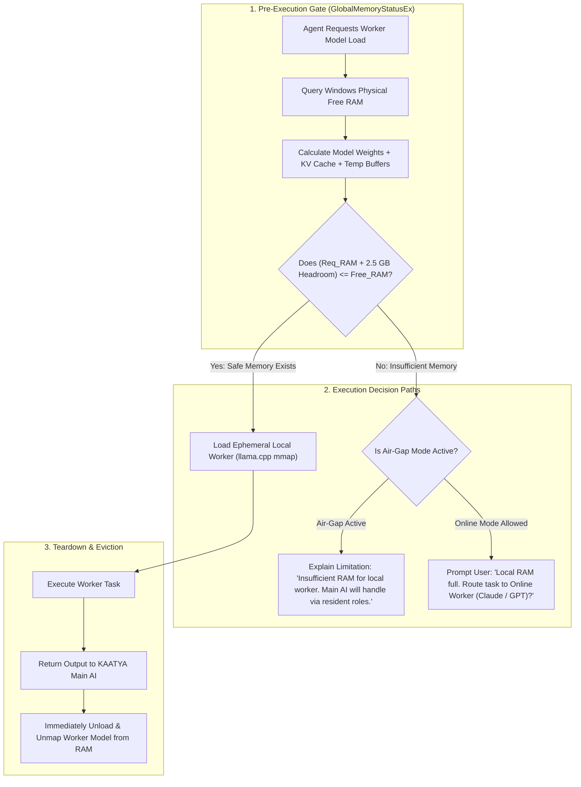

# KAATYA: Local Runtime & Dynamic Memory Execution Policy

## 1. Executive Memory Governance Framework

Operating a local-first AI assistant on an **Intel Core i3-6100T with 12.0 GB RAM and no dedicated GPU** requires a deterministic, hardware-enforced memory policy. 

Windows 10 physical memory is an unforgiving boundary: exceeding physical RAM triggers hard pagefile paging, dropping system throughput to $<0.5\text{ tok/s}$ and causing audio stutter and UI freezing.



---

## 2. The Strict Three-Tier Concurrency Rules

1. **Tier 0: Permanent Controller (KAATYA Main AI)**
   - Pinned in physical memory at application launch.
   - Resource allocation: **~3,100 MB RAM** (weights + 4,096 KV cache).
   - **Upper Bound: Exactly 1 permanent model.** Never unloaded, frozen, unmapped, or evicted under any circumstances.
2. **Tier 1: Ephemeral Local Worker (Specialist Helper)**
   - Spawned on demand for specialized sub-tasks (e.g., `Qwen2.5-Coder-1.5B` for coding or `SmolLM2-1.7B` for grammar).
   - Resource allocation: **$\le 1,400\text{ MB RAM}$**.
   - **Upper Bound: Maximum 0 or 1 active local worker.** Loaded, executed, and immediately evicted.
3. **Tier 2: Ephemeral Online Worker (Cloud API)**
   - Invoked via HTTPS when frontier reasoning, long context, or high-fidelity media generation is requested.
   - Resource allocation: **$\le 50\text{ MB RAM}$** (network buffers).
   - **Upper Bound: Maximum 0 or 1 active online request.** Requires explicit per-task user approval.

---

## 3. Dynamic Memory Budget & Safety Margins

$$\begin{aligned}
\text{Total Physical RAM} &= 12,288\text{ MB} (12.0\text{ GB}) \\
\text{Committed Base System (OS + HD 530 + App Shell + Audio)} &= 4,105\text{ MB} \\
\text{KAATYA Permanent Main AI (Qwen3-4B @ 4K Context)} &= 3,100\text{ MB} \\
\hline
\mathbf{Total\ Permanent\ Baseline\ Commitment} &= \mathbf{7,205\text{ MB} (~7.2\text{ GB})} \\
\mathbf{Theoretical\ Remaining\ RAM} &= \mathbf{5,083\text{ MB} (~5.0\text{ GB})} \\
\text{Mandatory Windows OS Disk Cache & UI Safety Cushion} &= -2,500\text{ MB} \\
\hline
\mathbf{Safe\ Maximum\ Allocatable\ Budget\ for\ Local\ Worker} &= \mathbf{2,583\text{ MB} (~2.5\text{ GB})}
\end{aligned}$$

### 3.1 Local Worker Feasibility Table

| Local Candidate Model | Disk Size | Runtime Memory (4K Ctx) | Fits Within Safe 2.5 GB Budget? | Execution Status |
| :--- | :---: | :---: | :---: | :--- |
| **`Qwen2.5-Coder-1.5B-Q3_K_M`** | 824 MB | **~1,050 MB** | **YES** (Leaves ~1.5 GB cushion) | **Approved Local Worker** |
| **`SmolLM2-1.7B-Instruct-Q4_K_M`** | 1,055 MB | **~1,350 MB** | **YES** (Leaves ~1.2 GB cushion) | **Approved Local Worker** |
| **`Qwen3-1.7B-Q3_K_M`** | 1,073 MB | **~1,250 MB** | **YES** (Leaves ~1.3 GB cushion) | **Approved Local Worker** |
| **`qwen2.5-1.5b-instruct-q4_k_m`** | 1,117 MB | **~1,280 MB** | **YES** (Leaves ~1.3 GB cushion) | **Approved Local Worker** |
| **`flux-2-klein-4b-q4_0` (DiT)** | 2,256 MB | **~7,360 MB** (Full pipeline) | **NO** (Demands 7.3 GB) | **Memory-Gated / Experimental** |
| **`Nemotron-3.5-Bolt-E4B`** (Former) | 6,180 MB | **~7,200 MB** | **NO** (Demands 7.2 GB) | **Disqualified / Absent from Disk** |

---

## 4. Pre-Flight Resource Gate & Emergency Degradation Protocol

Before the Rust runtime executes `llama_load_model_from_file()`, it executes a mandatory pre-flight safety check:

```rust
// Pre-flight memory verification in KAATYA Rust Core
pub fn can_load_local_worker(required_bytes: u64) -> Result<(), MemoryError> {
    use windows::Win32::System::SystemInformation::{GlobalMemoryStatusEx, MEMORYSTATUSEX};
    
    let mut mem_status = MEMORYSTATUSEX::default();
    mem_status.dwLength = std::mem::size_of::<MEMORYSTATUSEX>() as u32;
    
    unsafe {
        GlobalMemoryStatusEx(&mut mem_status).ok()?;
    }
    
    let free_phys = mem_status.ullAvailPhys;
    let safety_cushion = 2_500 * 1024 * 1024; // 2.5 GB reserved cushion
    
    if free_phys < (required_bytes + safety_cushion) {
        return Err(MemoryError::InsufficientFreeRam {
            available_mb: free_phys / (1024 * 1024),
            required_mb: (required_bytes + safety_cushion) / (1024 * 1024),
        });
    }
    Ok(())
}
```

### 4.1 Low-Memory Handling & Transparent User Explanation
If `can_load_local_worker` fails (e.g., the user has multiple heavy browser tabs or Visual Studio open):
1. **The application NEVER attempts to load the worker anyway.**
2. **The application NEVER unloads KAATYA Main AI.**
3. **KAATYA delivers a clear, polite explanation:**
   > *"I cannot allocate the local coding worker because your PC currently has only 2.1 GB of free RAM (3.5 GB required for safe execution without slowing down Windows). I will handle this task directly using my resident capabilities, or you can authorize an online worker."*
4. **Emergency Context Truncation:** If memory drops critically during prompt generation, the KV cache is trimmed to the most recent 2,048 tokens using rolling window attention to prevent out-of-memory crashes.
