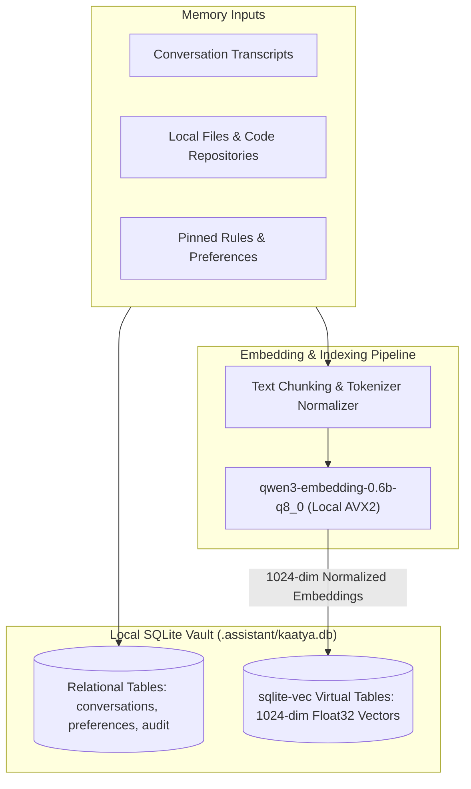
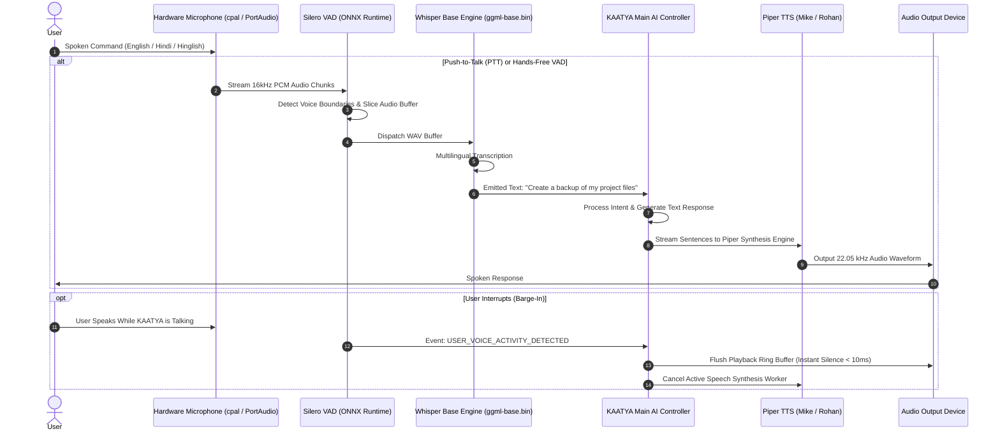

# KAATYA: Persistent Memory & Real-Time Offline Voice Architecture

## 1. Unified Semantic Memory Architecture

KAATYA maintains a dual-layer local memory ecosystem designed for long-term user personalization, document recall, and code context injection:
1. **Relational Episodic Memory (SQLite):** Fast ACID storage for chat transcripts, user profiles, tasks, and audit logs.
2. **Semantic Vector Memory (`sqlite-vec` + Qwen3-Embedding):** High-dimensional vector space for semantic similarity search across past interactions, project documentation, and code snippets.

---

## 2. Local Embedding Model Audit & Verification

### 2.1 The Present Embedding Engine
- **File:** `T:\ai creation\qwen3-embedding-0.6b-q8_0.gguf` (639,150,592 bytes / ~0.60 GiB).
- **SHA-256 Checksum:** `ee029816fb9615e361d9e444abc0059827322e665c3ed9e6bc0531efe20cddda`
- **Architecture:** `qwen3` transformer backbone (28 layers, 1,024 embedding dimension, 16 attention heads, mean pooling type 3).
- **Crucial Distinction:** This is strictly an **embedding representation model**, NOT a conversational chat model. It produces normalized dense float vectors for semantic comparison.
- **Estimated Throughput on i3-6100T:** **[UNVERIFIED THEORETICAL ESTIMATE: ~80 to 180 tokens/second]** across 2 CPU threads via AVX2 vector instructions. Embedding a 200-word paragraph takes **~1.4 to 2.8 seconds** in background worker mode.
- **Memory Footprint:** Pinned in memory using **~750 MB RAM** during active indexing sessions.

### 2.2 Status of Historical Embedding Model: Nomic Embed
- **Reference:** `nomic-embed-text-v1.5.Q4_K_M.gguf`
- **Audit Finding:** **CONFIRMED ABSENT.** Does not exist in `T:\ai creation`. `qwen3-embedding-0.6b` fulfills this role completely.

### 2.3 User Governance & Privacy Controls (Screen 09: Memory Centre)
- **Pinned Anchors:** Mark rules (e.g., *"Always write TypeScript with strict types and no any"*) as permanent system anchors injected into every prompt.
- **Selective Forgetting:** The user can inspect, edit, or delete any memory vector with immediate SQLite `VACUUM` purging.
- **Air-Gap Privacy:** 100% offline. Zero embeddings or search queries are ever transmitted over the network.

---

## 3. Real-Time Offline Voice Processing Architecture

The voice pipeline delivers natural, low-latency spoken conversations in **English, Hindi, and Hinglish** with zero cloud dependencies.

---

## 4. Voice Model Assets & Performance Profiling

### 4.1 Speech-To-Text: Whisper Base (`ggml-base.bin`)
- **Asset Path:** `T:\ai creation\ggml-base.bin` (147,951,465 bytes / ~141 MB).
- **SHA-256 Checksum:** `60ed5bc3dd14eea856493d334349b405782ddcaf0028d4b5df4088345fba2efe`
- **Architecture:** 74M parameter multilingual transformer encoder-decoder.
- **Performance on i3-6100T:** **[UNVERIFIED THEORETICAL ESTIMATE: Real-Time Factor ~0.25 – 0.35]**; transcribes a 3-second spoken phrase in **~750 – 950 ms**.
- **Memory Footprint:** Pinned in memory using **~220 MB RAM**.

### 4.2 Text-To-Speech: Piper Neural Voice System
- **English Model:** `T:\ai creation\english voice onnx + jons\en_US-mike-medium.onnx` (63,221,984 bytes).
  - SHA-256: `6876866e3dfadc7f044bc5e4fbac16c47b5a1e79eaec04e3bb0c2c6e9da8a857`
  - Profile: Natural American English male with crisp technical cadence.
- **Hindi Model:** `T:\ai creation\hindi voice onnx + jon\hi_IN-rohan-medium.onnx` (62,950,044 bytes).
  - SHA-256: `b65dc80fb34d9dcd1cf684cb297966a34983bbc93bb1696fe207f32b0b33a091`
  - Profile: Natural Hindi/Hinglish male with clear Devanagari phoneme articulation.
- **Performance on i3-6100T:** **[UNVERIFIED THEORETICAL ESTIMATE: Real-Time Factor ~0.08 – 0.12]** (~90 ms synthesis per second of speech). Pinned to CPU Core 1 / Thread 3.
- **Memory Footprint:** **~140 MB RAM** total for both ONNX runtime sessions.

---

## 5. Voice Interaction Modes & Instant Barge-In

1. **Push-To-Talk (PTT - Default):** Holding a global hotkey (e.g., `Right Alt` or `Caps Lock`) opens the microphone. Releasing it immediately triggers Whisper transcription. Zero idle background CPU usage.
2. **Hands-Free Voice Activity Detection (VAD):** Silero VAD monitors incoming microphone levels and automatically triggers transcription upon voice detection.
3. **Instant Barge-In (Interruptibility):** If KAATYA is speaking and the user begins talking, presses `Spacebar`, or hits `ESC`, the audio sink buffer is flushed in $<10\text{ ms}$, immediately silencing playback and switching KAATYA back to listening mode.
