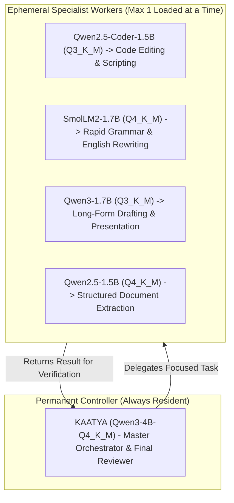

# KAATYA: Model Compatibility, Comparative Evaluation & Benchmark Plan

## 1. Comparative Evaluation of Local Language Models

KAATYA has access to four compact language models (1.5B to 1.7B parameters) in addition to the permanent Main AI (`Qwen3-4B`).



### 1.1 Comparative Capability Matrix (1.5B – 1.7B Models)

| Model Candidate | Quant | Architecture | Multilingual (EN / HI / Hinglish) | Code / Logic | Grammar & Proofreading | Estimated Working RAM (4K Ctx) | Recommended Primary Role |
| :--- | :---: | :---: | :---: | :---: | :---: | :---: | :--- |
| **`Qwen3-1.7B`** | Q3_K_M | `qwen3` | **EXCELLENT** (Strong Hindi & Hinglish support) | Good | High | **~1,250 MB** | **Writer** (Agent 5), **Social Media** (Agent 19) |
| **`SmolLM2-1.7B`** | Q4_K_M | `llama` | **FAIR** (Optimized primarily for English) | Moderate | **SUPERIOR** (Fast English text refinement) | **~1,350 MB** | **Grammar & Language** (Agent 18), **Assistant** (Agent 15) |
| **`qwen2.5-1.5b`** | Q4_K_M | `qwen2` | **VERY GOOD** (Robust English & Asian languages) | Good | High | **~1,280 MB** | **Document Intelligence** (Agent 22), **Data Analyst** (Agent 13) |
| **`Qwen2.5-Coder-1.5B`** | Q3_K_M | `qwen2` | **GOOD** (Technical English & docstrings) | **SUPERIOR** (Trained on code repositories) | Moderate | **~1,050 MB** | **Coder** (Agent 2), **Database Engineer** (Agent 23) |

---

## 2. Coding Specialist Evaluation: Qwen2.5-Coder-1.5B vs. KAATYA Main AI

### 2.1 The Scope of a 1.5B Coding Model
`Qwen2.5-Coder-1.5B-Instruct-Q3_K_M.gguf` (824 MB file) is an exceptionally efficient coding assistant, but **its architectural parameter scale must be respected**:
- **What it excels at:** Small functions, regex generation, JavaScript/TypeScript boilerplate, HTML/CSS tweaks, bug diagnosis from stack traces, and writing unit tests.
- **What it CANNOT do reliably:** Complex multi-file architecture design, full-stack framework scaffolding, or enterprise security audits.
- **The Supervision Policy:** The Coder agent utilizes `Qwen2.5-Coder-1.5B` for granular code generation. However, **KAATYA Main AI (`Qwen3-4B`) retains final responsibility** for reviewing the diff, validating syntax, checking edge cases, and requesting user authorization before touching files.

---

## 3. Image Generation Feasibility Audit: FLUX.2 Klein 4B

### 3.1 Binary Reality of `flux-2-klein-4b-q4_0.gguf`
Our direct binary header inspection revealed:
1. **Header Structure:** GGUF v3, 149 tensors, **0 KV metadata entries**.
2. **Component Identity:** Contains exclusively the **Diffusion Transformer (DiT) backbone weights** (`double_blocks.*`, `single_blocks.*`).
3. **Missing Companion Components:** To execute FLUX image generation locally, the system also requires:
   - **Text Encoder 1:** CLIP-L (`clip_l.safetensors`, ~246 MB).
   - **Text Encoder 2:** T5-XXL (`t5xxl_fp8_e4m3fn.safetensors`, ~4.8 GB or GGUF equivalent ~2.5 GB).
   - **Variational Autoencoder (VAE):** `ae.safetensors` (~335 MB).

### 3.2 Hardware Reality on Intel Core i3-6100T & Intel HD 530
- **No CUDA Acceleration:** The Intel HD Graphics 530 shares system memory and lacks CUDA cores. Diffusion compute runs on the dual-core CPU via AVX2.
- **Memory Footprint:** Loading DiT (2.26 GB) + T5-XXL (2.5–4.8 GB) + VAE (0.33 GB) + latent tensor buffers requires **9.0 to 11.5 GB RAM**.
- **CPU Generation Latency:** Generating a single 512x512 image on a 35W dual-core CPU with 20 diffusion steps will take **[UNVERIFIED ESTIMATE: 5 to 15 minutes per image]**.
- **Architectural Resolution:**
  - `flux-2-klein-4b-q4_0.gguf` is classified as **EXPERIMENTAL LOCAL / OFFLINE TIER**.
  - The Image Studio (Agent 17) provides an **Online Provider Integration** (OpenAI DALL-E, Ideogram, Stability AI) for fast, production-quality generations, while offering local CPU generation as a purely experimental fallback.

---

## 4. Empirical Benchmark Protocol (For Target PC Validation)

All estimated metrics below are marked as **[UNVERIFIED THEORETICAL ESTIMATE]** until physically measured on the target computer.

| Model / Subsystem | Benchmark Operation | Metric | Estimated Theoretical Range | Status |
| :--- | :--- | :---: | :---: | :---: |
| **KAATYA (Qwen3-4B)** | Prompt Processing (p=512) | Tokens / sec | 45 – 65 tok/s | **[UNVERIFIED]** |
| **KAATYA (Qwen3-4B)** | Autoregressive Generation (n=128) | Tokens / sec | 12 – 16 tok/s | **[UNVERIFIED]** |
| **Qwen3-1.7B-Q3_K_M** | Generation (n=128, 3 threads) | Tokens / sec | 24 – 32 tok/s | **[UNVERIFIED]** |
| **SmolLM2-1.7B-Q4_K_M** | Generation (n=128, 3 threads) | Tokens / sec | 22 – 30 tok/s | **[UNVERIFIED]** |
| **Qwen2.5-Coder-1.5B** | Generation (n=128, 3 threads) | Tokens / sec | 26 – 35 tok/s | **[UNVERIFIED]** |
| **Qwen3-Embedding** | 200-word paragraph vectorization | Latency | ~1.4 – 2.8 sec | **[UNVERIFIED]** |
| **Whisper Base STT** | 3-second spoken sentence | Transcription Time | ~750 – 950 ms | **[UNVERIFIED]** |
| **Piper TTS (Mike/Rohan)** | 1-second speech synthesis | Synthesis Latency | ~90 – 120 ms | **[UNVERIFIED]** |

### Benchmark Execution Commands (Phase 4 Validation):
```powershell
# 1. Benchmark KAATYA Permanent Core (3 CPU threads)
.\tools\llama-bench.exe -m "T:\ai creation\Qwen3-4B-Q4_K_M.gguf" -p 512 -n 128 -t 3 -ngl 0

# 2. Benchmark Local Coding Specialist (3 CPU threads)
.\tools\llama-bench.exe -m "T:\ai creation\Qwen2.5-Coder-1.5B-Instruct-Q3_K_M.gguf" -p 512 -n 128 -t 3 -ngl 0

# 3. Benchmark Fast English Assistant (3 CPU threads)
.\tools\llama-bench.exe -m "T:\ai creation\SmolLM2-1.7B-Instruct-Q4_K_M.gguf" -p 512 -n 128 -t 3 -ngl 0

# 4. Benchmark Writing Specialist (3 CPU threads)
.\tools\llama-bench.exe -m "T:\ai creation\Qwen3-1.7B-Q3_K_M.gguf" -p 512 -n 128 -t 3 -ngl 0
```
