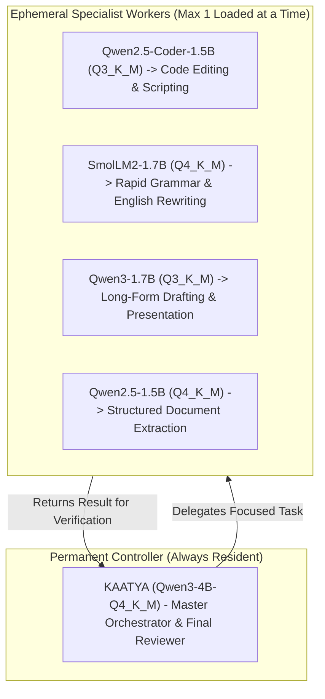

# KAATYA: Model Compatibility, Comparative Evaluation & Benchmark Plan

## 1. Comparative Evaluation of Local Language Models

KAATYA has access to four compact language models (1.5B to 1.7B parameters) in addition to the permanent Main AI (`Qwen3-4B`).



### 1.1 Comparative Capability Matrix (1.5B – 1.7B Models)

The table below delineates **recommended baseline assignments** versus **benchmark-dependent assignments**. Benchmark-dependent assignments must be empirically validated during Phase 4 hardware testing rather than assumed beforehand.

| Model Candidate | Quant | Architecture | Multilingual (EN / HI / Hinglish) | Code / Logic | Grammar & Proofreading | Estimated Working RAM (4K Ctx) | Primary Assignment Status |
| :--- | :---: | :---: | :---: | :---: | :---: | :---: | :--- |
| **`Qwen3-1.7B`** | Q3_K_M | `qwen3` | **EXCELLENT** (Strong Hindi & Hinglish support) | Good | High | **~1,250 MB** | **Recommended:** Writer (5), Social Media (19). *Benchmark candidate for Hindi Grammar (18).* |
| **`SmolLM2-1.7B`** | Q4_K_M | `llama` | **FAIR** (Trained primarily on English) | Moderate | **SUPERIOR (EN)** | **~1,350 MB** | **Recommended:** Assistant (15). *Benchmark candidate for English Grammar (18).* |
| **`qwen2.5-1.5b`** | Q4_K_M | `qwen2` | **VERY GOOD** (Robust English & Asian scripts) | Good | High | **~1,280 MB** | **Recommended:** Document Intelligence (22). |
| **`Qwen2.5-Coder-1.5B`** | Q3_K_M | `qwen2` | **GOOD** (Technical English & docstrings) | **SUPERIOR (Code)** | Moderate | **~1,050 MB** | **Recommended:** Coder (2), Database Engineer (23), Tester (9). |

> [!NOTE]
> **Deterministic Tools for Numerical Analysis (Agent 13 - Data Analyst):**
> Small language models (1.5B–4B) frequently exhibit arithmetic hallucination when computing statistics or financial figures. Agent 13 is strictly architected to use **deterministic execution tools** (Python scripts, `pandas`, SQLite `COUNT/AVG/SUM`, and IEEE-754 arithmetic engines) for all data analysis, utilizing the LLM solely for translating user queries into SQL/Python and formatting tabular output.
> 
> **Role of Embedding Models (`qwen3-embedding-0.6b-q8_0`):**
> Embedding models are mathematical vector feature extractors used strictly for vector similarity search, document chunk indexing, and cosine retrieval inside `sqlite-vec`. They do not generate conversational tokens and must never be loaded into conversational text loops.

---

## 2. Coding Specialist Evaluation: Qwen2.5-Coder-1.5B vs. KAATYA Main AI

### 2.1 The Scope of a 1.5B Coding Model
`Qwen2.5-Coder-1.5B-Instruct-Q3_K_M.gguf` (824 MB file) is an exceptionally efficient coding assistant, but **its architectural parameter scale must be respected**:
- **What it excels at:** Small functions, regex generation, JavaScript/TypeScript boilerplate, HTML/CSS tweaks, bug diagnosis from stack traces, and writing unit tests.
- **What it CANNOT do reliably:** Complex multi-file architecture design, full-stack framework scaffolding, or enterprise security audits.
- **The Supervision Policy:** The Coder agent utilizes `Qwen2.5-Coder-1.5B` for granular code generation. However, **KAATYA Main AI (`Qwen3-4B`) retains final responsibility** for reviewing the diff, validating syntax, checking edge cases, and requesting user authorization before touching files.

---

## 3. Image Generation Feasibility Audit: FLUX.2 Klein 4B

### 3.1 Binary Reality & Architecture of `flux-2-klein-4b-q4_0.gguf`
Our direct binary header and tensor inspection revealed:
1. **Header Structure:** GGUF v3, 149 tensors, **0 KV metadata entries**.
2. **Component Identity:** Contains exclusively the **Diffusion Transformer (DiT) backbone weights** (`double_blocks.*`, `single_blocks.*`).
3. **Actual FLUX.2 Klein Pipeline Dependencies:**
   - **Text Encoder:** Unlike FLUX.1 (which used CLIP-L + T5-XXL), FLUX.2 Klein utilizes a **Qwen3 language model** text encoder. It concatenates intermediate hidden activations from layers 9, 18, and 27 (each 2,560 dimensions, $2560 \times 3 = 7,680$) to match the DiT's `txt_in.weight` dimensions (`[7680, 3072]`).
   - **Variational Autoencoder (VAE):** `flux2-vae.safetensors` (not legacy `ae.safetensors`).
   - **Tokenizer:** Qwen3 tokenizer with `<|im_start|>` chat template formatting.
4. **Feasibility of Reusing Resident `Qwen3-4B-Q4_K_M.gguf` as Text Encoder:**
   - *Theoretical Overlap:* The layers exist inside the Qwen3-4B architecture.
   - *Technical Roadblocks:*
     1. `llama.cpp` evaluates next-token logits and discards intermediate hidden layers; extracting multi-layer activations requires specialized C-API hooks.
     2. `Q4_K_M` weight quantization introduces quantization noise into continuous embedding representations.
     3. Reusing the resident instance disrupts Main AI conversation state and KV-caching.
5. **Runtime Comparison:**
   - *ComfyUI-GGUF:* Supports GGUF DiT backbones with custom FLUX.2 nodes, but requires dedicated text encoder and VAE files loaded in separate memory slots.
   - *stable-diffusion.cpp:* Experimental FLUX branches exist but lack mature out-of-the-box CPU support for FLUX.2 Klein multi-layer Qwen extraction.
6. **Hardware Verdict:** Local FLUX generation remains **EXPERIMENTAL**. Companion files will not be fetched until a verified runtime is benchmarked on target hardware.

---

## 4. Local Video Diffusion Feasibility Analysis

### 4.1 Evidence-Based Feasibility Matrix for Video Models

| Video Diffusion Model | File Size (Backbone) | Companion Assets | Minimum VRAM | Target Machine Status | Technical Rationale |
| :--- | :---: | :--- | :---: | :---: | :--- |
| **Wan 2.1 T2V 1.3B** | ~1.5–2.8 GB | T5-XXL (4.8 GB) + 3D VAE | 8–10 GB VRAM | **Impractical on target hardware** | Demands 16–32 GB system RAM; 3D attention on 2-core i3-6100T takes hours per 5s clip. |
| **LTX-Video 2B Distilled**| ~2.2 GB | T5/Gemma Encoder + Spatio-Temporal VAE | 8–12 GB VRAM | **Impractical on target hardware** | Requires high-throughput tensor cores; CPU execution exceeds physical 12 GB RAM budget. |
| **Programmatic Video Pipeline**| ~150 MB (binaries) | Whisper Base + Piper ONNX + FFmpeg | 0 GB (Shared) | **FULLY SUPPORTED** | Fast, deterministic cuts, transitions, subtitles, and voiceover synchronization on CPU. |
| **Online Cloud Video Providers**| N/A (API) | Runway Gen-3 / Luma / Kling | N/A | **SUPPORTED (Human Gate)** | High-fidelity video generation with explicit per-call user confirmation. |

---

## 5. Empirical Benchmark Protocol (For Target PC Validation)

All estimated metrics below are marked as **[UNVERIFIED THEORETICAL ESTIMATE]** until physically measured on the target computer.

| Model / Subsystem | Benchmark Operation | Metric | Estimated Theoretical Range | Status |
| :--- | :--- | :---: | :---: | :---: |
| **KAATYA (Qwen3-4B)** | Prompt Processing (p=512) | Tokens / sec | 45 – 65 tok/s | **[UNVERIFIED]** |
| **KAATYA (Qwen3-4B)** | Autoregressive Generation (n=128) | Tokens / sec | 12 – 16 tok/s | **[UNVERIFIED]** |
| **Qwen3-1.7B-Q3_K_M** | Generation (n=128, 3 threads) | Tokens / sec | 24 – 32 tok/s | **[UNVERIFIED]** |
| **SmolLM2-1.7B-Q4_K_M** | Generation (n=128, 3 threads) | Tokens / sec | 22 – 30 tok/s | **[UNVERIFIED]** |
| **Qwen2.5-Coder-1.5B** | Generation (n=128, 3 threads) | Tokens / sec | 26 – 35 tok/s | **[UNVERIFIED]** |
| **Qwen3-Embedding** | 200-word paragraph vectorization | Latency | ~1.4 – 2.8 sec | **[UNVERIFIED]** |
| **Whisper Base STT** | 3-second spoken sentence | Transcription Time | ~750 – 950 ms | **[UNVERIFIED]** |
| **Piper TTS (Mike/Rohan)** | 1-second speech synthesis | Synthesis Latency | ~90 – 120 ms | **[UNVERIFIED]** |

### Benchmark Execution Commands (Phase 4 Validation):
```powershell
# 1. Benchmark KAATYA Permanent Core (3 CPU threads)
.\tools\llama-bench.exe -m "T:\ai creation\Qwen3-4B-Q4_K_M.gguf" -p 512 -n 128 -t 3 -ngl 0

# 2. Benchmark Local Coding Specialist (3 CPU threads)
.\tools\llama-bench.exe -m "T:\ai creation\Qwen2.5-Coder-1.5B-Instruct-Q3_K_M.gguf" -p 512 -n 128 -t 3 -ngl 0

# 3. Benchmark Fast English Assistant (3 CPU threads)
.\tools\llama-bench.exe -m "T:\ai creation\SmolLM2-1.7B-Instruct-Q4_K_M.gguf" -p 512 -n 128 -t 3 -ngl 0

# 4. Benchmark Writing Specialist (3 CPU threads)
.\tools\llama-bench.exe -m "T:\ai creation\Qwen3-1.7B-Q3_K_M.gguf" -p 512 -n 128 -t 3 -ngl 0
```
