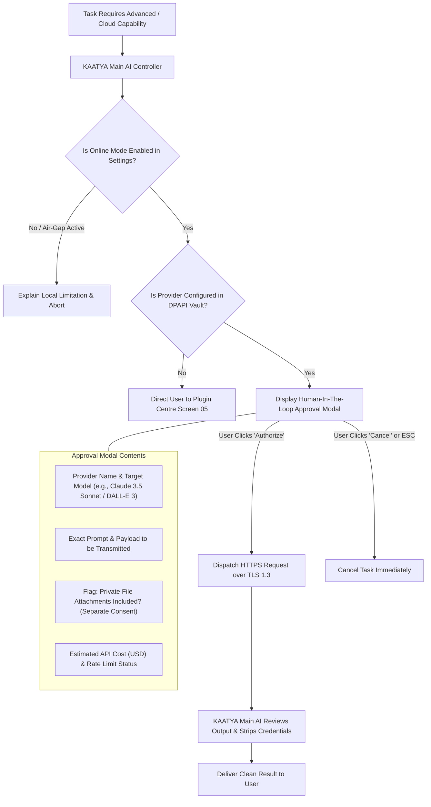

# KAATYA: Online AI Provider & Plugin Architecture

## 1. Governance Principles & Strict User Consent

KAATYA is engineered as a **local-first, air-gapped system by default**. Online cloud AI providers are strictly optional worker extensions underneath the sovereign supervision of **KAATYA Main AI**.



### 1.1 Non-Negotiable Online Rules
1. **Disabled by Default:** Out-of-the-box, KAATYA has zero outbound internet connections enabled.
2. **Mandatory Explicit Consent Before EVERY Request:** The application will **NEVER** silently or automatically switch to an online provider.
3. **Data Disclosure:** The user must be informed of the exact text and files being transmitted. Transmitting private files requires a separate, explicit checkbox.
4. **Online Concurrency Limit:** At most **one online worker** can be active at any given moment.
5. **No Blind History Leaks:** KAATYA does not dump complete multi-day conversation logs to external providers; only the minimal context window necessary for the specific subtask is staged.

---

## 2. Supported Online Providers & Service Capabilities

| Provider Category | Supported Services | Primary Use Cases | Transmission Data Type |
| :--- | :--- | :--- | :--- |
| **Frontier Reasoning** | Anthropic Claude 3.5 Sonnet, OpenAI GPT-4o / o1 | Deep code refactoring, complex mathematical proofs, massive document analysis | Text prompts + code snippets |
| **High-Speed Inference** | Groq Cloud (Llama 3.3 70B @ 300 tok/s) | Rapid generation of large boilerplate codebases or articles | Text prompts |
| **Long Context** | Google Gemini 1.5 Pro (2M token window) | Ingesting whole code repositories or 500-page PDF archives | Text documents + prompts |
| **Image Generation** | OpenAI DALL-E 3, Stability AI SD3, Ideogram v2 | High-fidelity video thumbnails, marketing posters, visual concept art | Text prompts + aspect ratios |
| **Video Generation** | Runway Gen-3, Luma Dream Machine, Kling AI | High-end cinematic B-roll clips, product advertisement animations | Text prompt + reference image |
| **Voice & Speech** | ElevenLabs, Cartesia | Custom character voices, ultra-realistic emotional voiceovers | Text script |

---

## 3. Windows DPAPI Credential Security Vault

A paramount security rule:
> **Zero plaintext API keys on disk. Zero secrets in logs, UI inputs, or git repositories.**

### 3.1 DPAPI Encryption Implementation
On Windows 10, all credentials, API keys, and OAuth refresh tokens are encrypted using the native **Windows Data Protection API (`CryptProtectData`)** via the Rust `windows-rs` crate:

```rust
// Native DPAPI Encryption in KAATYA Rust Core
pub fn encrypt_api_key(provider_id: &str, plaintext_key: &str) -> Result<(), SecurityError> {
    use windows::Win32::Security::Cryptography::{CryptProtectData, DATA_BLOB};
    
    let mut in_blob = DATA_BLOB {
        cbData: plaintext_key.len() as u32,
        pbData: plaintext_key.as_ptr() as *mut u8,
    };
    let mut out_blob = DATA_BLOB::default();
    
    unsafe {
        CryptProtectData(
            &in_blob,
            None,
            None,
            None,
            None,
            0,
            &mut out_blob
        ).ok()?;
    }
    
    // Store encrypted bytes in SQLite 'plugin_credentials' table
    db::store_credential(provider_id, out_blob.as_slice())?;
    Ok(())
}
```

- Keys are cryptographically bound to the current Windows user's logon credentials.
- Decrypted keys exist strictly in ephemeral Rust heap memory for the duration of the outbound HTTPS request and are overwritten with `zeroize` immediately after the response is received.
- Disconnecting a provider immediately purges both the encrypted database record and any cached in-memory structures.

---

## 4. Local Model Context Protocol (MCP) Architecture

KAATYA provides first-class support for Anthropic's **Model Context Protocol (MCP)**, allowing offline local tools and developer servers to be attached without network exposure:
- **Transports Supported:** Standard I/O (`stdio`) child processes and Windows Named Pipes (`\\.\pipe\kaatya_mcp_*`).
- **Tool Scoping:** Each MCP server registers specific capabilities mapped to authorized agents (e.g., SQLite tools scoped to **Database Engineer**, filesystem tools scoped to **File Manager**).
- **Execution Containment:** All local MCP servers execute under Windows Job Objects to ensure total process cleanup upon exit.
