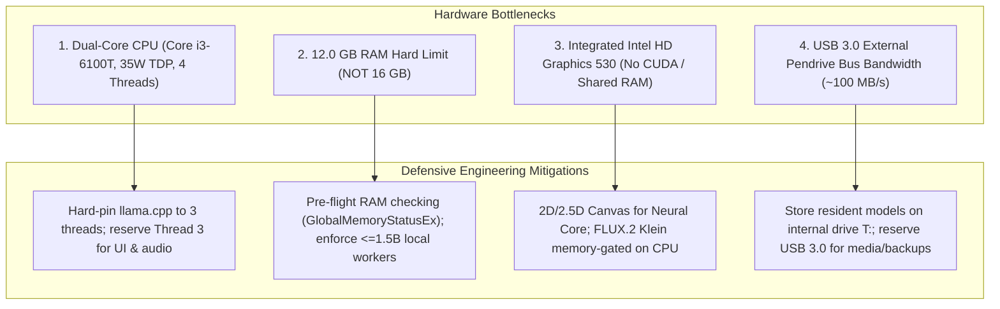

# KAATYA: Technical Risks, Hardware Bottlenecks & Final Review Decisions

## 1. Physical Hardware Bottlenecks & Defensive Mitigations

KAATYA operates under four distinct physical hardware constraints on the target Windows 10 desktop:

### 1.1 Detailed Hardware Risk Register

| Risk ID | Risk Description | Severity | Probability | Defensive Mitigation Strategy |
| :---: | :--- | :---: | :---: | :--- |
| **R-01** | **CPU Thread Saturation & Audio Stutter:** If model inference uses all 4 logical threads, the Piper TTS audio buffer stutters and the UI drops frames. | **HIGH** | **HIGH** | Pinned `llama.cpp` to **3 threads** (`-t 3`). Thread 3 is reserved exclusively for the Windows message pump, PortAudio playback, and Tokio async I/O. |
| **R-02** | **RAM Exhaustion by Heavy Models:** Loading models $>2\text{ GB}$ (like FLUX.2 or the former Nemotron) while KAATYA is resident triggers severe Windows pagefile swapping. | **CRITICAL** | **HIGH** | Enforce **Pre-Flight Memory Verification**. If free RAM is $<2.5\text{ GB}$, worker loading is blocked, and KAATYA handles the task via resident logical roles or offers cloud delegation. |
| **R-03** | **Integrated GPU Memory Contention (HD 530):** Heavy 3D WebGL scenes contend with CPU for DDR4 memory bus bandwidth, slowing down token generation. | **MEDIUM** | **HIGH** | Render Neural Core in **HTML5 2D / 2.5D Canvas** (`GL_LOWRES`). Zero high-polygon WebGL post-processing. |
| **R-04** | **USB 3.0 I/O Latency:** Loading models directly from the Amazon Basics USB 3.0 pendrive will take 3x to 5x longer than internal SSD storage due to USB bus overhead. | **MEDIUM** | **MEDIUM** | **Drive Partitioning Policy:** Keep KAATYA Main AI and active worker models on the internal drive (`T:\`). Reserve the USB drive for video scratch footage, image exports, and cold model archives. |
| **R-05** | **Thermal Throttling on 35W CPU:** Long diffusion steps (FLUX.2) or extended code generation will heat the 35W Skylake package, dropping clocks from 3.20 GHz to ~2.40 GHz. | **MEDIUM** | **MEDIUM** | Batching pauses (10 ms between prompt evaluation chunks) and live CPU thermal status in System Monitor (Screen 12). |

---

## 2. Definitive Classification: Verified Facts vs. Untested Estimates

To maintain absolute technical truthfulness, all project metrics are categorized:

### 2.1 Verified Facts (Empirically Confirmed on Filesystem & OS)
- **Host CPU:** Intel Core i3-6100T (2 cores, 4 threads @ 3.20 GHz, AVX2).
- **Physical RAM:** Exactly 12.0 GB DDR4.
- **Graphics Adapter:** Intel HD Graphics 530 (Integrated, dynamic shared memory).
- **External Storage:** Amazon Basics USB 3.0 pendrive (~116 GB usable capacity).
- **10 Present Models:** Verified byte-sizes and calculated SHA-256 hashes (see `KAATYA_FINAL_MODEL_INVENTORY.md`).
- **Absence of Historical Models:** `Nemotron-7.5B`, `qwen-image-2.1`, `nomic-embed`, and `qwen2.5-coder-3b` are verified absent.
- **FLUX.2 GGUF Structure:** Verified as DiT backbone only (149 tensors, 0 KV pairs; utilizes Qwen3 text encoder and `flux2-vae.safetensors`, both absent locally).

### 2.2 Theoretical Calculations (Derived from Measured Hardware Bounds)
- **Base Committed Working Set:** ~3.65 GB (Windows 10 base ~3.0 GB + dynamic Intel HD 530 idle UI ~0.16 GB + Tauri/WebView2 shell/audio ~0.50 GB).
- **KAATYA Main AI Resident Working Set:** ~3.14 GB (2.50 GB weights + 576 MB 4K FP16 KV cache + compute graph buffers).
- **Total Base Active Working Set:** ~6.79 to 7.12 GB.
- **Physical Headroom:** $12,288\text{ MiB} - 6,788\text{ MiB} = \mathbf{5,500\text{ MiB}}$ (~5.37 GiB binary / ~5.77 GB decimal).
- **Dynamic Worker Admission:** Evaluated on demand via the 10-step procedure (enforcing a minimum 2,048 MiB system floor before calculating model weights, KV cache, and runtime buffers).

### 2.3 Untested Items (Classified as [UNVERIFIED] Pending Phase 4 Benchmarking)
- Real-world tokens/second throughput of `Qwen3-4B` on 3 threads.
- Exact prompt processing latency (TTFT) on Skylake AVX2.
- Precise generation speed of `Qwen2.5-Coder-1.5B` and `SmolLM2-1.7B`.
- End-to-end CPU diffusion generation time of FLUX.2 Klein 4B.
- Real-Time Factor (RTF) of Whisper Base and Piper TTS under peak CPU load.

---

## 3. Decisions for Final Review

The following three architectural decisions are presented for final user and ChatGPT review:

### Decision 1: Default Secondary Local Worker Model Selection
- **The Options:**
  - *Candidate A:* `Qwen2.5-Coder-1.5B-Instruct-Q3_K_M.gguf` (824 MB file, ~1.05 GB RAM) -> Focused on rapid code snippets, debugging, and SQL queries.
  - *Candidate B:* `SmolLM2-1.7B-Instruct-Q4_K_M.gguf` (1.06 GB file, ~1.35 GB RAM) -> Focused on ultra-fast English grammar, proofreading, and conversational assistance.
  - *Candidate C:* `Qwen3-1.7B-Q3_K_M.gguf` (1.07 GB file, ~1.25 GB RAM) -> Focused on multilingual writing (English, Hindi, Hinglish) and social posts.
- **Recommendation:** **Keep all three models on disk and allow KAATYA to dispatch dynamically.** Because each takes only ~1 GB of storage and fits comfortably within available physical headroom under the 10-step admission check, KAATYA can load whichever worker is needed for the active subtask and evict it immediately upon completion.

---

### Decision 2: Video Production Engine Routing
- **The Options:**
  - *Option A (Programmatic CLI via FFmpeg - RECOMMENDED):* Fast, headless, handles 90% of tasks (cuts, transitions, audio ducking, Whisper subtitle burn-in) without touching the desktop GUI.
  - *Option B (Observable UI Automation via CapCut Desktop):* Used when the user explicitly requests complex kinetic sticker animations, trending CapCut transitions, or visual filters.
- **Recommendation:** **Use FFmpeg as the default engine**, escalating to CapCut Desktop only when stylistic effects require it.

---

### Decision 3: Global Hotkey Assignments
- **Defaults:**
  - `F9`: Toggle Floating AI HUD window.
  - `Ctrl + K`: Focus Command Console Input.
  - `Right Alt` (or `Caps Lock`): Push-to-Talk microphone trigger.
  - `Ctrl + Alt + Escape`: Global Emergency Panic Interrupt.
  - `ESC`: Pauses execution and dismisses active modals only when the Assistant window or HUD has input focus.
- **User Preference:** Confirm whether these shortcuts are acceptable or if any conflict with games or development IDEs. All hotkeys remain customizable in Screen 14 (Settings).
