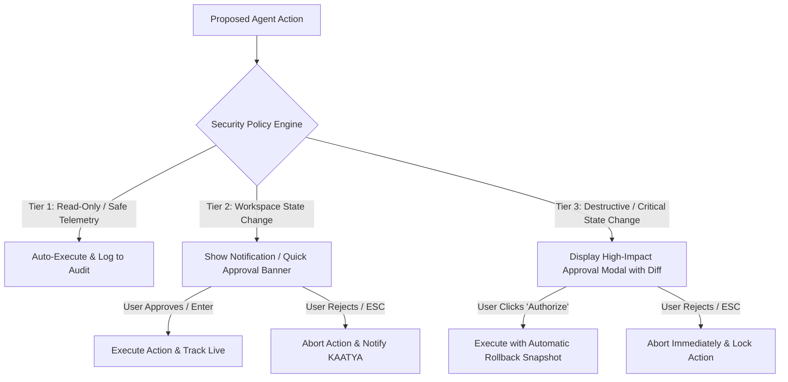
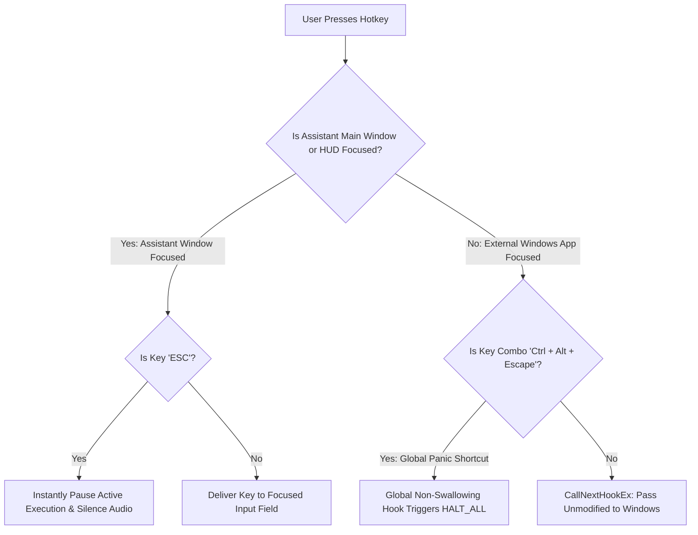

# KAATYA: Security, Desktop Automation & User Control Policy

## 1. Zero Hidden PC Activity Mandate

A founding tenet of **KAATYA** is:
> **Zero covert background activity.** Every tool invocation, file edit, shell command, and desktop window interaction must be visually announced on screen, tracked in real-time, and committed to an append-only SQLite audit log.

The user maintains sovereign authority over every action KAATYA executes on their Windows 10 desktop.



---

## 2. Three-Tier Permission Matrix

| Security Tier | Classification | Included Operations | Enforcement Policy | UI Representation |
| :---: | :--- | :--- | :--- | :--- |
| **Tier 1** | **Safe / Read-Only** | Reading file contents, searching directories, reading system metrics (CPU/RAM), vector memory search, local TTS audio generation. | **Auto-Approved** (Air-Gap compliant) | Green pulse indicator on Floating HUD and Command Center. |
| **Tier 2** | **Project State Change** | Writing a new file in active workspace, patching code, running benign developer commands (`git status`, `npm test`, `cargo build`), switching window focus. | **Standard Confirmation** (Single-click or hotkey confirmation) | Yellow card displaying proposed command, working directory, and estimated time. |
| **Tier 3** | **Destructive / High Impact** | Deleting/moving files, overwriting files without backup, sending external emails/webhooks, executing elevated/PowerShell commands (`rmdir`, `reg.exe`, admin scripts), network access. | **Mandatory Explicit Human Approval** | Modal dialog displaying side-by-side diff, security risk warning, and requires explicit click. |

---

## 3. Strict Desktop Automation Guardrails

### 3.1 Scoped Filesystem & Pre-Edit Rollback Vault
- **Whitelisted Workspaces:** KAATYA operates exclusively inside user-designated project directories (e.g., `T:\ai creation` or explicitly selected project repositories).
- **Prohibited System Paths:** Access to `C:\Windows`, `C:\Program Files`, root system drives, or boot records is hard-blocked at the Rust host level.
- **Automatic Pre-Edit Snapshots:** Before any file is modified, the Rust backend writes a timestamped snapshot to `.assistant/backups/<timestamp>_<filename>`. If an agent introduces bugs or errors, the user can click `"Rollback"` in the UI to instantly restore the original file.

### 3.2 Multi-Layered PowerShell & Terminal Execution Sandbox
- **Why Blacklists Fail:** Regex blacklists searching for strings like `del` or `Remove-Item` can be easily bypassed via PowerShell alias expansions (`ri`), base64 encoded commands (`powershell -enc`), or string concatenation.
- **KAATYA Multi-Layer Defense:**
  1. *Directory Scoping:* All child processes run with their working directory strictly constrained to the approved project workspace.
  2. *AST Semantic Analysis:* Commands are parsed into an Abstract Syntax Tree using PowerShell's native language parser before execution to detect obfuscated payloads, execution policy bypasses, and unauthorized process elevation.
  3. *Process Containment:* All child processes are assigned to a Windows **Job Object** (`JOB_OBJECT_LIMIT_KILL_ON_JOB_CLOSE`). Terminating the job instantly kills the entire process tree, leaving zero orphaned background processes.
  4. *Execution Timeouts:* Every command runs under a strict timeout (default: 30 seconds for routine commands).

### 3.3 Strict Desktop Protections
- **No Silent Software Installation:** Installing software or downloading packages requires Tier 3 confirmation.
- **No Silent File Deletion:** File deletion is always staged and requires human confirmation.
- **No Automatic Communications:** Outbound emails, webhook triggers, and messages remain in draft mode until approved.
- **No Automatic Video Publishing:** Rendered videos are saved to local disks; publishing to YouTube, Instagram, or social media requires explicit user review.

---

## 4. Emergency Cancellation & Hotkey Protocol



1. **Context-Aware `ESC` Key:** When the Assistant Main Window or Floating AI HUD has input focus, pressing the bare `ESC` key cancels the active task, dismisses open confirmation modals, and flushes speech synthesis buffers in $<10\text{ ms}$.
2. **Dedicated Global Panic Interrupt (`Ctrl + Alt + Escape`):** A global registered hotkey (`RegisterHotKey` Win32 API) listens specifically for `Ctrl + Alt + Escape`. This guarantees zero interference with other Windows software while providing an instant panic button.
3. **Emergency Stop Action:** When triggered, the Rust core:
   - Sets an atomic cancellation flag on the active Tokio task queue.
   - Dispatches `TerminateJobObject` on the active child process job object.
   - Clears the PortAudio / Piper TTS playback buffer in $<10\text{ ms}$.
   - Updates the UI execution badge to `"PAUSED BY USER"`.

---

## 5. Security & Audit Logging Engine

Every single action is permanently recorded in the local SQLite database table `audit_events`:

```sql
CREATE TABLE audit_events (
    id INTEGER PRIMARY KEY AUTOINCREMENT,
    timestamp DATETIME DEFAULT CURRENT_TIMESTAMP,
    agent_name TEXT NOT NULL,
    action_type TEXT NOT NULL, -- 'FILE_READ', 'FILE_WRITE', 'SHELL_EXEC', 'WINDOW_FOCUS', 'WEB_CALL'
    target_path_or_cmd TEXT NOT NULL,
    permission_tier INTEGER NOT NULL,
    approval_status TEXT NOT NULL, -- 'AUTO_APPROVED', 'USER_CONFIRMED', 'USER_REJECTED', 'EMERGENCY_HALTED'
    execution_duration_ms INTEGER,
    return_code INTEGER,
    sha256_hash TEXT
);
```

The user can view, filter, and inspect this audit trail at any time in the **Security & Permissions** screen (Screen 13).
