# KAATYA: UI Feature Integration Map & Design Preservation

## 1. Preservation of the 15 Google Stitch Screen Architectures

KAATYA preserves **100% of the approved 15 Google Stitch screens** and the Obsidian Command design system. The expanded 23-agent roster, Video Studio, Image Studio, and document intelligence tools are seamlessly integrated into the existing 15 screens without adding visual bloat or redundant navigation routes.

```mermaid
graph TD
    Shell[KAATYA Desktop App Shell & Persistent Navigation Rail]

    Shell --> S01[01: Command Center - Operations Cockpit & Quick Actions]
    Shell --> S02[02: Conversation Workspace - Multi-Turn Chat & Grammar Toggle]
    Shell --> S03[03: 3D Neural Core - 2D/2.5D Canvas GL_LOWRES Topology]
    Shell --> S04[04: Intelligence & AI Models - 10-Model Inventory & Parameters]
    Shell --> S05[05: Plugin Centre - Local MCP Tools & Cloud AI Providers]
    Shell --> S06[06: Agent Workspace - 23 Logical Agent Roster & Dispatch]
    Shell --> S07[07: Workflow Builder - Multi-Step Pipelines & Presentations]
    Shell --> S08[08: PC Control Centre - Video Studio, Image Studio, DB Runner]
    Shell --> S09[09: Memory Centre - Vector Search, Document Ingestion, Anchors]
    Shell --> S10[10: Voice Studio - Piper Mike/Rohan & Whisper STT Calibration]
    Shell --> S11[11: Tasks & Activity - Real-Time Queue & Live Timers]
    Shell --> S12[12: System Monitor - CPU, RAM, HD 530 GPU & USB 3.0 Telemetry]
    Shell --> S13[13: Security & Permissions - Air-Gap Shield, 3 Tiers, Audit Log]
    Shell --> S14[14: Settings - Global Hotkeys, Storage Paths, Themes]

    Shell -.-> S15[15: Floating AI HUD - Independent Transparent Always-On-Top Window]
```

---

## 2. Seamless Integration Map for the 8 New Agents & Studio Tools

Instead of creating fragmented, crowded menus, each new specialist agent and studio capability is integrated into the natural functional screen of the Obsidian Command interface:

| New Agent / Subsystem | Primary Host Screen | UI Integration Point | Concrete Feature Delivered |
| :--- | :--- | :--- | :--- |
| **Agent 16: Video Editor** | **Screen 08: PC Control** | Dedicated "Video Studio" Tab | Timeline preview, FFmpeg script runner, CapCut project generator, and subtitle burn-in panel. |
| **Agent 17: Image Studio** | **Screen 08: PC Control** | Dedicated "Image Studio" Tab | Diffusion concept builder, FLUX.2 Klein parameters, and cloud provider approval modal. |
| **Agent 18: Grammar & Language** | **Screen 02: Conversation** | Prompt Bar "Proofread" Pill | One-click button to polish grammar, fix spelling, or translate text into Hindi/Hinglish. |
| **Agent 19: Social Media** | **Screen 01: Command Center** | Quick Actions Grid | Launchers for "Generate Reel Hook", "YouTube Description & Tags", and "Tweet Thread". |
| **Agent 20: Audio & Voice** | **Screen 10: Voice Studio** | Audio Processing Tab | Waveform loudness normalizer (EBU R128) and speech noise reduction tools. |
| **Agent 21: Presentation** | **Screen 07: Workflow Builder** | Presentation Template Node | Node block that takes notes and outputs structured Marp/Slidev presentation decks. |
| **Agent 22: Document Intel** | **Screen 09: Memory Centre** | "Ingest Document" Dropzone | PDF/Invoice parser that converts tables into structured JSON and indexes text into vector memory. |
| **Agent 23: Database Engineer** | **Screen 08: PC Control** | SQL Runner Drawer | Interactive SQLite/Postgres schema viewer, query optimizer, and database backup button. |
| **All 23 Agents** | **Screen 06: Agent Workspace** | Comprehensive 23-Card Grid | Filterable roster with status chips (Idle, Active, Blocked) and system persona inspector. |

---

## 3. Design System & Ergonomic Standards

- **Color Harmony:**
  - Canvas Surface: `#070B14` (Deep obsidian).
  - Primary Container: `#101A2B` (Structured cards).
  - Elevated Container: `#162238` (Modals and Floating HUD).
  - Local Processing Accent: `#43D9FF` (Electric cyan).
  - System Accent: `#367BFF` (Royal cobalt).
  - Cloud / Remote Accent: `#9B78FF` (Lilac purple).
- **Typography:** Manrope (structural headings), Inter (clean conversational reading), and JetBrains Mono (telemetry, code blocks, parameter badges).
- **Ergonomics:** Spacing adheres strictly to an 8px grid (16px gutters, 10px inputs, 14px cards), maintaining high information density suitable for multi-hour productivity without visual clutter.
- **Hardware-Protected Visuals:** The 3D Neural Core (Screen 03) renders in lightweight **HTML5 2D / 2.5D Canvas with spring physics**, conforming to the original `GL_LOWRES` design token and keeping the Intel HD 530 GPU unstressed.
