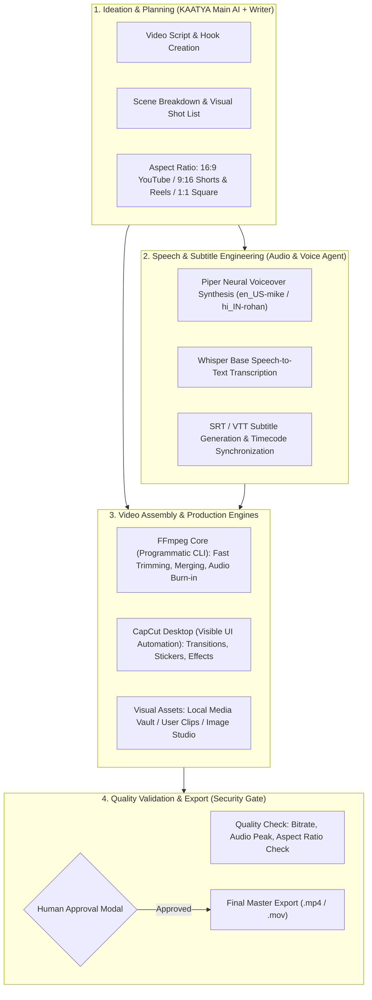
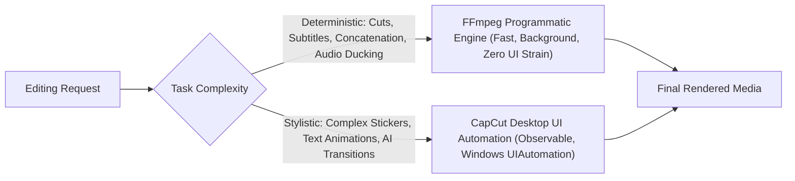
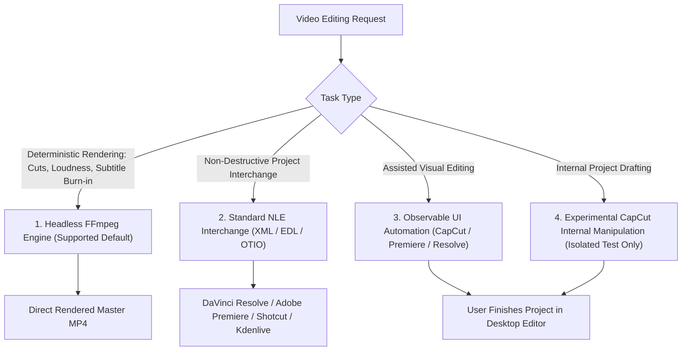

# KAATYA: Video Studio Architecture & Production Pipeline

## 1. Executive Vision: Multi-Tool Hybrid Video Production

The **KAATYA Video Studio** is a full-lifecycle video creation and editing subsystem engineered to operate on Windows 10 without demanding an enterprise GPU cluster.

---

## 2. The 22 Core Video Studio Capabilities

The Video Studio implements a comprehensive 22-step production pipeline:

| # | Production Step | Implementation Technique | Primary Tool / Engine |
| :---: | :--- | :--- | :--- |
| **1** | **Script Creation** | Engaging hooks, pacing, call-to-actions (30s, 60s, long-form). | Writer Agent (`Qwen3-1.7B` or Main AI) |
| **2** | **Storyboard Generation** | Multi-panel descriptive breakdown with shot timings. | Designer Agent + Main AI |
| **3** | **Scene Planning** | Categorizing footage requirements (A-roll, B-roll, screen capture). | Video Editor Agent |
| **4** | **Shot Lists** | Formatted checklist of required camera angles and screen recordings. | Video Editor Agent |
| **5** | **Asset Organization** | Structured folder trees: `footage/`, `audio/`, `stills/`, `exports/`. | File Manager Agent |
| **6** | **Thumbnail Generation** | High-contrast visual compositions with bold text overlays. | Image Studio + Canvas/FFmpeg |
| **7** | **Video Clip Sourcing** | Integrating user-recorded clips and local media stock. | Scoped Workspace Media Vault |
| **8** | **Audio Extraction** | Demuxing audio tracks from source videos to 16kHz WAV. | `ffmpeg -i input.mp4 -vn -ar 16000 audio.wav` |
| **9** | **Speech-To-Text** | High-accuracy transcription of dialogue and voiceovers. | Whisper Base (`ggml-base.bin`) |
| **10** | **Subtitle Generation** | Formatted `.srt` files with word-level timestamps. | Whisper Python/Rust post-processor |
| **11** | **Subtitle Timing & Correction** | Adjusting start/end offsets to prevent audio overlap. | Grammar & Language Agent |
| **12** | **Voiceover Preparation** | Script phonemization and SSML-style sentence pacing. | Audio & Voice Agent |
| **13** | **Audio Synchronization** | Aligning speech waveforms to visual transition marks. | FFmpeg `atempo` / `apad` audio filters |
| **14** | **Video Trimming** | Cutting dead air, pauses, and unwanted segments. | FFmpeg `-ss` and `-to` loss-less cuts |
| **15** | **Joining Clips** | Seamless concatenation of multiple clips without re-encoding. | FFmpeg `concat` demuxer |
| **16** | **Transitions** | Crossfades, wipes, and zoom transitions between scenes. | CapCut Desktop UI Automation / FFmpeg `xfade` |
| **17** | **Visual Effects** | Color grading, contrast adjustment, vignette, blur overlays. | CapCut Desktop / FFmpeg `eq` filter |
| **18** | **Background Music** | Ducking background audio during speech (-18 dB to -24 dB). | FFmpeg `sidechaincompress` audio filter |
| **19** | **Aspect Ratio Selection** | 16:9 (YouTube), 9:16 (Shorts/Reels), 1:1 (Instagram Feed). | FFmpeg `scale` & `pad` filters |
| **20** | **Resolution Selection** | 720p (Draft), 1080p (Standard HD), 4K (Archive). | FFmpeg `libx264` / `libx265` encoding presets |
| **21** | **Export Configuration** | Container packaging (MP4/H.264), bitrate, audio sample rate. | FFmpeg CLI parameter profiles |
| **22** | **Quality Control Check** | Verifying audio clipping, frame drops, and sync drift. | Automated FFmpeg probe & audio peak check |

---

## 3. Video Editing Strategy: FFmpeg vs. CapCut Desktop

To ensure maximum reliability, KAATYA utilizes a **Dual-Engine Video Strategy**:

## 3. Video Editing Strategy: Multi-Editor Ecosystem & CapCut Integration

To ensure versatility and zero lock-in, KAATYA implements a **Multi-Tier Video Architecture**:

### 3.1 Headless FFmpeg Engine (Primary Supported Workhorse)
- **Zero Headless Overhead:** Executes directly via supervised child processes in the Rust backend.
- **Deterministic Throughput:** Stream copying (`-c copy`) trims and concatenates 1080p footage in seconds without re-encoding.
- **Audio & Subtitle Mastering:** Applies EBU R128 loudness normalization and hardcoded/soft subtitle rendering via the `subtitles` / `ass` filters.

### 3.2 Standards-Compliant Multi-Editor Interchange
Rather than binding exclusively to one proprietary editor, KAATYA exports standard project files:
- **Final Cut Pro XML / Premiere XML (`.xml`):** Multitrack timeline structures with asset paths, clip offsets, and transition marks supported natively by Adobe Premiere Pro and DaVinci Resolve.
- **Edit Decision List (`.edl`):** Universal CMX 3600 standard supported across virtually all NLEs.
- **OpenTimelineIO (`.otio`):** Modern open interchange format for track hierarchies and transitions.
- **Timed Subtitle Tracks (`.srt`, `.ass`, `.vtt`):** Formatted speech-to-text tracks with millisecond accuracy.

### 3.3 Safe CapCut Desktop Integration Tiers
1. **Tier A: Supported Import/Export (Production Standard):**
   - KAATYA renders footage, background audio, and generates timed `.srt` files into `.assistant/exports/video/`.
   - The user opens CapCut and imports these media assets directly into standard bins.
2. **Tier B: Visible UI Automation (Optional Helper):**
   - Uses Microsoft Windows UI Automation (`UIAutomationCore.dll`) to launch `CapCut.exe`, focus the window, and open the import dialog.
   - Strictly observable: No hidden windows, no synthetic mouse grabbing, and immediate abort if `ESC` or mouse movement is detected.
3. **Tier C: Experimental Internal Project Manipulation:**
   - Writing directly into `%LOCALAPPDATA%\CapCut\User Data\Projects\com.lveditor.draft\` is categorized as **EXPERIMENTAL**.
   - *Strict Safety Mandates:*
     - **NEVER Overwrite:** The engine will never overwrite, alter, or rename existing user projects.
     - **Disposable Test Folders Only:** Always writes to a dedicated, uniquely timestamped test folder (e.g., `kaatya_test_draft_YYYYMMDD_HHMMSS`).
     - **User Authorization Required:** Creating an internal draft requires explicit user confirmation via an Obsidian Command modal.

---

## 4. Local Video-Generation Model Feasibility Audit

### 4.1 Evidence-Based Feasibility Analysis for Diffusion Video Models

| Dimension | Wan 2.1 T2V 1.3B | LTX-Video 2B Distilled | Target Hardware Constraint | Status on Target Machine |
| :--- | :--- | :--- | :--- | :--- |
| **Backbone File Size** | ~1.5 GB (Q4 GGUF) / ~2.8 GB (FP16) | ~2.2 GB (GGUF/FP8) | Limited USB/internal disk | Exists as download candidate |
| **Companion Files** | T5-XXL text encoder (4.8 GB) + 3D VAE (~350 MB) | T5/Gemma Encoder (4.8 GB) + Spatio-Temporal VAE | Extra ~5.2 GB storage | Absent locally |
| **Runtime Memory** | Min 8–10 GB VRAM; 16–32 GB system RAM | Min 8–12 GB VRAM; 32 GB system RAM | Host has 12.0 GB physical RAM | **Severe Memory Exhaustion** |
| **GPU Requirements** | Dedicated NVIDIA tensor cores (RTX 3060/4060+) | Dedicated NVIDIA GPU (RTX 3060/4060 Ti+) | Integrated Intel HD 530 (0 CUDA) | **Unsupported by GPU** |
| **CPU Fallback Availability**| Technical PyTorch CPU fallback exists | Technical CPU fallback exists | 2 cores / 4 threads @ 35W TDP | **Extremely Slow Execution** |
| **Actual Latency Performance**| [UNVERIFIED ESTIMATE: 60 to 180+ min per 5s clip] | [UNVERIFIED ESTIMATE: 45 to 120+ min per 5s clip] | Severe CPU saturation & thermal drop | **Impractical for Interactive Use** |

### 4.2 Definitive Architectural Classification:
1. **Local Video Diffusion:** Classified as **Impractical on target hardware / Unsupported by selected local runtime**. Attempting to run local video diffusion on a 2-core i3-6100T with 12 GB RAM will induce heavy pagefile thrashing, thermal throttling, and unacceptable multi-hour wait times for short low-resolution clips.
2. **Video Studio Autonomy:** The KAATYA Video Studio does **NOT** require local video diffusion. It delivers full script-to-video production via Piper speech synthesis, Whisper transcription, asset sourcing, programmatic FFmpeg CLI effects, and timeline interchange.
3. **Frontier Video Gate:** Generative text-to-video clips are delegated to **authorized Online Video Providers** (e.g., Runway Gen-3, Luma Dream Machine, Kling AI) with mandatory per-clip cost and prompt approval.
