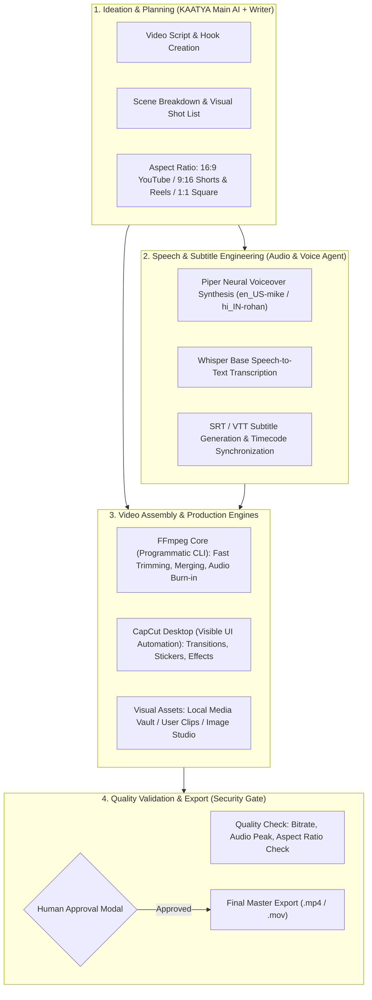
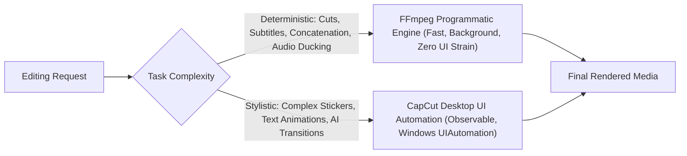

# KAATYA: Video Studio Architecture & Production Pipeline

## 1. Executive Vision: Multi-Tool Hybrid Video Production

The **KAATYA Video Studio** is a full-lifecycle video creation and editing subsystem engineered to operate on Windows 10 without demanding an enterprise GPU cluster.

---

## 2. The 22 Core Video Studio Capabilities

The Video Studio implements a comprehensive 22-step production pipeline:

| # | Production Step | Implementation Technique | Primary Tool / Engine |
| :---: | :--- | :--- | :--- |
| **1** | **Script Creation** | Engaging hooks, pacing, call-to-actions (30s, 60s, long-form). | Writer Agent (`Qwen3-1.7B` or Main AI) |
| **2** | **Storyboard Generation** | Multi-panel descriptive breakdown with shot timings. | Designer Agent + Main AI |
| **3** | **Scene Planning** | Categorizing footage requirements (A-roll, B-roll, screen capture). | Video Editor Agent |
| **4** | **Shot Lists** | Formatted checklist of required camera angles and screen recordings. | Video Editor Agent |
| **5** | **Asset Organization** | Structured folder trees: `footage/`, `audio/`, `stills/`, `exports/`. | File Manager Agent |
| **6** | **Thumbnail Generation** | High-contrast visual compositions with bold text overlays. | Image Studio + Canvas/FFmpeg |
| **7** | **Video Clip Sourcing** | Integrating user-recorded clips and local media stock. | Scoped Workspace Media Vault |
| **8** | **Audio Extraction** | Demuxing audio tracks from source videos to 16kHz WAV. | `ffmpeg -i input.mp4 -vn -ar 16000 audio.wav` |
| **9** | **Speech-To-Text** | High-accuracy transcription of dialogue and voiceovers. | Whisper Base (`ggml-base.bin`) |
| **10** | **Subtitle Generation** | Formatted `.srt` files with word-level timestamps. | Whisper Python/Rust post-processor |
| **11** | **Subtitle Timing & Correction** | Adjusting start/end offsets to prevent audio overlap. | Grammar & Language Agent |
| **12** | **Voiceover Preparation** | Script phonemization and SSML-style sentence pacing. | Audio & Voice Agent |
| **13** | **Audio Synchronization** | Aligning speech waveforms to visual transition marks. | FFmpeg `atempo` / `apad` audio filters |
| **14** | **Video Trimming** | Cutting dead air, pauses, and unwanted segments. | FFmpeg `-ss` and `-to` loss-less cuts |
| **15** | **Joining Clips** | Seamless concatenation of multiple clips without re-encoding. | FFmpeg `concat` demuxer |
| **16** | **Transitions** | Crossfades, wipes, and zoom transitions between scenes. | CapCut Desktop UI Automation / FFmpeg `xfade` |
| **17** | **Visual Effects** | Color grading, contrast adjustment, vignette, blur overlays. | CapCut Desktop / FFmpeg `eq` filter |
| **18** | **Background Music** | Ducking background audio during speech (-18 dB to -24 dB). | FFmpeg `sidechaincompress` audio filter |
| **19** | **Aspect Ratio Selection** | 16:9 (YouTube), 9:16 (Shorts/Reels), 1:1 (Instagram Feed). | FFmpeg `scale` & `pad` filters |
| **20** | **Resolution Selection** | 720p (Draft), 1080p (Standard HD), 4K (Archive). | FFmpeg `libx264` / `libx265` encoding presets |
| **21** | **Export Configuration** | Container packaging (MP4/H.264), bitrate, audio sample rate. | FFmpeg CLI parameter profiles |
| **22** | **Quality Control Check** | Verifying audio clipping, frame drops, and sync drift. | Automated FFmpeg probe & audio peak check |

---

## 3. Video Editing Strategy: FFmpeg vs. CapCut Desktop

To ensure maximum reliability, KAATYA utilizes a **Dual-Engine Video Strategy**:

### 3.1 Programmatic FFmpeg Engine (Primary Workhorse)
- **Zero Headless Overhead:** Executes directly via supervised child processes in the Rust backend.
- **Speed on i3-6100T:** Fast stream copying (`-c copy`) trims and merges 1080p video in seconds without CPU re-encoding.
- **Subtitle Burn-in:** Renders crisp ASS/SRT subtitles directly onto video frames using the `subtitles` filter with custom styling (e.g., yellow bold font, black outline).

### 3.2 CapCut Desktop Automation Architecture
- **No Fictitious API:** CapCut Desktop provides no public HTTP/REST developer API. Claiming an API exists would be an engineering falsehood.
- **Observable Windows UIAutomation:** When advanced CapCut transitions, kinetic text templates, or effects are requested:
  1. The assistant launches `CapCut.exe` visibly on the desktop.
  2. Uses Microsoft Windows UI Automation (`UIAutomationCore.dll` via `windows-rs`) to locate interface elements (Timeline, Media Import, Effects Drawer).
  3. Prepares an editable CapCut project file (`draft_content.json` in CapCut's project directory), inserting video assets and subtitle tracks programmatically.
  4. Never performs covert mouse movements or hides the window.
- **Safety Interlock:** If the user moves the mouse or presses `ESC`, automation instantly pauses.

---

## 4. Local Video-Generation Model Feasibility Audit

### 4.1 Evaluation of Small Video Models (Wan 2.1 1.3B, LTX-Video 2B)
- **The Claim:** Can small video-generation models (e.g. Wan 2.1 T2V 1.3B or LTX-Video 2B) run locally on our target PC?
- **The Physical Reality on Intel Core i3-6100T (12 GB RAM, Intel HD 530):**
  - **Zero Dedicated VRAM:** Video diffusion models require massive 3D spatio-temporal attention matrices.
  - **Memory Footprint:** A 1.3B–2B video diffusion model paired with a video VAE and T5-XXL text encoder demands **11 to 14 GB RAM**, causing immediate memory exhaustion on a 12 GB host where OS + Main AI already consume ~7.2 GB.
  - **CPU Latency:** Video diffusion generates 49 to 120 latent video frames across 20–30 denoising steps. On a 2-core / 4-thread CPU, generating a 3-second 480p video clip would take **[UNVERIFIED ESTIMATE: 45 to 120 minutes per clip]**.
- **Definitive Architectural Policy:**
  1. **Local video generation is strictly EXPERIMENTAL.**
  2. **Video creation and editing in KAATYA does NOT depend on local video generation.**
  3. The Video Editor agent produces complete, professional videos by orchestrating user footage, screen recordings, synthesized speech, Whisper subtitles, and programmatic FFmpeg effects.
  4. When AI video clip generation is explicitly desired, the assistant delegates to an **authorized Online Video Provider** (Runway Gen-3, Luma Dream Machine, Kling AI) with explicit per-clip human approval.
