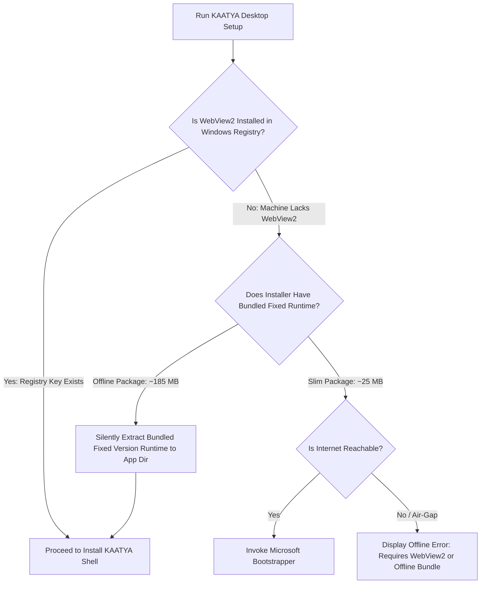

# KAATYA: Windows 10 & Microsoft Edge WebView2 Compatibility

## 1. Supported Windows 10 Platform Matrix

KAATYA is engineered natively for bare-metal **Windows 10 64-bit (`x86_64`)** desktop installations.

| Windows 10 Edition | Minimum Build | Architecture | Support Status |
| :--- | :---: | :---: | :---: |
| **Windows 10 Home / Pro** | Version 19041+ (20H1 / 20H2 / 21H1 / 21H2 / 22H2) | 64-bit (`x86_64`) | **Full Support (Target Baseline)** |
| **Windows 10 Enterprise LTSC 2021** | Build 19044+ | 64-bit (`x86_64`) | **Full Support** |
| **Windows 10 Enterprise LTSC 2019** | Build 17763 | 64-bit (`x86_64`) | **Supported with Bundled Fixed Runtime** |
| **Windows 11** | All builds | 64-bit (`x86_64`) | **Full Support (Backward Compatible)** |
| *32-bit Windows / Windows 7 / 8* | N/A | 32-bit (`x86`) | **UNSUPPORTED** |

---

## 2. Microsoft Edge WebView2 Offline Deployment Guarantee

### 2.1 The Two Installer Packaging Profiles
1. **Standalone Offline Air-Gapped Installer (~185 MB - Recommended):**
   - Packages the **Microsoft Edge WebView2 Fixed Version Runtime** (or standalone offline CAB) directly inside an Inno Setup / WiX installer.
   - If WebView2 is absent in the Windows Registry (`HKLM\SOFTWARE\WOW6432Node\Microsoft\EdgeUpdate\Clients\{F3017226-FE2A-4295-8BDF-6D3A4405E24E}`), the installer extracts the runtime locally into `%LOCALAPPDATA%\Programs\KAATYA\webview2_runtime\` without attempting any network connection.
2. **Lightweight Online Installer (~25 MB):**
   - For internet-connected desktops where WebView2 is pre-installed or can be pulled via Windows Update.

---

## 3. Native Dependencies & 100% Offline Asset Bundling

### 3.1 Visual C++ Redistributable Guarantee
The native Rust binary links against the **Microsoft Visual C++ 2015–2022 Redistributable (x64)** (`vcruntime140.dll` and `msvcp140.dll`), required by the embedded `llama.cpp` AVX2 backend and ONNX Runtime.
- The installer statically packages the official Microsoft `VC_redist.x64.exe` and runs it silently with `/quiet /norestart` if VC++ runtimes are absent.

### 3.2 100% Offline Asset Bundling (Zero Remote CDNs)
In the original Google Stitch HTML prototypes, screens referenced remote Google Fonts, the Tailwind CDN, and Google-hosted images. In the production Tauri application:
- **Typography:** Manrope, Inter, and JetBrains Mono are pre-converted to `.woff2` files stored locally in `src/assets/fonts/` and loaded via `@font-face` CSS declarations.
- **Iconography:** Material Symbols Outlined are embedded as a local SVG sprite sheet or local WOFF2 font.
- **Styling:** Tailwind CSS is precompiled at build time via PostCSS and Vite. Zero runtime `<script src="https://cdn.tailwindcss.com">` dependencies exist.
- **Images & Graphics:** All emblems, preview graphics, and default avatars are bundled in `src/assets/images/`.

---

## 4. External Storage Integration: Amazon Basics USB 3.0 Pendrive

The user has designated an **Amazon Basics USB 3.0 pendrive (~116 GB usable capacity)** as external storage.

### 4.1 Storage Partitioning Strategy
- **Internal Drive (`T:\ai creation`):**
  - Application binaries, resident models (`Qwen3-4B`, `Qwen3-Embedding`), voice ONNX models, and active SQLite databases.
- **External USB 3.0 Storage (~116 GB):**
  - **Secondary Model Vault:** Storage for large, infrequently used models (e.g. `flux-2-klein-4b`, full video models).
  - **Video Studio Scratch Disk:** Cache directory for raw 1080p footage, uncompressed WAV extractions, and temporary FFmpeg render chunks.
  - **Export Archive:** Final rendered MP4 videos, archived project zip files, and automated database backups.
- **Dynamic Drive Detection:** The Rust core uses Win32 `GetVolumeInformationW` and `GetDriveTypeW` to detect drive insertion/removal, dynamically displaying USB storage telemetry in **System Monitor** (Screen 12).
