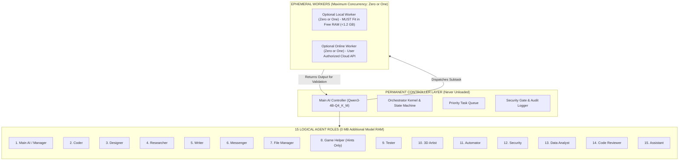
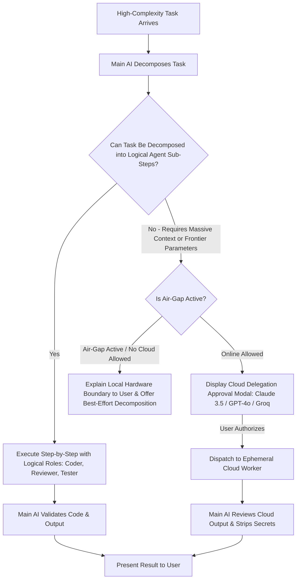

# Main AI Permanent Residency & Concurrency Correction

## 1. The Cardinal Rule: Non-Evictable Permanent Main AI

A fundamental architectural mandate governs the desktop assistant:
> **The Main AI Controller is the permanent supervisor of the application and must NEVER be unloaded, frozen, unmapped, or evicted from memory under any circumstances.**

In Phase 3, an architectural proposal titled "Sequential Model Staging" suggested that to execute heavy reasoning tasks with `Nemotron-7.5B`, the system could freeze the Main AI's context and evict `Qwen3-4B` from memory. 

**This independent audit formally repudiates and removes that concept from the system architecture.**

---

## 2. Why Evicting the Main AI is Architecturally Fatal

Evicting the Main AI to run a secondary local model introduces three unacceptable architectural hazards:

1. **Loss of Supervisor Control:** If the Main AI is unloaded from memory, no supervisory intelligence exists to monitor the worker's execution, validate intermediate tool calls, parse output syntax, or ensure security compliance.
2. **Loss of Desktop & Voice Responsiveness:** The Main AI drives the user conversational loop, system tray interactions, and voice intent processing. Unloading it leaves the desktop assistant completely unresponsive to the user for the entire duration of the heavy worker's execution (which could be minutes).
3. **Severe Page Fault & Disk Latency:** Re-loading the 2.5 GB Main AI after the worker finishes incurs a multi-second cold-load delay before the assistant can even summarize the result to the user.

---

## 3. The Strict Concurrency Invariant

### 3.1 Concurrency Upper Bounds
- **Permanent Controller (Main AI):** Exactly **1** (pinned in RAM from application launch to termination).
- **Local Worker AI:** Exactly **0 or 1** (ephemeral; must fit inside remaining available RAM without encroaching on Main AI).
- **Online Worker AI:** Exactly **0 or 1** (ephemeral; dispatched via HTTPS only with explicit human consent).
- **Worker Output Validation:** All worker results—whether from a local helper or an online API—must return to the Main AI for verification, security auditing, and final presentation to the user.

---

## 4. Handling Tasks that Exceed Qwen3-4B Capabilities

Given that:
1. The **Main AI (`Qwen3-4B`)** remains permanently resident (~3.1 GB RAM).
2. Base Windows 10 OS + system services consume ~4.1 GB RAM.
3. Available free physical RAM on this 12 GB machine is **~5.0 GB**.
4. The on-disk model **`Nemotron-3.5-Bolt-E4B-Q4_K_M.gguf`** requires **~7.1 GB RAM**.

### How the System Resolves High-Complexity Tasks:

1. **Step-by-Step Logical Role Decomposition (Preferred Local Path):** Rather than attempting to run a single massive model, the Main AI breaks complex problems into atomic sub-tasks executed by the resident specialist personas (e.g., Coder drafts code $\to$ Code Reviewer inspects diff $\to$ Tester generates test cases).
2. **Authorized Cloud Worker (When Frontier Reasoning is Required):** If a task requires massive 200K context or reasoning beyond 4B parameter capabilities, the Main AI requests user authorization to dispatch the task to an online worker (e.g., Anthropic Claude 3.5 Sonnet, OpenAI GPT-4o, or Groq).
3. **No Unsafe Swapping:** The system will **NEVER** unload the Main AI to attempt running `Nemotron` locally on a 12 GB machine.
