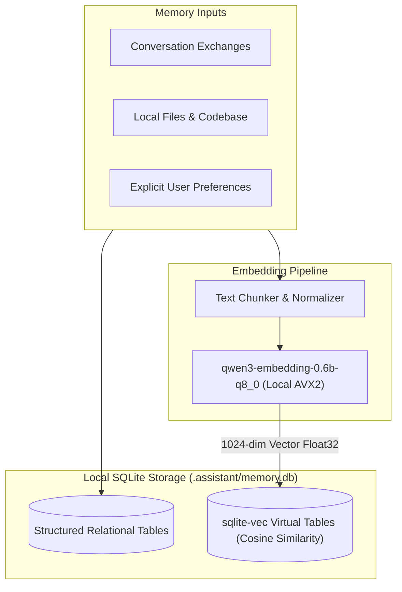
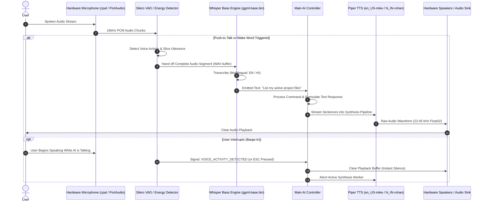

# Memory & Voice Architecture Specification

## 1. Unified Persistent Memory Architecture

To act as a genuine companion and proactive orchestrator, the assistant maintains two interconnected memory stores:
1. **Relational Episodic Memory (SQLite):** Structured storage for conversations, user preferences, tasks, workflows, and security audit events.
2. **Semantic Vector Memory (`sqlite-vec` + Qwen3-Embedding):** High-dimensional vector space for semantic similarity search across past conversations, project documentation, code snippets, and persistent knowledge.

---

## 2. Technical Implementation: SQLite + `sqlite-vec`

### 2.1 Why SQLite + `sqlite-vec`?
Alternative vector databases (such as Chroma, Milvus, or Qdrant) require separate background daemons, heavy Python runtimes, or excessive memory footprints (>500 MB).
- **`sqlite-vec`** is a zero-dependency, ultra-lightweight C extension for SQLite that loads directly into the embedded `rusqlite` connection in our Rust core.
- Consumes **<15 MB additional RAM**.
- Performs sub-millisecond exact KNN / cosine similarity queries across 50,000 vectors on our Intel i3-6100T CPU.

### 2.2 Local Embedding Model Profiling
- **Model File:** `T:\ai creation\qwen3-embedding-0.6b-q8_0.gguf` (639 MB).
- **Architecture:** 0.6B parameter transformer outputting 1024-dimensional normalized vectors.
- **Inference Speed on i3-6100T:** **[UNVERIFIED THEORETICAL ESTIMATE: ~80 to 180 tokens/second]** (CPU vectorized via AVX2 on 2 threads). Embedding a 200-word paragraph (~260 tokens) takes **~1.4 to 2.8 seconds** in background worker mode. *(Note: Corrected from prior typographical error of 120 tok/ms).*
- **Memory Footprint:** Pinned in memory using **~750 MB RAM**, sharing the memory space during active indexing sessions.

### 2.3 Memory Governance & User Control (Screen 09: Memory Center)
- **Pinning:** Mark critical instructions (e.g., *"Always format code using 4-space indentation and include type hints"*) as permanent system anchors that are injected into every prompt.
- **Selective Forgetting & Deletion:** Any memory item or past conversation can be permanently deleted with immediate VACUUM purging.
- **Import / Export:** Full database backup to encrypted JSON or standard SQLite `.db` file.
- **Air-Gap Privacy:** 100% local. Zero embeddings are ever sent to remote vector services.

---

## 3. Real-Time Offline Voice Processing Architecture

The voice system achieves full conversational flow, from microphone capture to streaming speech synthesis, completely offline without external cloud dependencies.

---

## 4. Voice Model Assets & Performance Metrics

### 4.1 Speech-To-Text: Whisper Base (`ggml-base.bin`)
- **Asset Path:** `T:\ai creation\ggml-base.bin` (148 MB).
- **Architecture:** 74M parameter encoder-decoder transformer.
- **Language Support:** Robust multilingual support, including English and Hindi transcription.
- **Inference Runtime:** `whisper.cpp` AVX2 backend pinned to 2 threads.
- **Performance on i3-6100T [UNVERIFIED THEORETICAL ESTIMATES]:**
  - Real-Time Factor (RTF): **~0.25 – 0.35**.
  - A 3-second spoken sentence transcribes in **~750 – 950 ms**.
  - Memory Footprint: **~220 MB RAM** during active processing.

### 4.2 Text-To-Speech: Piper Neural Voice System
- **English Model:** `T:\ai creation\english voice onnx + jons\en_US-mike-medium.onnx` (63.2 MB) + JSON config.
  - Voice Profile: `en_US-mike` (Natural American English male, clear technical articulation).
- **Hindi Model:** `T:\ai creation\hindi voice onnx + jon\hi_IN-rohan-medium.onnx` (63.0 MB) + JSON config.
  - Voice Profile: `hi_IN-rohan` (Natural Hindi/Hinglish male, high phoneme clarity).
- **Unified Engine:** Both voice models share the identical ONNX Runtime VITS architecture. Switching languages dynamically involves selecting the corresponding model handle based on detected response language.
- **Performance on i3-6100T [UNVERIFIED THEORETICAL ESTIMATES]:**
  - Real-Time Factor (RTF): **~0.08 – 0.12** (Synthesizing 1 second of speech takes ~90 ms).
  - Pinned to Core 1 / Thread 3.
  - Memory Footprint: **~140 MB RAM** when both voice models are resident.

---

## 5. Voice Interaction Modes & Control

1. **Push-To-Talk (PTT):** Default and recommended mode. Holding a global hotkey (e.g., `Right Alt` or `Caps Lock`) opens the microphone; releasing it immediately triggers Whisper transcription. Zero background CPU usage while idle.
2. **Continuous Hands-Free (VAD):** Voice Activity Detection automatically activates on speech. Ideal for rapid back-and-forth debugging sessions.
3. **Optional Wake Word Engine:** Supports local ONNX wake word detection (e.g., *"Hey Jarvis"* or *"Assistant"*). Marked as **Optional** in Settings to allow users on battery or low-power modes to disable background audio listening entirely.
4. **Instant Barge-In (Interruptibility):** If the assistant is speaking and the user speaks or presses the `Spacebar` / `ESC`, the audio sink is instantly flushed (`sink.stop()`), silence is restored in <10 milliseconds, and the assistant listens to the new input.
