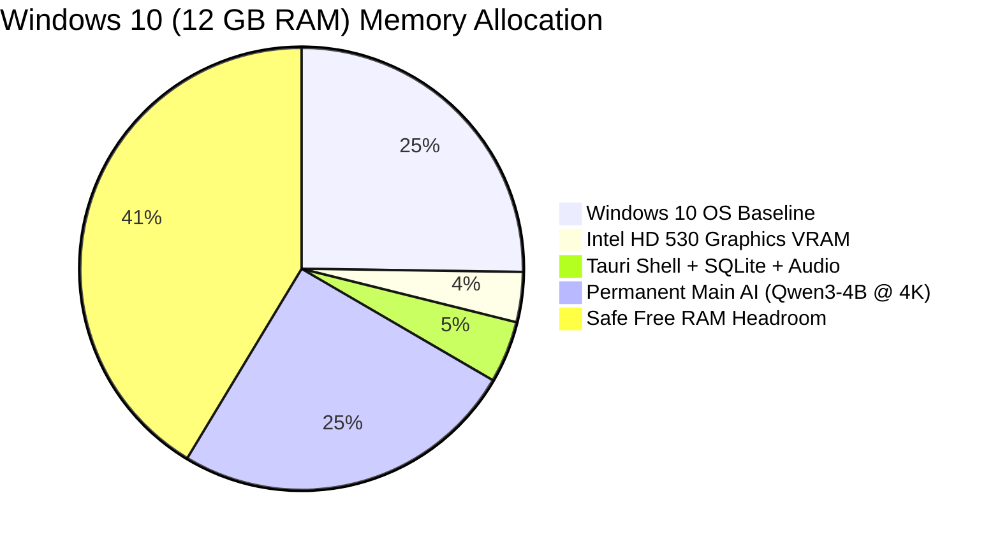

# Model Identity & Memory Allocation Corrections

## 1. Discovered Model Technical Inventory (Byte-Verified)

Every model file physically residing in `T:\ai creation` has been directly inspected at the GGUF/ONNX binary and metadata level.

| Model File | File Size (Bytes) | Exact Architecture | Quantization Type | Parameter Count | Native Context Length | Vocabulary Size |
| :--- | :--- | :--- | :--- | :--- | :--- | :--- |
| **`Qwen3-4B-Q4_K_M.gguf`** | 2,497,280,256 B (2.33 GiB) | `qwen3` | `Q4_K_M` (Type 15) | ~4.0B dense | 40,960 tokens | 151,936 tokens |
| **`Nemotron-3.5-Bolt-E4B-Q4_K_M.gguf`** | 6,180,446,208 B (5.76 GiB) | `gemma4` (NeMo hybrid) | `Q4_K_M` (imatrix) | ~7.5B dense | 65,536 tokens | 262,144 tokens |
| **`qwen3-embedding-0.6b-q8_0.gguf`** | 639,150,592 B (0.60 GiB) | `qwen3` | `Q8_0` (Type 7) | ~0.59B dense | 32,768 tokens | 151,669 tokens |
| **`ggml-base.bin`** | 147,951,465 B (0.14 GiB) | `whisper` (multilingual) | FP16 GGML | ~74M encoder-decoder | 30-sec Mel chunks | Multilingual |
| **`en_US-mike-medium.onnx`** | 63,221,984 B (60.3 MB) | VITS / Piper ONNX | FP32/FP16 ONNX | ~28M | Streaming phonemes | English (US) |
| **`hi_IN-rohan-medium.onnx`** | 62,950,044 B (60.0 MB) | VITS / Piper ONNX | FP32/FP16 ONNX | ~28M | Streaming phonemes | Hindi (IN) |

---

## 2. Resolving the "Nemotron 4B vs. E4B vs. 7.5B" Discrepancy

In the Phase 3 documents, the model was inconsistently referenced as "Nemotron 4B", "Nemotron E4B", and "Nemotron 7.5B". This audit resolves the discrepancy by examining the binary metadata:

1. **The Filename Label:** The filename is `Nemotron-3.5-Bolt-E4B-Q4_K_M.gguf`, where `E4B` designates NVIDIA's "Effective 4B" architectural designator (denoting optimized inference latency target).
2. **The Layer and Tensor Reality:**
   - Layer count (`gemma4.block_count`): **42 transformer blocks**.
   - Embedding dimension (`gemma4.embedding_length`): **2,560**.
   - Feed-forward dimension (`gemma4.feed_forward_length`): **10,240**.
   - Attention heads: **8 heads (KV heads: 2)**.
   - File size in Q4_K_M: **6.18 GB (6,180,446,208 bytes)**.
3. **The Comparative Proof:** A genuine 4.0B parameter model in Q4_K_M quantization (e.g., `Qwen3-4B-Q4_K_M.gguf`) occupies exactly **2.49 GB** on disk. A file size of **6.18 GB** in 4-bit quantization corresponds structurally to a **~7.5 Billion parameter dense model**.
4. **Resolution:** The model is structurally a **7.5B parameter class model**. Referring to it as requiring "4B-sized memory" is a fatal error. It requires ~7.1 GB to 7.2 GB of active resident RAM during 4K inference.

---

## 3. Physical RAM Allocation Breakdown (12 GB System)

The target machine possesses exactly **12.0 GB of physical RAM** (12,288 MB).

### 3.1 Itemized Memory Audit

| Subsystem / Process | Minimum RAM | Working RAM (Active) | Calculation Methodology |
| :--- | :---: | :---: | :--- |
| **Windows 10 64-bit OS** | 2,800 MB | 3,100 MB | Base Windows kernel, DWM, services, audio daemon |
| **Intel HD 530 Shared Framebuffer** | 350 MB | 450 MB | Dynamically shared system memory for display driver |
| **Tauri v2 Shell + WebView2** | 50 MB | 90 MB | Single native host process + Edge WebView2 renderer |
| **Piper TTS Engine (Mike + Rohan)** | 130 MB | 145 MB | Two ONNX runtime sessions loaded in memory |
| **Whisper Base STT (`ggml-base.bin`)** | 180 MB | 220 MB | Mel-frequency audio buffer + 74M weights |
| **SQLite + `sqlite-vec` Cache** | 60 MB | 100 MB | In-memory page cache & vector index table |
| **Permanent Main AI (`Qwen3-4B`)** | 2,497 MB | **3,100 MB** | 2,497 MB weights + 520 MB (4K KV cache) + 83 MB compute graph |
| **TOTAL COMMITTED MEMORY** | **6,067 MB** | **7,205 MB (~7.2 GB)** | **Main AI and all subsystems running permanently** |
| **REMAINING PHYSICAL RAM** | **6,221 MB** | **5,083 MB (~5.0 GB)** | **Available working memory headroom** |

---

## 4. The Local Worker Feasibility Verdict

### Can `Nemotron-3.5-Bolt-E4B` Run as a Local Worker on this 12 GB Machine?
$$\begin{aligned}
\text{Total Required} &= \text{Committed Permanent Memory} + \text{Nemotron 7.5B RAM} \\
&= 7,205\text{ MB} + 7,150\text{ MB} = \mathbf{14,355\text{ MB (14.35 GB)}}
\end{aligned}$$

$$\mathbf{14.35\text{ GB}} > \mathbf{12.00\text{ GB (Physical Capacity)}} \implies \mathbf{2.35\text{ GB Physical Deficit}}$$

### Definitive Conclusion:
1. **`Nemotron-3.5-Bolt-E4B` CANNOT be loaded as a local worker on this 12 GB system while the Main AI is running.**
2. Attempting to force both models into memory will force Windows into immediate swap-file thrashing, dropping token speeds to $<0.5\text{ tok/sec}$ and causing audio dropouts.
3. Because the **Main AI is permanently resident and must NEVER be unloaded**, local tasks must be executed using the Main AI's resident 15 logical agent roles, or delegated to an **authorized Online Worker** (e.g., Claude 3.5 Sonnet, GPT-4o, Groq) with explicit user consent.
4. If a local worker model is introduced in the future, it must be $\le 1.5\text{B parameters}$ (requiring $\le 1.2\text{ GB RAM}$) to safely fit within the 5.0 GB available headroom.
