# Complete Navigation & Interaction Flow Map

This document charts the page connections, routing targets, global shortcuts, and contextual drill-down links across the 15 screens of the **Obsidian Command** design system.

---

## 1. Global Navigation Topology

The application utilizes a **Hub-and-Spoke Desktop Architecture** centered on the **Command Center (Screen 01)**. Every primary view is accessible within one click from the persistent Left Navigation Rail, while global search (`Ctrl + K`) and the Floating HUD (`F9`) provide instant access from anywhere.

```mermaid
flowchart TD
    subgraph Global_Shell [Universal Navigation Rail & Header]
        Search["Global Command Palette (Ctrl + K)"]
        HUDTrigger["Floating HUD Trigger (F9)"]
        NavRail["14-Item Left Navigation Rail"]
    end

    subgraph Hub [Central Hub]
        Screen01["01. Command Center (Primary Operations Hub)"]
    end

    subgraph Core_Workspaces [Primary Workspaces]
        Screen02["02. Conversation Workspace"]
        Screen03["03. 3D Neural Core"]
        Screen06["06. Agent Workspace"]
        Screen07["07. Workflow Builder"]
        Screen08["08. PC Control Centre"]
    end

    subgraph Resources_Tools [Resources & Engine Management]
        Screen04["04. Intelligence & AI Models"]
        Screen05["05. Plugin Centre"]
        Screen09["09. Memory Centre"]
        Screen10["10. Voice & Personality Studio"]
    end

    subgraph Governance_Ops [Governance & System Telemetry]
        Screen11["11. Tasks & Activity"]
        Screen12["12. System Monitor"]
        Screen13["13. Security & Permissions"]
        Screen14["14. Settings"]
    end

    subgraph Companion [Mini Companion]
        Screen15["15. Floating AI HUD (Compact Overlay)"]
    end

    %% Hub Connections
    NavRail --> Screen01
    NavRail --> Screen02
    NavRail --> Screen03
    NavRail --> Screen04
    NavRail --> Screen05
    NavRail --> Screen06
    NavRail --> Screen07
    NavRail --> Screen08
    NavRail --> Screen09
    NavRail --> Screen10
    NavRail --> Screen11
    NavRail --> Screen12
    NavRail --> Screen13
    NavRail --> Screen14
    HUDTrigger --> Screen15

    %% Deep Links from Command Center
    Screen01 -- "Active Tasks Click" --> Screen11
    Screen01 -- "Approval Review Click" --> Screen13
    Screen01 -- "Neural Emblem Click" --> Screen03
    Screen01 -- "Hardware Status Meter" --> Screen12
    Screen01 -- "Model Metric Pill" --> Screen04
    Screen01 -- "Voice Microphone Trigger" --> Screen10
    Screen01 -- "Full Conversation History" --> Screen02

    %% Return from HUD
    Screen15 -- "Expand Button (F9)" --> Screen01
```

---

## 2. Navigation Routing Table

| Screen Index & Title | Internal `data-path` | Sidebar Icon (Material Symbols) | Primary Functional Role | Direct Sub-Navigation Links |
| :--- | :--- | :--- | :--- | :--- |
| **01. Command Center** | `command-center` | `dashboard` | Global operational command & status hub | Links to Tasks, Approvals, Neural Core, Telemetry |
| **02. Conversation Workspace** | `conversation` | `chat` | Multi-turn chat, prompt engineering, code display | Links to Session history, Tool outputs, Model picker |
| **03. 3D Neural Core** | `3d-neural-core` | `hub` | Visual node graph of models, agents & memory | Node Inspector drawer, Camera zoom, 2D/3D toggle |
| **04. Intelligence & AI Models** | `intelligence-models` | `neurology` | Local GGUFs and online model configuration | Benchmark launcher, Quant picker, RAM unloader |
| **05. Plugin Centre** | `plugin-center` | `extension` | Extensions, MCP tools, filesystem sandbox | Plugin Configuration slide-out drawer, Category tabs |
| **06. Agent Workspace** | `agent-workspace` | `group_work` | Swarm agent roster, roles & task queues | Agent detail drawer, Model assignment, Message trace |
| **07. Workflow Builder** | `workflow-builder` | `account_tree` | Visual DAG workflow designer & step debugger | Node palette, Trigger config modal, Step execution |
| **08. PC Control Centre** | `pc-control` | `desktop_windows` | Visual desktop automation & screenshot viewer | Safety level toggle, Process list, Action history |
| **09. Memory Centre** | `memory-center` | `history_edu` | Vector knowledge store, memory ledger & graph | Vector injection modal, Forget confirmation dialog |
| **10. Voice & Personality Studio**| `voice-studio` | `record_voice_over` | Piper TTS speech synthesis & acoustic sliders | Voice picker, Personality matrix, Waveform tester |
| **11. Tasks & Activity** | `tasks-activity` | `task_alt` | Kanban board of active and queued agent jobs | Task detail drawer, Approval modal, Log viewer |
| **12. System Monitor** | `system-monitor` | `monitoring` | Real-time hardware telemetry (RAM/CPU/VRAM) | Process table filter, Time-range selector (1h/24h) |
| **13. Security & Permissions** | `security-permissions` | `verified_user` | Air-gap switch, capability matrix & audit log | Path whitelist editor, Revoke all permissions modal |
| **14. Settings** | `settings` | `settings` | Application, hardware, and directory preferences | Category tabs (General, AI, Hardware, Storage) |
| **15. Floating AI HUD** | (Detached Widget) | `deployed_code` (`F9`) | Borderless desktop companion overlay | Expand to Full Window (`F9`), Mic trigger, Mini-feed |

---

## 3. Global Desktop Shortcuts & Event Triggers

The design embeds specific desktop keybindings in the interface chrome:

1. **`Ctrl + K` (Global Command Palette):**
   - Centered in the top header on every screen.
   - Opens an omnibar modal allowing fuzzy search across pages, agents, tools, memory entries, and settings.
2. **`F9` (Toggle Floating HUD Mode):**
   - Located at the bottom of the Left Navigation Rail.
   - Collapses the main multi-pane window into the compact **Floating AI HUD (Screen 15)** or expands the HUD back into the full Command Center.
3. **`Ctrl + [` (Collapse / Expand Left Rail):**
   - Minimizes the 256px wide navigation rail into a 64px icon-only rail, expanding central workspace width.
4. **`Ctrl + Enter` (Dispatch Command):**
   - Standard execution trigger inside the Command Center prompt box and Conversation input area.
5. **Physical `Escape` Key (Emergency Safety Halt):**
   - Hooked via Stonic's low-level keyboard hook (`WH_KEYBOARD_LL`).
   - Immediately stops all active PC automation and tool calls.

---

## 4. Modal Dialogs & Context Drawers

The audit identified **6 dedicated modal dialogs and slide-out drawers** designed across the templates:

1. **Pending Approval Confirmation Modal (Screens 01 & 11):**
   - Intercepts destructive actions (file delete, format, shell execution).
   - Displays requested command, affected file paths, requesting agent name, and `Approve Once` / `Reject` buttons.
2. **Node Inspector Flyout Drawer (Screen 03):**
   - Slides out from the right margin when any node (Agent, Model, Memory) in the SVG graph is clicked.
   - Shows live token streams, latency ms, and parent-child connections.
3. **Plugin Configuration Slide-Out (Screen 05):**
   - Displays deterministic sandbox guarantees, read/write path allowlists, and memory caps.
4. **Manual Memory Vector Injection Modal (Screen 09):**
   - Allows users to type or paste notes and manually vectorize them into SQLite memory.
5. **Confirm Irreversible Forget Modal (Screen 09):**
   - Safety dialog requiring explicit confirmation before purging a memory vector from the database.
6. **Agent Detail Configuration Modal (Screen 06):**
   - Configures model assignment, temperature, and capability boundaries for an individual specialist agent.

---

## 5. Navigation Completeness Assessment

- **Orphaned Screens:** **ZERO.** Every one of the 15 screens has an active representation in the navigation rail or header triggers.
- **Routing Implementation Gap:** In the current Stitch export, `data-path="name"` attributes exist on `<a>` tags with `href="#"`. Clicking a navigation item in a web browser does not load the corresponding screen because a client-side SPA router (e.g. React Router or Zustand active tab state) has not yet been hooked up.
- **Breadcrumb Navigation:** High-level breadcrumbs are present in the top header (`root / workspace`), but do not dynamically update based on nested page views.
