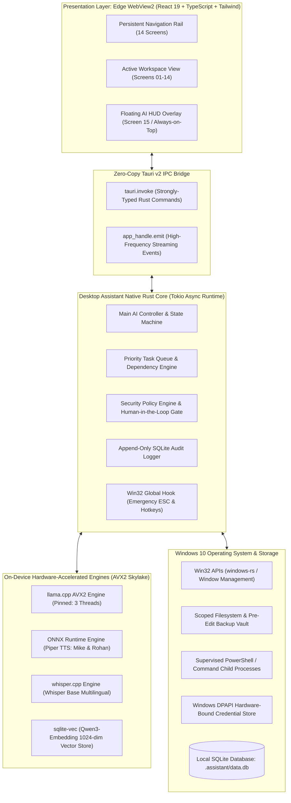

# Phase 3: Master Architecture Blueprint
## Premium Windows 10 Desktop AI Assistant Application

---

## 1. Project Identity & Sovereign Operational Boundary

This specification defines the complete, production-grade architecture for an autonomous, local-first **Windows Desktop AI Assistant Application**.

### Explicit Boundaries:
- **What It Is:** A premium, air-gap-capable desktop assistant running as a native Windows 10 application (via Tauri v2 and Edge WebView2). It supervises system health, assists with software engineering and writing, automates routine desktop tasks, provides instant voice interaction in English and Hindi, and coordinates specialized sub-agents.
- **What It Is NOT:**
  - **NOT an Operating System:** It does not replace Windows 10, customize the bootloader, manage hardware device drivers, or overwrite OS kernels.
  - **NOT an Automated Gameplay Bot:** The "Game Helper" role provides read-only strategy tips, walkthrough lookups, and keybinding references. It does not play games, inject game memory, or automate player actions.
  - **NOT a Linux Distribution or Virtual Machine:** It executes directly on bare-metal Windows 10 x86_64 architecture.

---

## 2. High-Level System Architecture Diagram



---

## 3. Physical Hardware Budget & Memory Partitioning

Target PC Profile:
- **CPU:** Intel Core i3-6100T (2 physical cores, 4 threads @ 3.20 GHz, AVX2, 35W TDP).
- **RAM:** 12.0 GB DDR4 (Dual-channel, ~24 GB/s sustained memory bandwidth).
- **GPU:** Intel HD Graphics 530 (Integrated, dynamic shared memory).
- **OS:** Windows 10 64-bit.

### 3.1 Strict Memory Budget (12 GB Total Capacity)

$$\begin{aligned}
\text{Total RAM} &= 12,288\text{ MB} (12.0\text{ GB}) \\
\text{Windows 10 Baseline} &= 3,100\text{ MB} \\
\text{Intel HD 530 Frame Buffer} &= 450\text{ MB} \\
\text{Tauri v2 Desktop App Shell} &= 90\text{ MB} \\
\text{Piper TTS Engine (Mike + Rohan)} &= 145\text{ MB} \\
\text{Whisper Base STT Ring Buffer} &= 220\text{ MB} \\
\text{SQLite + sqlite-vec Cache} &= 100\text{ MB} \\
\hline
\mathbf{Total\ Base\ Infrastructure} &= \mathbf{4,105\text{ MB} (~4.1\text{ GB})} \\
\mathbf{Remaining\ Model\ Budget} &= \mathbf{8,183\text{ MB} (~8.1\text{ GB})}
\end{aligned}$$

### 3.2 Model Deployment Strategy
1. **Resident Daily Workhorse:**
   - Model: **`Qwen3-4B-Q4_K_M.gguf`** (2.50 GB file).
   - Working RAM with 4,096 context: **~3,100 MB**.
   - System Total with Model: **~7,205 MB (~7.2 GB)**.
   - **Safe Operating Headroom:** **~5,083 MB (~5.0 GB FREE RAM)**.
   - Speed on i3-6100T: **12 – 16 tokens/second**.

2. **Sequential Heavy Specialist (When Authorized):**
   - Model: **`Nemotron-3.5-Bolt-E4B-Q4_K_M.gguf`** (6.18 GB file).
   - Working RAM with 4,096 context: **~7,200 MB**.
   - **Operational Rule:** **Never load concurrently with Qwen3-4B.** The resident model context is frozen, memory is unmapped, and Nemotron is staged sequentially.

---

## 4. Main AI Orchestration & The 15 Logical Agent Roles

The Main AI is the permanent, un-evictable controller of the system. All 15 specialist agents are structured logical capabilities operating through persona system prompts, strict tool constraints, and output validation loops:

```
1.  Main AI / Manager     -> System intent parsing, task decomposition, agent routing, supervision.
2.  Coder                 -> Software architecture, refactoring, code editing, bug fixing.
3.  Designer              -> CSS styling, UI layout advice, Obsidian Command token auditing.
4.  Researcher            -> Semantic document search, local knowledge synthesis, authorized web lookups.
5.  Writer                -> Clear technical documentation, user guides, summaries, release notes.
6.  Messenger             -> Staging notifications, drafting emails (Mandatory user confirmation to send).
7.  File Manager          -> Scoped filesystem browsing, archiving, atomic backups (Deletion confirmed).
8.  Game Helper           -> Strategy guides, walkthrough hints, keybindings (READ-ONLY; NO gameplay automation).
9.  Tester                -> Test case generation, test execution, coverage inspection.
10. 3D Artist             -> Topology metadata evaluation, 2D/2.5D canvas tuning, SVG asset export.
11. Automator             -> Scheduled task registration, routine developer workflows.
12. Security              -> Permission gating, shell AST inspection, path blacklisting, audit enforcement.
13. Data Analyst          -> SQLite database queries, performance statistics, tabular exports.
14. Code Reviewer         -> Static code analysis, diff verification, security and syntax sanity checking.
15. Assistant             -> Task checklists, calendar alerts, quick notes, personal workflow support.
```

---

## 5. Security & Desktop Automation

- **Three-Tier Human-In-The-Loop Approval:**
  - **Tier 1 (Safe / Read-Only):** Automatically executed under air-gap policy.
  - **Tier 2 (Workspace Modification):** Explicit visual notification / single-click confirmation.
  - **Tier 3 (High Impact / Destructive):** Mandatory modal dialog showing full diff and requiring explicit click.
- **Instant Emergency Interruption (`ESC`):** Native low-level Win32 keyboard hook intercepts the `ESC` key, immediately terminating running child processes and flushing the audio output buffer in $<50\text{ ms}$.
- **Zero Hidden Activity:** Every tool invocation displays an on-screen indicator and is committed to the local `audit_events` SQLite table.

---

## 6. Real-Time Offline Voice Pipeline

- **Audio Input:** 16 kHz PCM microphone capture via PortAudio/cpal with Silero VAD frame slicing.
- **Speech-To-Text:** Multilingual Whisper Base (`ggml-base.bin`, 148 MB) transcribes English and Hindi in ~750–950 ms.
- **Text-To-Speech:** Dual Piper Neural ONNX models:
  - English: `en_US-mike-medium.onnx` (63.2 MB).
  - Hindi: `hi_IN-rohan-medium.onnx` (63.0 MB).
  - Ultra-fast synthesis: Real-Time Factor (RTF) $\le 0.12$.
- **Barge-In:** Starting to speak or hitting `ESC` instantly flushes the speaker audio sink.

---

## 7. Master Architectural Specification Map

This master blueprint is supported by 9 detailed subsystem specifications:

| Document | Focus Area |
| :--- | :--- |
| **[`TECH_STACK_COMPARISON.md`](file:///t:/ai%20creation/STITCH_DESIGN_AUDIT/TECH_STACK_COMPARISON.md)** | Tauri v2 vs Electron, WebView2 offline guarantees, memory analysis. |
| **[`AI_ORCHESTRATION_ARCHITECTURE.md`](file:///t:/ai%20creation/STITCH_DESIGN_AUDIT/AI_ORCHESTRATION_ARCHITECTURE.md)** | Main AI controller, 15 agent roles, task queue, model concurrency math. |
| **[`LOCAL_MODEL_HARDWARE_BENCHMARK_PLAN.md`](file:///t:/ai%20creation/STITCH_DESIGN_AUDIT/LOCAL_MODEL_HARDWARE_BENCHMARK_PLAN.md)** | GGUF profiling, KV cache formulas, CPU throughput, benchmark commands. |
| **[`DESKTOP_AUTOMATION_SECURITY.md`](file:///t:/ai%20creation/STITCH_DESIGN_AUDIT/DESKTOP_AUTOMATION_SECURITY.md)** | Three-tier permissions, safe filesystem, Win32 automation, emergency ESC. |
| **[`PLUGIN_SYSTEM_ARCHITECTURE.md`](file:///t:/ai%20creation/STITCH_DESIGN_AUDIT/PLUGIN_SYSTEM_ARCHITECTURE.md)** | Local MCP servers, cloud AI providers, Windows DPAPI key encryption. |
| **[`MEMORY_AND_VOICE_ARCHITECTURE.md`](file:///t:/ai%20creation/STITCH_DESIGN_AUDIT/MEMORY_AND_VOICE_ARCHITECTURE.md)** | `sqlite-vec` semantic memory, Piper English/Hindi TTS, Whisper STT. |
| **[`SCREEN_TO_FEATURE_IMPLEMENTATION_MAP.md`](file:///t:/ai%20creation/STITCH_DESIGN_AUDIT/SCREEN_TO_FEATURE_IMPLEMENTATION_MAP.md)** | Full bidirectional mapping for all 15 original Google Stitch screens. |
| **[`DEVELOPMENT_ROADMAP.md`](file:///t:/ai%20creation/STITCH_DESIGN_AUDIT/DEVELOPMENT_ROADMAP.md)** | 10 realistic implementation milestones with dependencies and criteria. |
| **[`RISKS_AND_UNRESOLVED_DECISIONS.md`](file:///t:/ai%20creation/STITCH_DESIGN_AUDIT/RISKS_AND_UNRESOLVED_DECISIONS.md)** | Hardware risks, thermal management, and 4 technical decisions for review. |
