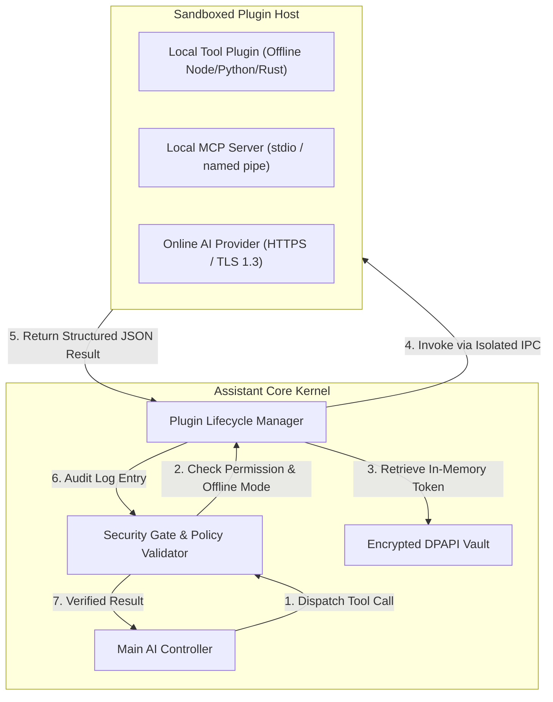
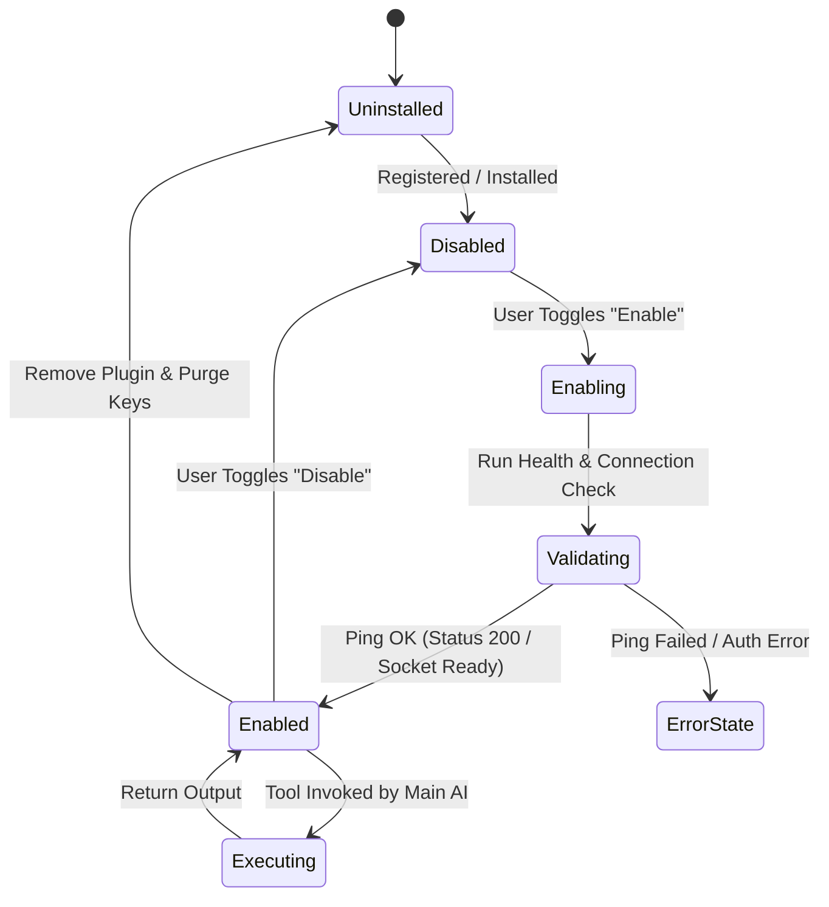

# Plugin Architecture & Provider Integration Specification

## 1. System Overview

The desktop assistant integrates a modular, sandboxed plugin system designed to extend capabilities without compromising local stability or air-gapped security. The plugin system provides two distinct integration classes:
1. **Local Plugins:** On-device scripts, developer utilities, local Model Context Protocol (MCP) servers, and Windows tools running 100% offline.
2. **Online AI & Service Providers:** Optional external cloud endpoints (Anthropic Claude, OpenAI, Google Gemini, Groq, OpenRouter) and web services.

All plugin invocations are governed exclusively by the **Main AI Controller** through the **Security Gate**. No plugin can execute autonomously or initiate network connections without an explicit policy authorization.

---

## 2. Plugin Architecture & Component Lifecycle



### 2.1 Plugin Lifecycle States
Every registered plugin transitions through deterministic states managed in the **Plugin Center** (Screen 05):



---

## 3. Credential Security & DPAPI Key Management

A critical security principle:
> **Zero hardcoded credentials. Zero plaintext API keys on disk. Zero secrets in logs or git repositories.**

### 3.1 Windows Data Protection API (DPAPI)
On Windows 10, all API keys, OAuth refresh tokens, and private webhooks are encrypted using the native Windows DPAPI (`CryptProtectData` via the Rust `windows-rs` crate).
- Keys are encrypted with a machine-and-user-bound key derived from the Windows user's login credentials.
- Even if an attacker copies the SQLite database file, the encrypted blob cannot be decrypted without the user's active Windows logon session.
- Decrypted keys exist strictly in ephemeral Rust process memory for the duration of the outbound HTTPS request and are scrubbed with `zeroize` immediately afterward.

```rust
// Conceptual DPAPI Secret Storage in Rust Core
pub fn store_secret(provider_id: &str, plaintext: &str) -> Result<(), SecurityError> {
    let encrypted_blob = dpapi::encrypt(plaintext.as_bytes())?;
    db::upsert_secret(provider_id, &encrypted_blob)?;
    Ok(())
}
```

---

## 4. Local Model Context Protocol (MCP) Integration

The assistant natively supports the **Model Context Protocol (MCP)** developed by Anthropic, enabling seamless compatibility with ecosystem tools:
- **Transport Modes:** Local standard I/O (`stdio`) or Windows Named Pipes (`\\.\pipe\mcp_<tool_name>`).
- **Discovery:** Scans `.assistant/plugins/` or user-configured directories for `mcp.json` manifests.
- **Agent Scoping:** Each MCP tool specifies which logical agent roles are authorized to invoke it (e.g., SQLite query tools are scoped to **Data Analyst**, git tools to **Coder**).

---

## 5. Online AI Providers & Air-Gap Enforcement

The application includes built-in driver connectors for leading AI endpoints:

| Provider | Supported Protocols | Use Case | Offline Behavior |
| :--- | :--- | :--- | :--- |
| **Local llama.cpp** | Native FFI / Named Pipe | Primary resident controller & local worker | Always available (Air-gap native) |
| **Ollama Local** | HTTP localhost:11434 | Alternative local model runner | Always available (Localhost only) |
| **Anthropic Claude** | HTTPS REST API (`claude-3-5-sonnet`) | Deep reasoning, multi-file architectural refactoring | Disabled when Air-Gap is active |
| **OpenAI / Azure** | HTTPS REST API (`gpt-4o`, `o1`) | Alternative cloud reasoning worker | Disabled when Air-Gap is active |
| **Google Gemini** | HTTPS REST API (`gemini-1.5-pro`) | Long-context document ingestion | Disabled when Air-Gap is active |
| **Groq Cloud** | HTTPS REST API (Llama 3.3 70B @ 300 t/s) | Ultra-high-speed cloud worker | Disabled when Air-Gap is active |

### 5.1 Air-Gap Master Switch
- When the **Air-Gap Shield** (visible on header of all screens) is **ACTIVE**:
  - The Rust backend immediately rejects all outbound socket requests targeting remote IP addresses.
  - The network stack is physically locked down; only `127.0.0.1` and `localhost` bindings are permitted.
  - All agent requests requiring cloud inference automatically failover to local fallback models or alert the user.

---

## 6. Diagnostic Testing & Telemetry Logging

In Screen 05 (Plugin Center), each plugin card features:
1. **"Test Connection" Button:** Dispatches a zero-cost ping or lightweight test prompt (`{"model": "...", "messages": [{"role": "user", "content": "ping"}]}`).
2. **Telemetry Counters:** Displays real-time metrics:
   - Round-trip latency (e.g., `185 ms`).
   - Success rate percentage over the last 100 requests.
   - Cumulative token usage and estimated API cost.
3. **Structured Error Log:** If an API returns HTTP 401 (Invalid Key) or HTTP 429 (Rate Limit Exceeded), the exact error message is surfaced in the UI with actionable recovery instructions.
