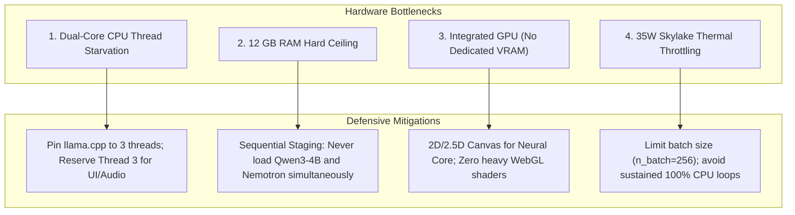

# Risks, Hardware Bottlenecks & Unresolved Technical Decisions

## 1. Hardware Bottleneck Analysis & Mitigations

Deploying a local, multi-capability AI assistant on an **Intel Core i3-6100T (35W TDP, 2 cores / 4 threads)**, **12 GB DDR4 RAM**, and **Intel HD Graphics 530** introduces several physical constraints that must be handled with defensive engineering:

### 1.1 Detailed Hardware Risk Register

| Risk ID | Risk Description | Severity | Probability | Mitigation Strategy |
| :---: | :--- | :---: | :---: | :--- |
| **R-01** | **CPU Thread Starvation & Audio Glitches:** If `llama.cpp` claims all 4 threads, the audio playback buffer for Piper TTS stutters and the UI drops frames. | **HIGH** | **HIGH** | Hard-pin `llama.cpp` to **3 threads** (`-t 3`). The 4th thread is dedicated exclusively to Tokio async I/O, PortAudio playback, and WebView message pump. |
| **R-02** | **RAM Exhaustion & Pagefile Thrashing:** Loading `Nemotron-7.5B` (~7.1 GB) while `Qwen3-4B` (~3.1 GB) is resident demands 14.3 GB RAM, exceeding the 12 GB physical limit. | **CRITICAL** | **CERTAIN (if attempted)** | **Prohibit Local Nemotron Loading on 12 GB Host.** Enforce permanent Main AI residency. Tasks exceeding Qwen3-4B are routed to authorized Online Workers or solved via Main AI logical roles. Main AI is NEVER unloaded. |
| **R-03** | **Integrated GPU Overhead (Intel HD 530):** The HD 530 shares system memory bandwidth. Complex 3D WebGL scenes in the 3D Neural Core will contend with the CPU for DDR4 memory bus bandwidth, slowing down token generation. | **MEDIUM** | **HIGH** | Render the Neural Core in **2D / 2.5D Canvas** (`GL_LOWRES`). Do not initialize heavy WebGL post-processing or particle effects. |
| **R-04** | **Thermal Throttling on 35W Core i3-6100T:** Sustained long-form generation (e.g., generating 2,000 tokens of code) will cause the 35W CPU to hit thermal ceilings and downclock from 3.20 GHz to 2.40 GHz. | **MEDIUM** | **MEDIUM** | Configure generation chunking with micro-pauses (10 ms between prompt evaluation batches) and display a clear thermal/load status in System Monitor. |
| **R-05** | **Offline Dependency Failures:** If any UI screen attempts to load Google Fonts, Tailwind CDN, or remote images when offline, the layout will break or experience 30-second connection timeouts. | **HIGH** | **LOW (Mitigated)** | All fonts (Manrope, Inter, JetBrains Mono) and Material Symbols icons are bundled locally as offline assets. Zero external CDN links exist in the production build. |

---

## 2. Unresolved Technical Decisions for Review

Before commencing Phase 4 application implementation, the user and reviewing engineer should evaluate and confirm the following technical decisions:

### Decision 1: Complex Task Routing Strategy (Resolved)
- **The Rule:** The Main AI (`Qwen3-4B`) is permanently resident and cannot be unloaded. Because `Nemotron-3.5-Bolt-E4B` requires ~7.1 GB RAM and free RAM is ~5.0 GB, `Nemotron` cannot run as a concurrent local worker on 12 GB RAM.
- **Routing Protocol:**
  - *Tier A (Default Local):* Decompose complex tasks into multi-turn steps executed by resident logical roles (Coder, Reviewer, Tester).
  - *Tier B (Authorized Cloud):* Prompt the user to delegate complex reasoning to an ephemeral Online Worker (Claude 3.5 Sonnet, GPT-4o, Groq).
  - *Tier C (Auxiliary Lightweight Local Worker):* If a user provides a $\le 1.5\text{B}$ parameter model ($\le 1.2\text{ GB RAM}$), it can run concurrently in available headroom.

---

### Decision 2: WebView2 Offline Installer Distribution (Resolved)
- **Resolved Decision:** **Bundle the Microsoft Edge WebView2 Fixed Version Runtime (~160–180 MB)** inside the standalone offline installer package.
- *Rationale:* The Evergreen Bootstrapper requires an active internet connection to download the runtime cabinet and will fail on an air-gapped PC. Bundling the Fixed Version Runtime guarantees 100% offline installation on any Windows 10 x86_64 desktop.

---

### Decision 3: Global Hotkey Binding Preferences
- **Current Defaults:**
  - `F9`: Toggle Floating AI HUD window.
  - `Ctrl + K`: Focus Command Console Input.
  - `Right Alt` (or `Caps Lock`): Push-to-Talk microphone trigger.
  - `Ctrl + Alt + Escape`: Global Emergency Panic Interrupt (never swallows bare `ESC` globally).
  - `ESC`: Pauses execution and closes modals only when the Assistant or HUD window is focused.
- *Open Question:* Do these shortcuts conflict with the user's existing developer environment, games, or tools? The application provides full rebinding in Screen 14 (Settings).

---

### Decision 4: 3D Neural Core Rendering Technique
- **Option A (HTML5 2D / 2.5D Canvas with Spring Physics - RECOMMENDED):** Consumes $<15\text{ MB RAM}$, $0.5\%\text{ CPU}$, and leaves the Intel HD 530 GPU completely unstressed.
- **Option B (Three.js WebGL Low-Polygon Mesh):** Delivers higher 3D visual depth, but consumes $60\text{ MB RAM}$ and $15\text{--}25\%\text{ GPU}$ fill-rate on Intel HD 530.
- *Recommendation:* **Option A**, matching the `GL_LOWRES` design flag in Google Stitch.
