# Screen-to-Feature Implementation Map

This document establishes the complete, bidirectional mapping between every original Google Stitch design screen located in `design-source/` and its production implementation in the Tauri v2 desktop application.

---

## Screen Architecture Overview

```mermaid
graph TD
    Shell[Desktop App Shell & Left Navigation Rail]
    
    Shell --> S01[01: Command Center]
    Shell --> S02[02: Conversation Workspace]
    Shell --> S03[03: 3D Neural Core]
    Shell --> S04[04: Intelligence & AI Models]
    Shell --> S05[05: Plugin Center]
    Shell --> S06[06: Agent Workspace]
    Shell --> S07[07: Workflow Builder]
    Shell --> S08[08: PC Control Center]
    Shell --> S09[09: Memory Center]
    Shell --> S10[10: Voice & Personality Studio]
    Shell --> S11[11: Tasks & Activity]
    Shell --> S12[12: System Monitor]
    Shell --> S13[13: Security & Permissions]
    Shell --> S14[14: Settings]
    
    Shell -.-> S15[15: Floating AI HUD - Independent Transparent Window]
```

---

## Detailed Screen-by-Screen Specifications

### Screen 01: Command Center (`screen_01_command_center/code.html`)
- **Visual Purpose:** The central operations cockpit displaying orchestrator identity, runtime status, live operational feed, quick execution buttons, and central command buffer.
- **Frontend Components:**
  - `IdentityHeroCard`: Shows assistant name, core engine version, and active status pill.
  - `RuntimeStateSelector`: Interactive pill strip (Ready, Listening, Planning, Using Local Model, Activating Agent, Executing, Completed).
  - `CommandConsoleInput`: Terminal-grade auto-expanding input box with context badge and `Ctrl+K` trigger.
  - `LiveOperationsFeed`: Real-time streaming log of background activities and step telemetry.
  - `QuickActionGrid`: Fast launchers for code auditing, system diagnostics, and file organization.
- **Backend Services & IPC:**
  - `cmd_get_orchestrator_state()`: Returns current state machine phase.
  - `cmd_submit_command(text: String)`: Dispatches task to Main AI.
  - `evt_orchestrator_state_changed`: Pushes live state transitions to UI.
- **Data Models:** `OrchestratorState`, `CommandPayload`, `TelemetryEntry`.
- **Permissions:** Tier 1 (Safe navigation and prompt submission).
- **Edge States:**
  - *Empty State:* Shows "System Idle. Ready for voice or keyboard instructions."
  - *Loading State:* Subtle pulse animation on avatar core.
  - *Error State:* Yellow/red border highlight with recovery suggestion.
- **Low-Resource Strategy:** Replace CPU-intensive multi-layer radial blurs with lightweight CSS pre-rendered radial gradients.

---

### Screen 02: Conversation Workspace (`screen_02_conversation_workspace/code.html`)
- **Visual Purpose:** Deep conversational interface with multi-turn chat, markdown rendering, syntax-highlighted code blocks, thought process disclosures, and context token budgeting.
- **Frontend Components:**
  - `ChatThreadView`: Virtualized scrollable list for 1,000+ message histories.
  - `MessageBubble`: Distinct visual styling for User, Main AI, and Specialist Sub-agents.
  - `ThoughtDisclosurePanel`: Collapsible `
` accordion displaying reasoning traces.
  - `CodeSnippetContainer`: Monospace block with language badge, copy button, and diff highlighter.
  - `TokenBudgetMeter`: Progress bar showing active context consumption (e.g., `1,840 / 4,096`).
- **Backend Services & IPC:**
  - `cmd_load_conversation(session_id: Uuid)`: Fetches chat messages from SQLite.
  - `cmd_stream_prompt(prompt: String)`: Streams tokens directly from `llama.cpp` to WebView.
  - `evt_token_chunk`: High-frequency streaming event delivering generated tokens.
- **Data Models:** `ChatMessage`, `ConversationSession`, `TokenMetrics`.
- **Permissions:** Tier 1.
- **Low-Resource Strategy:** Use virtual DOM list (`@tanstack/react-virtual`) so long conversations never degrade rendering performance on Intel HD 530.

---

### Screen 03: 3D Neural Core (`screen_03_3d_neural_core/code.html`)
- **Visual Purpose:** Topological visual graph representing active model weights, agent conduits, memory embeddings, and plugin data pipelines.
- **Frontend Components:**
  - `NeuralGraphCanvas`: 2D / 2.5D interactive force-directed canvas view.
  - `TopologyControls`: Zoom in/out, reset viewport, simulation pause, and 2D/2.5D switch.
  - `NodeInspectorDrawer`: Side panel displaying selected node metadata, throughput, and status.
  - `FilterChipBar`: Toggles visibility of Local Models, Cloud Endpoints, Agents, and Plugins.
- **Backend Services & IPC:**
  - `cmd_get_graph_topology()`: Returns active nodes and connection conduits.
  - `evt_conduit_pulse`: Animates data transfer along edges when tools are invoked.
- **Data Models:** `GraphNode`, `GraphConduit`, `TopologyPreset`.
- **Permissions:** Tier 1.
- **Low-Resource Alternative (CRITICAL):** High-polygon 3D WebGL scenes will drop frames and overheat the Intel HD 530 GPU. The original Stitch design explicitly planned `2D / 2.5D` and `GL_LOWRES`. We implement this using **HTML5 2D Canvas or Pixi.js 2D** with lightweight circle nodes and spring physics running in a Web Worker.

---

### Screen 04: Intelligence & AI Models (`screen_04_intelligence_ai_models/code.html`)
- **Visual Purpose:** Management interface for local GGUF models, quantized parameters, context window sizing, CPU thread allocation, and cloud provider endpoints.
- **Frontend Components:**
  - `ModelCardList`: Cards for `Qwen3-4B`, `Nemotron-7.5B`, `Qwen3-Embedding`, and `Whisper Base`.
  - `ActiveModelBanner`: Visual indicator showing currently loaded resident model and RAM usage.
  - `ParameterSliders`: Context size (2K/4K/8K), temperature, top-p, and CPU thread selector (1–4).
  - `ImportModelModal`: Drag-and-drop zone for external `.gguf` files.
- **Backend Services & IPC:**
  - `cmd_list_local_models()`: Scans disk for valid GGUF and ONNX files.
  - `cmd_load_model(model_id: String)`: Loads selected model into RAM.
  - `cmd_unload_worker_model()`: Evicts non-resident model.
- **Data Models:** `ModelDescriptor`, `RuntimeParameters`, `MemoryFootprint`.
- **Permissions:** Tier 2 (Loading/unloading models allocates physical RAM).

---

### Screen 05: Plugin Center (`screen_05_plugin_centre/code.html`)
- **Visual Purpose:** Registry and lifecycle dashboard for local tools, MCP servers, and online AI providers.
- **Frontend Components:**
  - `PluginCardGrid`: Displays enabled/disabled status, author, version, and type badge.
  - `ConnectionTestPill`: Interactive button triggering real-time latency ping.
  - `ApiKeyConfigModal`: DPAPI-backed secret input with masked preview and scope checkboxes.
  - `ProviderToggleSwitch`: Hardware-style toggle switch for activating/deactivating plugins.
- **Backend Services & IPC:**
  - `cmd_list_plugins()`: Reads registered plugins from SQLite.
  - `cmd_test_plugin_connection(id: String)`: Dispatches ping probe.
  - `cmd_save_plugin_secret(id: String, key: String)`: Encrypts via Windows DPAPI.
- **Data Models:** `PluginManifest`, `PluginCredential`, `PingResult`.
- **Permissions:** Tier 2 (Plugin configuration), Tier 3 (Granting elevated system scopes).

---

### Screen 06: Agent Workspace (`screen_06_agent_workspace/code.html`)
- **Visual Purpose:** Roster and live dispatch center for all 15 logical agent roles, detailing assignments, tool permissions, and inter-agent communication.
- **Frontend Components:**
  - `AgentRosterGrid`: 15 agent cards with custom role icons, titles, and status chips (Idle, Active, Blocked).
  - `RoleInspectorModal`: View system prompt instructions, authorized tools, and temperature settings.
  - `LiveAssignmentQueue`: Visual cards showing subtasks assigned to specific agents.
- **Backend Services & IPC:**
  - `cmd_get_agent_roster()`: Returns status and metadata for all 15 agents.
  - `cmd_update_agent_prompt(role_id: String, prompt: String)`: Customizes persona.
- **Data Models:** `AgentDefinition`, `AgentTaskAssignment`.
- **Permissions:** Tier 1.

---

### Screen 07: Workflow Builder (`screen_07_workflow_builder/code.html`)
- **Visual Purpose:** Visual and rule-based pipeline designer to chain agent steps, file triggers, scheduled timers, and condition gates.
- **Frontend Components:**
  - `WorkflowCanvas`: Linear and branching step pipeline visualization.
  - `StepNodeCard`: Action block (e.g., "1. Watch Folder", "2. Run Coder Agent", "3. Display Notification").
  - `TriggerConfiguration`: File event, cron schedule, or manual button trigger.
- **Backend Services & IPC:**
  - `cmd_save_workflow(workflow: Workflow)`: Persists workflow to SQLite.
  - `cmd_execute_workflow(id: String)`: Manually initiates workflow run.
- **Data Models:** `WorkflowDefinition`, `WorkflowStep`, `WorkflowTrigger`.
- **Permissions:** Tier 2 (Creating workflows), Tier 3 (Automations that write files or send messages).

---

### Screen 08: PC Control Center (`screen_08_pc_control_centre/code.html`)
- **Visual Purpose:** Management console for safe desktop interaction: active window inspector, sandboxed terminal runner, file browser, and script executor.
- **Frontend Components:**
  - `ActiveWindowList`: Displays running Windows applications with icons and HWND identifiers.
  - `TerminalConsole`: Interactive terminal stream showing stdout/stderr with syntax coloring.
  - `FileWorkspaceBrowser`: Scoped directory explorer for reading and selecting files.
  - `ExecutionStatusBar`: Displays current process PID, elapsed execution time, and kill button.
- **Backend Services & IPC:**
  - `cmd_enumerate_windows()`: Calls Win32 `EnumWindows` via Rust.
  - `cmd_execute_sandboxed_command(cmd: String)`: Runs supervised PowerShell child process.
  - `cmd_terminate_process(pid: u32)`: Dispatches process termination.
- **Data Models:** `WindowDescriptor`, `ProcessInfo`, `CommandExecutionResult`.
- **Permissions:** Tier 2 (Benign terminal commands), Tier 3 (Administrative scripts or file deletion).

---

### Screen 09: Memory Center (`screen_09_memory_centre/code.html`)
- **Visual Purpose:** Comprehensive persistent memory management interface: semantic search, pinned anchors, user preferences, and privacy controls.
- **Frontend Components:**
  - `MemorySearchBar`: Natural language semantic search box powered by local embeddings.
  - `MemoryTable`: List of stored facts, project notes, and preferences with relevance scores.
  - `PinnedAnchorList`: Fixed system rules that persist across all conversations.
  - `MemoryActionToolbar`: "Forget Item", "Edit Memory", "Export Database", and "Purge All" buttons.
- **Backend Services & IPC:**
  - `cmd_query_vector_memory(query: String)`: Vector search via `sqlite-vec`.
  - `cmd_upsert_memory_fact(text: String, is_pinned: bool)`: Stores new fact.
  - `cmd_delete_memory(id: i64)`: Permanently deletes entry.
- **Data Models:** `MemoryItem`, `VectorSearchResult`.
- **Permissions:** Tier 1 (Reading/searching), Tier 2 (Editing/deleting memories).

---

### Screen 10: Voice & Personality Studio (`screen_10_voice_personality_studio/code.html`)
- **Visual Purpose:** Studio to configure, preview, and calibrate offline voice synthesis (Piper English & Hindi), Whisper speech recognition, and assistant tone.
- **Frontend Components:**
  - `VoiceSelectorCard`: Previews for `en_US-mike` and `hi_IN-rohan` with instant audio sample buttons.
  - `AudioSliders`: Pitch, speed (0.5x – 2.0x), volume, and pause duration controls.
  - `MicrophoneCalibration`: Real-time audio waveform visualizer and VAD sensitivity slider.
  - `PersonalityToneChips`: Formal, Technical, Casual, or Concise system prompt presets.
- **Backend Services & IPC:**
  - `cmd_preview_tts(voice_id: String, sample_text: String)`: Streams test audio waveform.
  - `cmd_set_voice_config(config: VoiceConfig)`: Saves audio parameters.
- **Data Models:** `VoiceConfig`, `PersonalityPreset`.
- **Permissions:** Tier 1.

---

### Screen 11: Tasks & Activity (`screen_11_tasks_activity/code.html`)
- **Visual Purpose:** Operational task tracker showing active queues, completed runs, background jobs, durations, and retry controls.
- **Frontend Components:**
  - `TaskQueueTable`: Columns for Task ID, Specialist Agent, Status, Progress %, and Time Elapsed.
  - `TaskDetailDrawer`: Inspection view showing step-by-step tool inputs and outputs.
  - `QueueControlButtons`: Pause Queue, Resume Queue, and Clear Completed.
- **Backend Services & IPC:**
  - `cmd_get_task_queue()`: Queries active and recent tasks from task scheduler.
  - `cmd_cancel_task(task_id: Uuid)`: Halts specific running task.
- **Data Models:** `TaskQueueItem`, `StepLogEntry`.
- **Permissions:** Tier 1.

---

### Screen 12: System Monitor (`screen_12_system_monitor/code.html`)
- **Visual Purpose:** Real-time hardware telemetry dashboard displaying CPU core loads, memory allocation, Intel HD 530 GPU activity, disk throughput, and token generation speed.
- **Frontend Components:**
  - `ResourceGaugeCards`: Circular meters for CPU (4 threads), RAM (out of 12 GB), and GPU.
  - `InferenceSpeedGraph`: Rolling line chart showing tokens/second generation rates.
  - `MemoryPartitionBreakdown`: Visual bar showing OS RAM, Model RAM, and Free System Headroom.
- **Backend Services & IPC:**
  - `cmd_get_system_telemetry()`: Reads Windows performance counters (`sysinfo` crate).
  - `evt_telemetry_tick`: Dispatches 1 Hz hardware update to frontend.
- **Data Models:** `SystemMetricsSnapshot`.
- **Permissions:** Tier 1.

---

### Screen 13: Security & Permissions (`screen_13_security_permissions/code.html`)
- **Visual Purpose:** Central security governance panel: Air-Gap Shield switch, permission tier policies, file path whitelist/blacklist, DPAPI key vault status, and complete audit trail.
- **Frontend Components:**
  - `AirGapMasterCard`: Giant toggle with pulsing shield status and network lock indicators.
  - `PolicyConfigurationGrid`: Radio buttons configuring Auto-Approve, Confirm, or Block per action category.
  - `AuditLogTable`: Paginated table showing timestamp, agent, action, target, and outcome.
  - `PathGovernanceManager`: List of allowed project workspaces and blocked Windows directories.
- **Backend Services & IPC:**
  - `cmd_get_security_policy()`: Fetches active security enforcement rules.
  - `cmd_update_policy(policy: SecurityPolicy)`: Updates operational permissions.
  - `cmd_query_audit_logs(filter: AuditFilter)`: Retrieves audit events.
- **Data Models:** `SecurityPolicy`, `AuditEvent`.
- **Permissions:** Tier 3 (Modifying security policies requires explicit user authentication).

---

### Screen 14: Settings (`screen_14_settings/code.html`)
- **Visual Purpose:** Global application preferences: theme customizer, global hotkey assignments (F9, Push-to-Talk, Escape), startup behavior, and local storage directory configuration.
- **Frontend Components:**
  - `GeneralSettingsForm`: Launch on Windows startup toggle, start minimized to system tray.
  - `HotkeyBindingInputs`: Keypress capture inputs for HUD Toggle (Default: `F9`) and PTT.
  - `StoragePathPicker`: Select custom storage drives for models and vector databases.
  - `DiagnosticsSection`: Export logs button, check for offline updates.
- **Backend Services & IPC:**
  - `cmd_get_settings()`: Reads settings from SQLite `settings` table.
  - `cmd_save_settings(settings: AppSettings)`: Writes updated preferences.
  - `cmd_register_global_hotkeys()`: Re-binds Windows global hotkeys in Rust.
- **Data Models:** `AppSettings`.
- **Permissions:** Tier 2.

---

### Screen 15: Floating AI HUD (`screen_15_floating_ai_hud/code.html`)
- **Visual Purpose:** Ultra-compact, transparent, always-on-top desktop overlay floating persistently over Windows 10 applications with instant voice capture, permission approvals, and quick commands.
- **Frontend Components:**
  - `FloatingHudFrame`: Frameless, draggable window with acrylic blur background (`window_vibrancy`).
  - `WindowModeToggle`: Switched between `Expanded` (~420px view) and `Mini-Pill` (~160px micro bar).
  - `PushToTalkMicPill`: Centered microphone button with pulsating audio level ring.
  - `ActiveStepToast`: Displays currently executing tool and progress spinner.
  - `ApprovalCardOverlay`: Inline Tier 2/3 confirmation prompt allowing quick `Enter` (Approve) or `ESC` (Reject).
- **Backend Services & IPC:**
  - Dedicated secondary Tauri window created via `tauri::WebviewWindowBuilder`.
  - `cmd_toggle_hud_visibility()`: Triggered globally via `F9` hotkey.
  - `cmd_set_hud_mode(mode: HudMode)`: Dynamically resizes window between mini and expanded.
- **Data Models:** `HudState`, `MicrophoneStream`.
- **Permissions:** Tier 1 (View and voice trigger).
- **Low-Resource Strategy:** The HUD window runs within the existing Tauri process, sharing WebView2 resources with zero additional process overhead.
