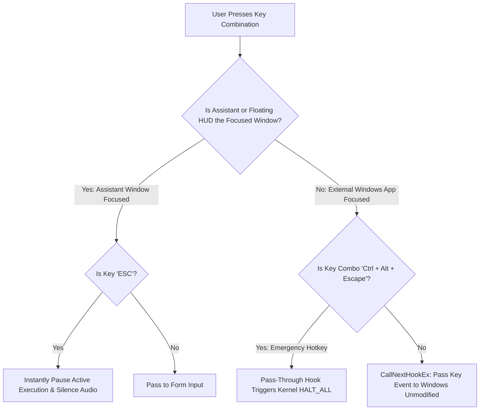
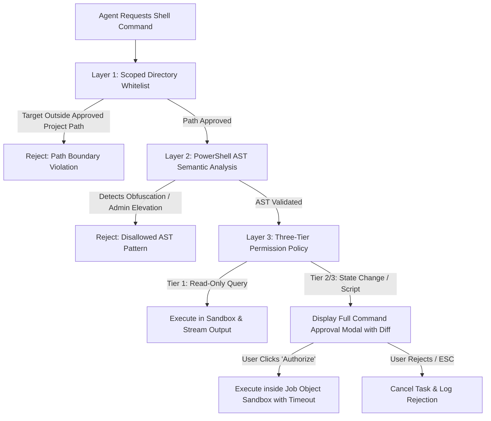

# Security, Desktop Automation & Air-Gap Architecture Corrections

## 1. Global Keyboard Hook & Emergency Stop Correction

### 1.1 The Flawed Assumption in Phase 3
Phase 3 specified:
> *"A low-level Windows keyboard hook (`WH_KEYBOARD_LL`) globally intercepts the `ESC` key to immediately halt all assistant activity."*

**The Flaw:** Swallowing or capturing the bare `ESC` key at the global OS level breaks basic functionality across all other Windows applications (e.g., closing dialogs in VS Code, escaping menus in games, canceling full-screen video, or dismissing context menus in Windows Explorer).

### 1.2 The Corrected Emergency Cancellation Architecture

1. **Context-Aware `ESC` Handling:** When the Assistant Main Window or Floating AI HUD has input focus, pressing the bare `ESC` key cancels the active task, dismisses open confirmation modals, and clears speech synthesis buffers.
2. **Global Emergency Interrupt (`Ctrl + Alt + Escape`):** A global registered hotkey (`RegisterHotKey` Win32 API) or non-swallowing hook listens specifically for `Ctrl + Alt + Escape`. This guarantees zero interference with other Windows software while providing an instant panic button.
3. **Emergency Stop Action:** When triggered, the Rust core:
   - Sets an atomic cancellation flag on the active Tokio task queue.
   - Dispatches `TerminateJobObject` on the active child process job object.
   - Clears the PortAudio / Piper TTS playback buffer in $<10\text{ ms}$.
   - Updates the UI execution badge to `"PAUSED BY USER"`.

---

## 2. Command Security: Eliminating Reliance on Blacklists

### 2.1 Why Blacklists Fail
A regex blacklist searching for strings like `del`, `rmdir`, or `Remove-Item` is trivial to bypass in Windows PowerShell:
- Alias obfuscation (e.g., `ri`, `del`, `erase` for `Remove-Item`).
- Base64 encoded commands (e.g., `powershell.exe -EncodedCommand ...`).
- String concatenation and variable expansion (e.g., `& ("Rem" + "ove-Item")`).
- Invocation through CMD or WMI (`cmd /c ...`).

### 2.2 The Multi-Layered Defense-in-Depth Model

1. **Layer 1: Scoped Workspace Whitelist:** Commands can only execute within explicitly user-approved project directories (e.g., `T:\ai creation` or designated git roots). Execution targeting `C:\Windows`, `C:\Program Files`, or system partitions is hard-blocked in Rust.
2. **Layer 2: AST Semantic Validation:** Commands are parsed into an Abstract Syntax Tree via PowerShell's native language parser before execution. Attempts to invoke encoded commands, bypass execution policies, or trigger unquoted dynamic evaluation are intercepted.
3. **Layer 3: Explicit Human Approval Modals:** Any command that writes to files, executes scripts, or alters system state triggers an explicit confirmation card displaying the working directory, exact command line, and estimated impact.
4. **Layer 4: Windows Job Object Containment:** All child processes are assigned to a Windows Job Object configured with `JOB_OBJECT_LIMIT_KILL_ON_JOB_CLOSE`. When a task ends or is canceled, every descendant process is reliably terminated.

---

## 3. Truthful Air-Gap Definition & Network Control

### 3.1 What the "Air-Gap Shield" Actually Does
The application does not claim to provide "physical network isolation" (which would require physically unplugging Ethernet cables). 

The **Air-Gap Shield** enforces a strict, verifiable software network boundary:
1. **Rust Core Socket Interception:** When the shield is active, the Rust backend refuses to initialize any outbound TCP/UDP client targeting non-loopback IP addresses. All network requests to external IPs or remote domains are blocked at the application transport layer.
2. **Strict Loopback Binding:** The application only communicates over `127.0.0.1` and `localhost` (used for internal IPC with local runtimes).
3. **Windows Firewall Rule Integration:** Upon installation or toggle, the assistant can register an outbound block rule in the Windows Defender Firewall via `netsh advfirewall firewall add rule name="Assistant_AirGap" dir=out action=block program="..."` ensuring that even spawned child processes cannot access the internet while the shield is engaged.
4. **Offline Local Tooling:** When the Air-Gap Shield is active, any agent request requiring cloud providers immediately fails over to local models or notifies the user that the operation requires internet authorization.
