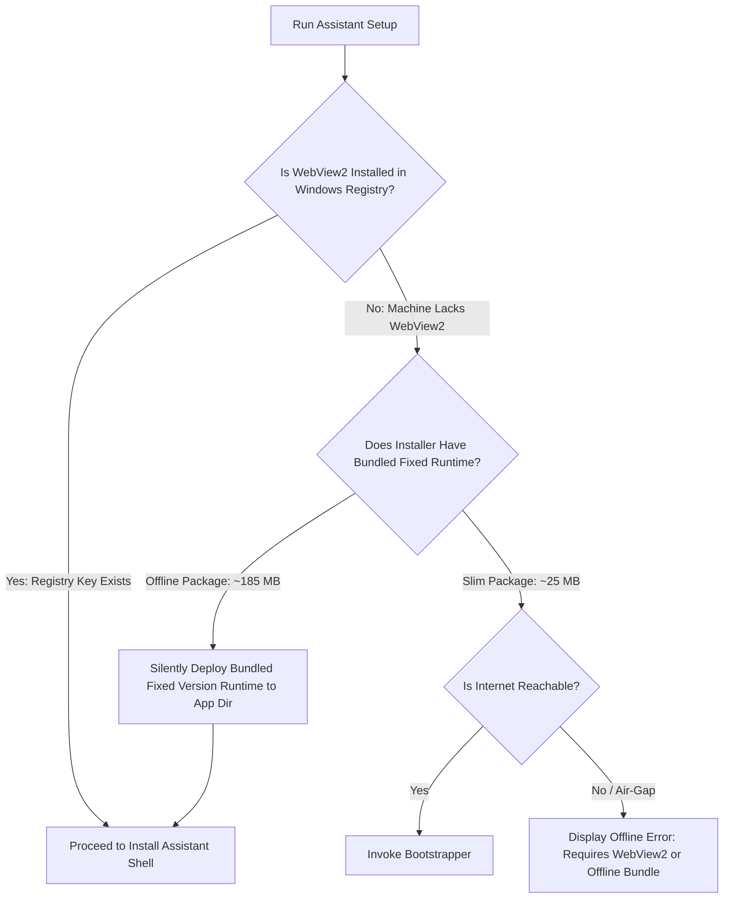

# Windows 10 & Microsoft Edge WebView2 Compatibility Specification

## 1. Supported Windows 10 Platform Matrix

The desktop assistant is built for bare-metal Windows 10 x86_64 environments.

| Windows 10 Edition | Minimum Build | Architecture | Support Status |
| :--- | :---: | :---: | :---: |
| **Windows 10 Home / Pro** | Version 19041+ (20H1 / 20H2 / 21H1 / 21H2 / 22H2) | 64-bit (`x86_64`) | **Full Support (Target Baseline)** |
| **Windows 10 Enterprise LTSC 2021** | Build 19044+ | 64-bit (`x86_64`) | **Full Support** |
| **Windows 10 Enterprise LTSC 2019** | Build 17763 | 64-bit (`x86_64`) | **Supported with Bundled Fixed Runtime** |
| **Windows 11** | All builds | 64-bit (`x86_64`) | **Full Support (Backward Compatible)** |
| *32-bit Windows / Windows 7 / 8* | N/A | 32-bit (`x86`) | **UNSUPPORTED** |

---

## 2. Microsoft Edge WebView2 Availability & Offline Reality

### 2.1 The Phase 3 Misconception
In Phase 3, it was asserted that:
> *"The Evergreen Bootstrapper supports 100% offline air-gapped installation."*

This is technically false. The **Evergreen Bootstrapper** (`MicrosoftEdgeWebview2Setup.exe`, ~1.8 MB) is a network-dependent stub installer that connects to Microsoft servers at install time to download the actual ~160 MB runtime cabinet. **Running the bootstrapper on an air-gapped or disconnected PC will fail.**

### 2.2 The Genuine Offline Installer Strategy

To ensure 100% guaranteed offline installation without internet access, two installer packaging profiles are specified:

#### Package Profile A: Complete Offline Air-Gapped Bundle (~185 MB)
- Packages the **Microsoft Edge WebView2 Fixed Version Runtime** (or Standalone CAB) directly inside an Inno Setup / WiX installer.
- If WebView2 is absent in the Windows Registry (`HKLM\SOFTWARE\WOW6432Node\Microsoft\EdgeUpdate\Clients\{F3017226-FE2A-4295-8BDF-6D3A4405E24E}`), the installer extracts the runtime locally into `%LOCALAPPDATA%\Programs\Assistant\webview2_runtime\` without attempting any network connection.

#### Package Profile B: Lightweight Standard Installer (~25 MB)
- For connected PCs that already possess the Evergreen Runtime (via standard Windows Updates).

---

## 3. Tauri v2 & Native Runtime Dependencies

### 3.1 C++ Runtime Guarantee
The native Rust binary links against the **Microsoft Visual C++ 2015–2022 Redistributable (x64)** (`vcruntime140.dll` and `msvcp140.dll`), required by the embedded `llama.cpp` AVX2 backend and ONNX Runtime.
- The installer statically packages or bundles the official Microsoft `VC_redist.x64.exe` and runs it silently with `/quiet /norestart` if VC++ runtimes are absent.

### 3.2 100% Offline Asset Bundling (Zero Remote CDNs)
In the original Google Stitch HTML prototypes, screens referenced remote Google Fonts, the Tailwind CDN, and Google-hosted images. In the production Tauri application:
- **Typography:** Manrope, Inter, and JetBrains Mono are pre-converted to `.woff2` files stored locally in `src/assets/fonts/` and loaded via `@font-face` CSS declarations.
- **Iconography:** Material Symbols Outlined are embedded as a local SVG sprite sheet or local WOFF2 font.
- **Styling:** Tailwind CSS is precompiled at build time via PostCSS and Vite. Zero runtime `<script src="https://cdn.tailwindcss.com">` dependencies exist.
- **Images & Graphics:** All emblems, preview graphics, and default avatars are bundled in `src/assets/images/`.

### 3.3 Offline Startup & Update Handling
- The desktop application launches instantly to a functional state without checking for internet connectivity.
- Background update checking is disabled by default when the **Air-Gap Shield** is active.
- If the user manually clicks "Check for Updates" in Settings (Screen 14) while offline, the application immediately surfaces a clean notification: *"Offline Mode Active. Remote updates are paused."*
